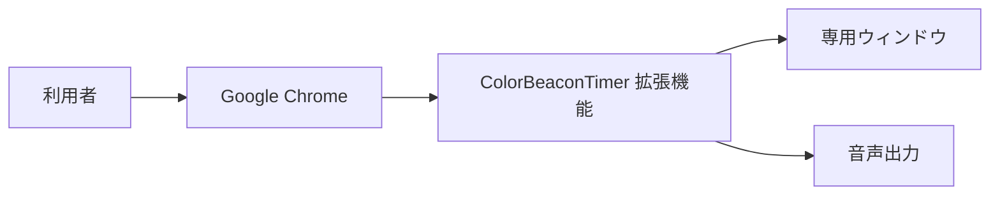

# SW105 ソフトウェア要求仕様書

- **文書ID**: SW105
- **プロジェクト名**: ColorBeaconTimer
- **版数**: 4.5
- **最終更新日**: 2026-11-25
- **承認状態**: 承認済（2026-11-25、Product Owner マサ）

## 1. 概要
### 1.1 目的と位置づけ
ColorBeaconTimer は、残時間に応じて色と点滅と音が変わるカウントダウン・タイマーである。設定時刻は初期値 2:00（2分）であり、1:00 から 3:00 の範囲で 10秒単位で変更できる。スタートボタンを押すとカウントダウンが始まる。残時間が 1分（60000ミリ秒）より長いあいだ、立体に見える青色ランプは青色のまま点灯し続ける。残時間が 1分以下になるとランプは赤色に変わり、点滅を開始する。点滅時間は 1分時点の 1秒点灯・1秒消灯から 10秒時点の 0.1秒点灯・0.1秒消灯まで線形で短くなり、消灯のタイミングで「ピコン」と音を鳴らす。残時間が 0 になるとランプは消灯する。その直後に「ピコン」と鳴ってから、単一の元気な成人男性話者による音声で「ジュワッチ」と 1秒間かけて一括発音する。続いて画面を消去し、中央からランダムにドットが 360度放射状に飛び散る画面を表示する。同画面には EXITボタン（ラベル「EXIT」）を設け、利用者が押すと専用ウィンドウが閉じ、プログラムが終了する。外国人利用者にも内容を伝えるため、言語切替ボタンは設けず、専用ウィンドウに表示する各日本語と拡張機能説明文に英語を常時併記する。

本ソフトウェアは、DADA（Document-and-Agent-Driven Agile）プロセスを用いたプログラム開発例である（教材ではない）。本開発では、DADAプロセスの次の 2つの特徴を発揮している。(1) 開発文書の作成とレビューが行われている（`SW105`・`SWP6`・`SW205` の作成と、工程ごとのレビュー記録表 `REV101_Requirements.md`・`REV101_Test.md`・`REV101_Design.md`・`REV101_Code.md` および機械チェックによる自己校正レビュー）。(2) アジャイル的にプログラムの要求改訂を頻繁に行っている。具体的には、Phase 5 の評価を起点とした開発 Loop により、継続的な要求仕様の改訂と実装・検証を進めている。開発は DADAプロセス（従来型プログラム × 承認ゲート型または自律型 × Major または Minor）に従う。各版の適用方式は、v4.1・v4.2 が Phase 1 承認ゲート確認後の自律型、v4.3 が Phase 1 承認後の自律型事前委譲である。続く v4.3.1 は Minor 自律型事前委譲、v4.4 は Phase 1 承認後の自律型事前委譲（Major）、v4.5 は承認ゲート型（Major）である。

デザイン・写真・曲・音声は、オリジナル制作物、パブリックドメイン素材、または再配布可能なフリーライセンス素材を用いる。禁止名称リストの作品またはキャラクタと、公式な関係があるように見せてはならない（REQ-006）。

### 1.2 適用範囲
- **対象（スコープ内）**:
  - Google Chrome の拡張機能（Manifest V3）として動作するタイマー。表示と操作は、chrome.windows で開く専用ウィンドウ（Windows 11 上の Chrome ポップアップウィンドウ実表示領域で実ビューポート幅 640px 以上）で行う
  - 専用ウィンドウを新しく開いたときに再生するオープニング（5シーン構成。第1〜第4シーンは NEXTボタン・Backボタンによる手動遷移、第5シーンの立体青色ランプ拡大は 5秒間の時間経過による自動遷移で設定画面へ進む）。第1シーンでは Backボタンを非表示とし、NEXTボタンのみを表示して無音とする。第2シーンでは『ジムノペディ第1番』をオフラインでループ再生する。第3シーンでは 1970〜80年代レトロフューチャー寄りのオリジナル・宇宙冒険SF映画風シンセサイザー楽曲をオフラインでシームレスループ再生する。再生音量は第2シーン『ジムノペディ第1番』と同等水準（再生時実効音量差が ±3.0 dB 以内）とする。第4シーンおよび第5シーンは無音とし、シーン遷移時および専用ウィンドウ終了時には旧シーンの BGM を即座に停止する。第1〜第4シーンの日本語文章およびタイトルには英語を常時併記し、言語切替ボタンは設けない。第2〜第4シーンでは Backボタンと NEXTボタンの両方を表示し、立体青色ランプ（カラービーコン）が表示される第5シーン以降は両ボタンを表示しない。オープニング全シーンおよび設定画面では EXITボタンを表示しない。第5シーンの拡大中は画面クリックで設定画面へスキップできる。既に開いている専用ウィンドウを前面に出す操作では、オープニングを開始しない
  - 設定時刻の変更（初期値 2:00、10秒単位、範囲 1:00〜3:00、単押しおよび 2秒長押しによる 0.2秒間隔の早送り）
  - スタートボタン（ラベル「スタート / START」）の押下によるカウントダウン開始。ストップボタンは設けない
  - 残時間に応じたランプの色・線形加速点滅と、消灯タイミングのピコン音
  - 残時間 0 におけるランプ消灯、ピコン音、および単一の元気な成人男性話者による「ジュワッチ」の一括 1秒発音。続いて既存画面表示を消去し、中央から 360度放射状にランダムにドットが飛散する終了演出画面と EXITボタン（ラベル「EXIT」）を表示する。EXITボタン押下または専用ウィンドウの閉鎖操作により、プログラムを終了する
  - 著作権・商標を侵害しない表示・音・文言、ならびに日英併記の拡張機能説明文（`manifest.json` の `description`・`extension/store-listing.txt`）。あわせて、本ソフトウェアが DADAプロセスを用いたプログラム開発例である位置づけと、DADAプロセスの 2つの特徴を記載する。さらに `README.md`・`LICENSE`・`extension/assets/SOURCES.md`・`extension/store-listing.txt` へ出典・クレジット・ライセンスを記載する（`README.md` は「開発状況」節なし・「機能概要」節簡素化）
- **対象外（スコープ外）**:
  - ストップボタン、一時停止、再開、リセット（開始後に設定へ戻す操作を含む）
  - 複数タイマーの同時実行、時刻の保存・復元、履歴
  - 通知（OS 通知、バッジ、メール）、バックグラウンドでの作業リマインド
  - アカウント、サーバ通信、課金、データ同期
  - スマートフォン向けアプリ、Chrome 以外のブラウザ向け配布
  - Windows 11 以外の OS、および最新版以外の Google Chrome での動作保証
  - 利用者操作による消音ボタン、および点滅や音の強さを変更する機能
  - 言語切替ボタン（専用ウィンドウに表示する各日本語に英語を常時併記するため設けない）
  - 点滅する光への特別な安全対策
  - 専用ウィンドウを閉じたあとのカウントダウン継続（閉じたらプログラムを終了する）
  - オープニング第1〜第4シーンにおける時間経過による自動遷移、処理バーの表示、および画面全体クリックによるスキップ（ボタンによる手動遷移へ変更し、誤操作を防ぐため）
  - 禁止名称リストの作品・キャラクタ・技名の公式素材・実写キャラクタ写真・公式名称、第三者が著作権を有する既存楽曲における旋律（音高の並び）および編曲の複製・引用・模倣、および「公認」「公式」という文言

### 1.3 用語定義
| 用語 | 定義 |
| :--- | :--- |
| ColorBeaconTimer | 本ソフトウェアの製品名。Chrome 拡張機能として提供するカウントダウン・タイマー |
| 禁止名称リスト | 禁止する名称の閉じた一覧。作品名は「ウルトラマン」と英字表記「Ultraman」、キャラクタ名は「三面星人ダダ」「三面怪人ダダ」とローマ字表記「Sanmen Seijin Dada」「Sanmen Kaijin Dada」、技名は「スペシウム光線」と英字表記「Specium Ray」の合計8文字列である。英字とローマ字は大文字と小文字を区別しない。画面に表示する文字、再生する音声の発話、ファイル名、`manifest.json`、`extension/store-listing.txt`、`README.md`、`LICENSE` のいずれかに一覧の名称が含まれるとき、その文字・発話・ファイル名・記載文を禁止する。「風」という語だけでは禁止しない。一覧の名称を含まない「風」付きの表現も禁止しない。一覧の名称を含む表現は禁止する |
| カラービーコン | 残時間を色と点滅で示す、立体に見える丸いランプ表示。オリジナルの画像またはイラストを用いる |
| 設定時刻 | スタート前に利用者が決めるカウントダウンの長さ。表示は分:秒（例: 2:00）。初期値は 2:00、範囲は 1:00〜3:00（10秒単位） |
| 残時間 | カウントダウン開始後、終了までに残っている時間。計測の単位はミリ秒。画面の表示は、残ミリ秒を 1000 で割った小数点以下切り上げの秒数（分:秒）とする。残ミリ秒が 1000 で割り切れる場合、商となる整数秒をそのまま表示する |
| スタートボタン | カウントダウンを開始するボタン。ラベルは「スタート / START」 |
| オープニング | 専用ウィンドウを新しく開いたとき、設定画面の前に表示する5シーン構成の連続演出。第1シーン（DADA開発説明の日英併記、無音）、第2シーン（連想ゲーム1の日英併記、《泉》写真、および『ジムノペディ第1番』ループ再生）、第3シーン（連想ゲーム2の日英併記、オリジナル三面シルエット風イラストに加え、第2シーン『ジムノペディ第1番』と同等水準の音量で再生するオリジナル・宇宙冒険SF映画風シンセサイザー楽曲のシームレスループ再生）、第4シーン（連想ゲーム3の日英併記、無音）は時間経過で自動遷移せず、NEXTボタン・Backボタンで手動遷移する。第1シーンの NEXTボタン押下でブラウザの音声再生を有効化し、遷移時は旧シーンの BGM を即座に停止して切り替える。第5シーン（立体青色ランプの拡大、5秒間、無音）は NEXTボタン・Backボタンを表示せず、5秒かけて拡大したあと設定画面へ遷移する。第5シーンの拡大中のみ画面クリックでスキップできる。既に開いている専用ウィンドウを前面に出す操作では、オープニングを開始しない |
| BGM | オープニングの第2シーンと第3シーンで背景音楽として再生する音声。本ソフトウェアではパッケージに同梱した音声ファイルからオフラインで再生し（第2シーンはループ再生、第3シーンはシームレスループ再生）、第1・第4・第5シーンおよび設定画面以降は再生しない |
| 『ジムノペディ第1番』 | 作曲者エリック・サティ（1866年〜1925年）が 1888年に発表した楽曲であり、1925年没により戦時加算を含めても日米ともに楽曲著作権が消滅済みの作品。オープニング第2シーンの BGM として、Wikimedia Commons で公開されている検証済みパブリックドメインまたは CC0 / CC BY 録音ファイルを同梱してオフラインでループ再生する |
| オリジナル・宇宙冒険SF映画風シンセサイザー楽曲 | オープニング第3シーンの BGM としてオフラインでシームレスループ再生する、1970〜80年代レトロフューチャー寄りの宇宙冒険SF映画風シンセウェーブ／電子音楽（100% オリジナル楽曲）。既存の宇宙冒険SF映画・特撮番組・電子音楽作品のテーマ曲や劇伴における主旋律および編曲は一切複製・引用・模倣しない。構成要素は、推進力のあるシンセサイザー・アルペジオベース、印象的なアナログ風シンセリード、浮遊感と広がりのあるアナログ風シンセパッド／コード、および広がりのあるステレオ空間残響（ディレイ／リバーブ）の 4要素である。開発時に非人声のシンセサイザー合成で PCM WAV ファイル（MIT License）を 1回生成して同梱する。音質基準は、サンプリング周波数 44.1kHz（44100Hz）以上、16bit、ステレオ（2チャンネル）、かつ最大正規化振幅 0.30 以上 0.95 以下とする。再生時は第2シーン『ジムノペディ第1番』と同等水準の音量（全区間 RMS 基準の dBFS で実効音量差 ±3.0 dB 以内）とし、音割れを発生させない |
| シームレスループ再生 | 楽曲の末尾から先頭へ折り返すループ境界において、無音ギャップが 0.05秒未満の状態で連続再生すること。あわせて、WAV データの末尾と先頭が接する接続点における正規化振幅差を 0.05 以下に保ち、クリックノイズを発生させないこと |
| 《泉》写真 | オープニング第2シーンで表示する、アルフレッド・スティーグリッツ撮影のマルセル・デュシャン作品《泉》の写真（Wikimedia Commons: `File:Marcel_Duchamp,_1917,_Fountain,_photograph_by_Alfred_Stieglitz.jpg`、1917年 *The Blind Man* No.2 掲載、`PD-1923` パブリックドメイン。1946年撮影者没により日米ともに写真著作権消滅） |
| オリジナル三面シルエット風イラスト | オープニング第3シーンで表示する、著作権を侵害しない自作の白黒幾何学模様による三面シルエット風イラスト（オリジナル画像。実写の特撮キャラクタ写真ではない） |
| NEXTボタン | オープニングの第1〜第4シーンに表示するボタン。ラベルは「NEXT」。押下で次のシーンへ遷移する。立体青色ランプが表示される第5シーン以降は表示しない |
| Backボタン | オープニングの第2〜第4シーンに表示するボタン。ラベルは「Back」。押下で前のシーンへ戻る。第1シーンおよび立体青色ランプが表示される第5シーン以降は表示しない |
| EXITボタン | 終了演出画面（ドット飛散状態）のみに表示するボタン。ラベルは「EXIT」。押下により専用ウィンドウが閉じ、プログラムが終了する。オープニング・設定画面・カウントダウン・ピコン音およびジュワッチ音声の再生中には表示しない |
| 専用ウィンドウ | chrome.windows で開く、本タイマーの表示と操作用のポップアップウィンドウ。Windows 11 上の Google Chrome 実表示領域において、実ビューポート幅は 640px 以上とする。オープニング全シーン・設定画面・カウントダウンの文字・画像・ボタン群は互いに重ならず、見切れおよび水平・垂直スクロールバーなしで専用ウィンドウ内に収める。終了演出のドット飛散領域と EXITボタンも見切れおよび水平・垂直スクロールバーなしで専用ウィンドウ内に収め、EXITボタンを操作可能に表示する。EXITボタン押下または専用ウィンドウの閉鎖操作により、プログラムは終了する |
| ピコン音 | 赤色点滅時のランプ消灯タイミング、および残時間 0 到達時に鳴らす、オリジナルの合成音。公式音源および公式音源に似せた録音は用いない |
| ジュワッチ音声 | 残時間 0 のときに「ピコン」音の直後に単一の元気な成人男性話者で「ジュワッチ」と 1秒間（許容誤差 ±0.2秒、0.80秒以上 1.20秒以下）かけて一括発音する音声。非圧縮 PCM WAV 形式（24000Hz 以上・16bit・モノラル）とする。全体ピーク正規化振幅は 0.85 以上 0.99 以下（クリッピング非発生）とし、全区間 RMS（元気・声量エネルギー基準）は 0.18 以上（-14.9 dBFS 以上）とする。有声区間フレームの基本周波数（F0）中央値は元気な成人男性胸声域の 110 Hz 以上 180 Hz 以下（女性声域 220 Hz 以上は不使用）とする。あわせて、前半区間（先頭 65%）および後半区間（後半 35%）の各有声区間における F0 中央値がいずれも成人男性声域（85 Hz 以上 200 Hz 以下）に収まり、別音源継ぎ接ぎによる不自然な声質断絶がないこと。後半区間（後半 35%）有音部ピーク振幅は前半区間（先頭 65%）ピーク振幅の 0.25 以上 0.85 以下に保ち、語尾「チ」が聞き取れつつ過剰強調しない自然な音量バランスとする。後半 3kHz〜8kHz 高域帯域 RMS は前半全帯域 RMS 以下とする。開発時に単一の元気な成人男性話者による音声合成で 1回一括生成して保存し、実行時は保存したファイルをオフライン再生する。女性話者のピッチ下げ変換と後半「チ」の別音源合成結合（継ぎ接ぎ）、人の声の録音、公式音声、実行時再合成、および外部通信は用いない |
| 終了演出 | 残時間 0 到達時にランプを消灯し、ピコン音とジュワッチ音声を再生したあと、既存画面表示を消去して中央からランダムにドットが 360度放射状に飛び散り続ける映像と EXITボタンを表示する状態。EXITボタン押下またはウィンドウ閉鎖操作により、専用ウィンドウを閉じて終了する |

## 2. システム全体構成
### 2.1 システム構成概要
利用者の PC 上の Google Chrome に、本ソフトウェアを拡張機能として導入する。表示と操作は、chrome.windows で開く専用ウィンドウで行う。オープニングの BGM、ピコン音、およびジュワッチ音声は PC の音声出力で再生する。外部サーバとは通信しない。

専用ウィンドウが閉じられた場合、プログラムは終了する。カウントダウンは続けない。再度開いたときは、起動からやり直す（オープニングから始まる）。図1にシステム構成を示す。

図1 システム構成図

### 2.2 ソフトウェアの構成要素
本ソフトウェアが担う構成要素は次の5つである。内部のモジュール分割は SW205 で定める。

- **オープニング**: 第1〜第4シーンを NEXTボタン・Backボタンによる手動遷移で表示する（第1シーンは Backボタン非表示）。言語切替ボタンは設けず、第1〜第4シーンの日本語と英語を常時併記する。第1シーンは DADA開発説明の日英併記（無音）、第2シーンは連想ゲーム1の日英併記と《泉》写真（『ジムノペディ第1番』ループ再生）を表示する。第3シーンは連想ゲーム2の日英併記とオリジナル三面シルエット風イラストを表示する。BGM はオリジナル・宇宙冒険SF映画風シンセサイザー楽曲を第2シーン『ジムノペディ第1番』と同等水準の音量でシームレスループ再生する。第4シーンは連想ゲーム3の日英併記（無音）を表示する。シーン遷移時は旧シーンの BGM を即座に停止する。第4シーンで NEXTボタンが押下されたあとは両ボタンを非表示にし、第5シーン（立体青色ランプ拡大 5秒、無音）を再生して設定画面へ移る
- **時刻設定**: 設定時刻の表示（初期値 2:00）と 10秒単位の増減（1:00〜3:00、単押しおよび 2秒長押しによる 0.2秒間隔の早送り）、スタートボタンの受け付け
- **カウントダウンとカラービーコン**: 残時間の更新、青色点灯から赤色線形加速点滅への状態遷移
- **音の再生**: 第2シーンにおける『ジムノペディ第1番』、および第3シーンにおける BGM（第2シーン『ジムノペディ第1番』と同等水準の音量で再生するオリジナル・宇宙冒険SF映画風シンセサイザー楽曲）の再生と停止制御。あわせて、ピコン音（消灯タイミング・残時間 0）の合成再生、および単一の元気な成人男性話者によるジュワッチ音声（一括 1秒発音）の再生
- **終了演出**: ランプ消灯、既存画面表示の消去、中央から 360度放射状へのランダムなドット飛散映像の再生、ならびに EXITボタンの表示と押下時の専用ウィンドウ閉鎖・プログラム終了

## 3. 制約条件と前提事項
### 3.1 ハードウェア制約
利用者が操作できる画面と音声出力を持つ PC が対象である。専用の装置は対象外である。画面の大きさやスピーカの規格は定めない。

### 3.2 ソフトウェア環境
- 実行形態は Google Chrome の拡張機能（Manifest V3）とする。
- 対応環境は、Windows 11 上の最新版 Google Chrome とする。他の OS および旧版の Chrome は動作を保証しない。
- プログラミング言語とライブラリは、本要求では指定しない（SW205 で定める）。Windows 11 上の Chrome ポップアップウィンドウ実表示領域で実ビューポート幅は 640px 以上とする。実ビューポート幅 640px 以上の条件のもと、ウィンドウ外寸定数の変更は、CSS レイアウト調整の詳細と合わせて既存設計構成の範囲で定める。
- ピコン音は合成する。合成の手段（例: Web Audio API）は設計で定める。
- ジュワッチ音声は、開発時に単一の元気な成人男性話者による音声合成で「ジュ」「ワ」「ッ」「チ」の音声全体を一括生成し、非圧縮 PCM WAV ファイル（24000Hz 以上・16bit・モノラル）として 1回だけ保存する。v4.3.1 までの女性話者（VOICEVOX:四国めたん）に対するピッチ下げ変換と後半「チ」の別音源合成結合（継ぎ接ぎ）は撤廃する。発話文は「ジュワッチ」とする。総発音時間は 1.0秒（許容誤差 ±0.2秒、0.80秒以上 1.20秒以下）とする。全体ピーク正規化振幅は 0.85 以上 0.99 以下（クリッピング非発生）とし、全区間 RMS は 0.18 以上（-14.9 dBFS 以上）とする。有声区間フレームの基本周波数（F0）中央値は元気な成人男性胸声域の 110 Hz 以上 180 Hz 以下とし、女性声域（220 Hz 以上）は用いない。あわせて、前半区間（先頭 65%）および後半区間（後半 35%）の各有声区間における F0 中央値がいずれも成人男性声域（85 Hz 以上 200 Hz 以下）に収まり、別音源継ぎ接ぎによる不自然な声質断絶がないこと。後半区間（後半 35%）有音部ピーク振幅比（前半 65% ピーク比）は 0.25 以上 0.85 以下とし、語尾「チ」が聞き取れつつ過剰強調しない自然な音量バランスとする。後半 3kHz〜8kHz 高域帯域 RMS は前半全帯域 RMS 以下とする。再生のときは保存した音声ファイルをオフラインで再生し、実行のたびに合成し直さず、外部通信も行わない。人の声の録音、および禁止名称リストにある作品の公式音声は用いない。使用する再配布許諾済み男性音声合成ツールおよび話者の利用許諾は、生成音声の再配布も許すものとする。具体的な男性話者および生成手段は TBD-v44-voice（第7章 表2）にて Phase 1 承認ゲートで Product Owner マサが選定し、Phase 3 の SW205 で確定する。
- オープニングの BGM（『ジムノペディ第1番』およびオリジナル・宇宙冒険SF映画風シンセサイザー楽曲）は、いずれも拡張機能パッケージへ同梱した音声ファイルをオフラインで再生する。実行時に外部サーバへ通信して音声を取得または生成しない。
- Google Chrome の自動再生制限に抵触せず第2シーン突入と同時に BGM を再生できるよう、第1シーンの NEXTボタン押下でブラウザの音声再生を有効化する。具体的な再生 API の選定は設計（SW205）で定める。
- 『ジムノペディ第1番』の録音ファイルは、Wikimedia Commons 上でライセンスを検証可能なパブリックドメインまたは CC0 / CC BY 録音を使用する。理由: Product Owner 指示内の非公開セッション URL（`https://www.perplexity.ai/session/bde15c27-f507-4b66-a765-7b2a05c58770`）が外部参照不可であるため。候補の選定方針は第3.3節および REQ-006 に従い、最終ファイルと SHA-256 ハッシュ値を SW205 および配布文書へ記録する。
- オリジナル・宇宙冒険SF映画風シンセサイザー楽曲は、1970〜80年代レトロフューチャー寄りのシンセウェーブ／電子音楽とする。構成要素はシンセサイザー・アルペジオベース、アナログ風シンセリード、アナログ風シンセパッド／コード、ステレオ空間残響（ディレイ／リバーブ）の 4要素である。開発時に非人声のシンセサイザー合成で PCM WAV ファイルを 1回生成して保存する。音質仕様は、サンプリング周波数 44.1kHz（44100Hz）以上、16bit、ステレオ（2チャンネル）、最大正規化振幅 0.30 以上 0.95 以下とする。実行時は、同梱した PCM WAV ファイルを外部通信なしでオフラインかつシームレスループ再生する。再生時は、第2シーン『ジムノペディ第1番』との実効音量差（全区間 RMS 基準の dBFS）を ±3.0 dB 以内の同等水準に保ち、音割れを発生させない。人の声による録音および既存著作物における演奏録音は用いない。具体的なシンセサイザー合成アルゴリズム、音色パラメータ、楽曲の詳細構成、および同梱ファイル名は SW205 で定める。再生ゲイン調整方式とシームレスループ再生の実装方式も SW205 で定める。

### 3.3 準拠規格
Product Owner から指定された法令・業界標準はない。ただし公開と配布に先立ち、次を守る。

- 著作権および商標を侵害しない（REQ-006）。《泉》写真には 1917年発表（`PD-1923`、1946年撮影者没で日米ともに写真著作権消滅）のアルフレッド・スティーグリッツ撮影写真を使用する。第3シーンには実写の特撮キャラクタ写真を使わず、オリジナルの白黒幾何学模様・三面シルエット風イラストを使用する。
- 第2シーン BGM の『ジムノペディ第1番』は、1888年発表・1925年作曲者没（戦時加算を含めても日米ともに楽曲著作権消滅済み）の楽曲である。録音には Wikimedia Commons の検証済みパブリックドメインまたは CC0 / CC BY 録音を使用する。第一候補は `File:Erik_Satie_-_gymnopedies_-_la_1_ere._lent_et_douloureux.ogg`（Musopen / Robin Alciatore 演奏、Public Domain）である。次点候補は `File:Gymnopedie_No._1..ogg`（Teknopazzo 演奏、CC0 1.0）または `File:Kevin_MacLeod_-_Erik_Satie_Gymnopedie_No_1.ogg`（Kevin MacLeod 演奏、CC BY 3.0）とする。作曲者・演奏者・取得元 URL・ライセンス・著作権消滅根拠・SHA-256 ハッシュ値は配布文書 3箇所へ明記する。記載先は `README.md`（「クレジット」節および「ライセンス・著作権表示」節）、`LICENSE`（Third-Party Notices 節）、および `extension/assets/SOURCES.md` である。
- 第3シーン BGM のオリジナル・宇宙冒険SF映画風シンセサイザー楽曲は、既存の宇宙冒険SF映画・特撮番組・電子音楽作品のテーマ曲や劇伴における主旋律および編曲を一切複製・引用・模倣しない。人の声による録音および第三者による無断録音も使用しない。代わりに、1970〜80年代レトロフューチャー寄りの宇宙冒険SF映画で演奏されがちな、推進力と浮遊感のあるシンセウェーブ／電子音楽のスタイルを採用する。あわせて 100% オリジナルの楽曲および非人声シンセサイザー合成 PCM WAV（MIT License）を用いる。楽曲は、推進力のあるシンセサイザー・アルペジオベース、印象的なアナログ風シンセリード、浮遊感と広がりのあるアナログ風シンセパッド／コード、ステレオ空間残響（ディレイ／リバーブ）の 4要素で構成する。禁止名称リストの名称および「公認」「公式」を含めない。
- 公開前に、Product Owner（マサ）がデザイン、日英表記文言、位置づけおよび特徴記載、ならびにクレジット・ライセンス記載を確認する。あわせて、実ビューポート幅 640px 以上の専用ウィンドウ全状態について、見切れ・スクロールバーなし・非重複の収まりを確認する。さらに、終了演出画面での EXITボタン表示および押下時の終了動作、第2シーンと第3シーンにおける BGM 音量バランス、ならびに単一の元気な成人男性話者による「ジュワッチ」一括発音の聴感も公開前に確認する。著作権・商標の最終判断はマサが行う。

## 4. 機能要求

### 4.1 ユースケースとシナリオ
利用者は、Chrome のツールバーにある本拡張機能のアイコンをクリックして、専用ウィンドウを開く。アイコンのクリック以外の操作では、専用ウィンドウは開かない。専用ウィンドウが既に開いているときに同じアイコンをクリックした場合、ColorBeaconTimer は新しい専用ウィンドウを開かず、開いている専用ウィンドウを前面に出す。

専用ウィンドウを新しく開いたとき、オープニングが始まる。既に開いている専用ウィンドウを前面に出す操作では、オープニングは始まらない。言語切替ボタンは設けず、各シーンの日本語には英語を常時併記する。オープニングでは最初に、DADA開発説明の日英併記文章と NEXTボタンを表示する（第1シーン。Backボタンは表示せず、無音）。利用者が NEXTボタンを押すと、ブラウザの音声再生許可が有効になる。同時に画面は第2シーンへ切り替わり、連想ゲーム1の日英併記文章と《泉》写真、Backボタン、NEXTボタンを表示し、パッケージ同梱の『ジムノペディ第1番』をループ再生する。

第2シーンで Backボタンを押すと、『ジムノペディ第1番』が停止して第1シーンへ戻る。第2シーンで NEXTボタンを押すと、『ジムノペディ第1番』が即座に停止し、画面は第3シーンへ移る。第3シーンでは、連想ゲーム2の日英併記文章とオリジナル三面シルエット風イラスト、および Backボタン・NEXTボタンを表示する。あわせて、オリジナル・宇宙冒険SF映画風シンセサイザー楽曲を第2シーン『ジムノペディ第1番』と同等水準の音量でシームレスループ再生する。

第3シーンで Backボタンを押すと、オリジナル・宇宙冒険SF映画風シンセサイザー楽曲が即座に停止し、第2シーンの画面と『ジムノペディ第1番』ループ再生へ戻る。第3シーンで NEXTボタンを押すと、オリジナル・宇宙冒険SF映画風シンセサイザー楽曲が即座に停止し、第4シーン（連想ゲーム3の日英併記文章と Backボタン・NEXTボタン、無音）へ移る。第4シーンで Backボタンを押すと、第3シーンの画面とオリジナル・宇宙冒険SF映画風シンセサイザー楽曲のシームレスループ再生へ戻る。第1〜第4シーンは時間経過で自動遷移せず、ボタン操作だけで前後のシーンへ移動する。

第4シーンで NEXTボタンを押すと、Backボタンと NEXTボタンを非表示にし、無音のまま立体青色ランプを設定画面のサイズまで 5秒間かけて拡大する（第5シーン）。利用者は第5シーンの完了を待つか、第5シーン再生中に画面をクリックしてスキップし、設定画面へ移る。第5シーン以降（設定画面・カウントダウン・終了演出）では、Backボタンと NEXTボタンを表示せず、オープニングの BGM も再生しない。設定画面では、立体青色ランプが青色で点灯したまま、無音である。ランプの下にタイマー数字（初期値 2:00）、＋ボタン、−ボタン、スタートボタン（ラベル「スタート / START」）が表示される。ストップボタンは存在しない。

スタートボタンを押すと、即座にカウントダウンが始まる。残時間が 1分（60000ミリ秒）になるまで、ランプは青色のまま点灯し続ける。残時間が 1分以下になると、ランプは赤色に変わり点滅を始める。最初は 1秒点灯・1秒消灯で点滅し、残り 10秒（10000ミリ秒）に向けて点灯時間と消灯時間が線形に短くなり、残り 10秒以下では 0.1秒点灯・0.1秒消灯になる。ランプが消灯するタイミングで「ピコン」と音が鳴る。

残時間が 0 になると、ランプは消灯する。その直後に「ピコン」と鳴ってから、単一の元気な成人男性話者による声で「ジュワッチ」と 1秒間かけて一括発音する。その後、タイマー数字と各ボタン、およびランプからなる既存画面表示が消去される。消去後、中央からランダムにドットが 360度放射状に飛んでいく映像と EXITボタン（ラベル「EXIT」）が表示される。設定画面への自動復帰およびリセットは行わない。利用者が EXITボタンを押すか、ウィンドウ閉鎖操作によって専用ウィンドウが閉じられると、プログラムは終了してカウントダウンを続けない。終了後にツールバーの本拡張機能アイコンを再クリックしたときは、オープニング第1シーンから開始する。

### 4.2 機能詳細

#### REQ-001: オープニングの表示遷移・BGM再生とスキップ
- **概要**: 実ビューポート幅 640px 以上（Windows 11 上の Chrome ポップアップウィンドウ実表示領域）の専用ウィンドウを新しく開いたとき、第1〜第4シーンを NEXTボタン・Backボタンの手動遷移で表示する。あわせて各シーンの遷移に応じて BGM の再生・停止を切り替える。その後、第5シーン（立体青色ランプ拡大、5秒間、無音）を経て設定画面へ移る。立体青色ランプ（カラービーコン）が表示される第5シーン以降は、NEXTボタンおよび Backボタンを表示せず、BGM も再生しない。オープニング全シーンおよび設定画面では EXITボタンを表示しない。言語切替ボタンは設けず、専用ウィンドウに表示する各日本語に英語を常時併記する。既に開いている専用ウィンドウを前面に出す操作では、オープニングを開始しない。
- **入力 / 処理 / 出力**:
  - 入力: 専用ウィンドウを新しく開いたこと（第5.3節）。第1〜第4シーンにおける NEXTボタン・Backボタンの押下。第5シーン再生中の画面クリック。専用ウィンドウを閉じる操作。
  - 処理: 次の順序で表示、遷移、および BGM 再生制御を行う。第1〜第4シーンでは時間経過による自動遷移を行わず、処理バーおよび画面全体クリックによるスキップも設けない（誤操作防止のため）。言語切替ボタンは設けず、専用ウィンドウに表示する各日本語に英語を常時併記する。Windows 11 上の Chrome ポップアップウィンドウ実表示領域において、専用ウィンドウの実ビューポート幅は 640px 以上とする。オープニング全シーンと設定画面で表示する日英の文章（空行区切りを含む）・画像・ランプ・タイマー数字・ボタン群は、互いに重ならない配置とする。各要素は見切れおよび水平・垂直スクロールバーなしで専用ウィンドウ内に収める（ウィンドウ外寸定数と CSS レイアウト調整は既存構成の範囲で行う）。オープニング全シーンおよび設定画面では EXITボタンを表示しない。すべての BGM はパッケージ同梱ファイルをオフラインで再生し、実行時に外部通信を行わない。
    - (1) 第1シーン（DADA開発説明）: 無音状態で下記の文章（日本語行・空行・英語行）と NEXTボタン（ラベル「NEXT」）を表示する。Backボタンおよび EXITボタンは表示しない。他のシーンから Backボタンで戻った場合は、再生中だった BGM を即座に停止する。文章と NEXTボタンは互いに重ならず、見切れおよび水平・垂直スクロールバーなしで専用ウィンドウ内に収める。NEXTボタンが押下された場合、ブラウザの音声再生有効化（自動再生制限の解除）を行ったうえで第2シーンへ遷移する。
      - 本文1行目（日本語）: `このソフトウェアは、 DADA（Document-and-Agent-Driven Agile）プロセスで開発しました。`
      - 本文2行目: （空行）
      - 本文3行目（英語）: `This software was developed using the DADA (Document-and-Agent-Driven Agile) process.`
    - (2) 第2シーン（連想ゲーム1＋《泉》写真＋『ジムノペディ第1番』）: 《泉》写真（`File:Marcel_Duchamp,_1917,_Fountain,_photograph_by_Alfred_Stieglitz.jpg`、1917年 *The Blind Man* No.2 掲載、`PD-1923` パブリックドメイン）を表示する。あわせて下記のタイトル（全角コロン「：」なし）と日英併記本文（日本語3行・空行・英語3行）、Backボタン（ラベル「Back」）、および NEXTボタン（ラベル「NEXT」）を表示する。EXITボタンは表示しない。遷移前に再生中だった BGM は即座に停止し、パッケージ同梱の『ジムノペディ第1番』音声ファイルをオフラインで先頭からループ再生する（重複再生しない）。日英の文章・写真・ボタン群は互いに重ならず、見切れおよび水平・垂直スクロールバーなしで専用ウィンドウ内に収める。Backボタンが押下された場合、第1シーンへ戻る。NEXTボタンが押下された場合、第3シーンへ遷移する。
      - タイトル: `連想ゲーム1 / Association Game 1`
      - 日本語1行目: `・ダダと言えば、前衛的な芸術運動のダダイズム`
      - 日本語2行目: `・中心人物の一人であるマルセル・デュシャンの代表作は、写真の大量生産の小便器を倒して "R.Mutt"と署名した「泉」。`
      - 日本語3行目: `・流れる曲はダダにも関わったサティの名曲「ジムノペディ第1番」`
      - 区切り行: （空行）
      - 英語1行目: `• Speaking of "Dada," it brings to mind Dadaism, the avant-garde art movement.`
      - 英語2行目: `• One of its key figures, Marcel Duchamp, created his iconic work "Fountain" (pictured) by turning a mass-produced urinal on its side and signing it "R.Mutt".`
      - 英語3行目: `• The music playing is "Gymnopédie No. 1," a masterpiece by Erik Satie, who was also associated with Dada.`
    - (3) 第3シーン（連想ゲーム2＋オリジナル三面シルエット風イラスト＋オリジナル・宇宙冒険SF映画風シンセサイザー楽曲）: 著作権を侵害しないオリジナルの白黒幾何学模様による三面シルエット風イラストを表示する。あわせて下記のタイトル（全角コロン「：」なし）と日英併記本文（日本語3行・空行・英語3行）、Backボタン（ラベル「Back」）、および NEXTボタン（ラベル「NEXT」）を表示する。EXITボタンは表示しない。遷移前に再生中だった BGM は即座に停止する。あわせてパッケージ同梱のオリジナル・宇宙冒険SF映画風シンセサイザー楽曲（非人声シンセサイザー合成 PCM WAV）をオフラインで先頭からシームレスループ再生する（重複再生しない）。オリジナル・宇宙冒険SF映画風シンセサイザー楽曲は、1970〜80年代レトロフューチャー寄りのシンセウェーブ／電子音楽とする。構成要素は推進力のあるシンセサイザー・アルペジオベース、アナログ風シンセリード、アナログ風シンセパッド／コード、ステレオ空間残響（ディレイ／リバーブ）の 4要素である。同梱 PCM WAV ファイルの音質基準は、サンプリング周波数 44.1kHz（44100Hz）以上、16bit、ステレオ（2チャンネル）、最大正規化振幅 0.30 以上 0.95 以下とする。さらに、ループ境界の無音ギャップを 0.05秒未満とし、WAV データの末尾と先頭が接する接続点における正規化振幅差を 0.05 以下（クリックノイズ非発生）に保って連続再生する。第3シーン切替時に音量が不自然に大きすぎたり小さすぎたりしないよう、第2シーン『ジムノペディ第1番』との再生時実効音量（全区間 RMS 基準の dBFS）を同等水準に保つ。実効音量差の絶対値は 3.0 dB 以内（±3.0 dB 以内）とする。あわせて再生時に音割れを発生させず、具体的な再生ゲイン調整方式は SW205 で定める。日英の文章・イラスト・ボタン群は互いに重ならず、見切れおよび水平・垂直スクロールバーなしで専用ウィンドウ内に収める。Backボタンが押下された場合、第2シーンへ戻る。NEXTボタンが押下された場合、第4シーンへ遷移する。
      - タイトル: `連想ゲーム2 / Association Game 2`
      - 日本語1行目: `・ダダと言えば、ダダイズムの影響を受けて命名された宇宙怪獣（1967年1月22日放送のTV番組）`
      - 日本語2行目: `・お約束通りにヒーローに倒されたが根強い人気があり、スイス大使館で2016年に開催されたダダイズム100周年パーティーに招待された。`
      - 日本語3行目: `・流れる曲は1970〜80年代レトロフューチャー風の宇宙冒険シンセサイザー音楽`
      - 区切り行: （空行）
      - 英語1行目: `• Speaking of "Dada," it also brings to mind the space monster named under the influence of Dadaism (a TV show broadcast on January 22, 1967).`
      - 英語2行目: `• Although defeated by the hero as expected, it remained deeply popular and was invited to the Dadaism 100th Anniversary Party held at the Swiss Embassy in 2016.`
      - 英語3行目: `• The music playing is 1970s–80s retro-futuristic space-adventure synthesizer music.`
    - (4) 第4シーン（連想ゲーム3）: 下記のタイトル（全角コロン「：」なし）と日英併記本文（日本語2行・空行・英語2行）、および Backボタン（ラベル「Back」）・NEXTボタン（ラベル「NEXT」）を表示する。EXITボタンは表示しない。第3シーンから遷移した時点でオリジナル・宇宙冒険SF映画風シンセサイザー楽曲を即座に停止し、無音とする。日英の文章とボタン群は互いに重ならず、見切れおよび水平・垂直スクロールバーなしで専用ウィンドウ内に収める。Backボタンが押下された場合、第3シーンへ戻る。NEXTボタンが押下された場合、第5シーンへ遷移する。
      - タイトル: `連想ゲーム3 / Association Game 3`
      - 日本語1行目: `・ダダを倒したのは、胸にランプが光る、あのヒーロー。`
      - 日本語2行目: `・そして、続くカラービームタイマーのプログラムは、DADA（Document-and-Agent-Driven Agile）プロセスで開発された`
      - 区切り行: （空行）
      - 英語1行目: `• The one who defeated Dada was that hero with a glowing lamp on his chest.`
      - 英語2行目: `• And the ColorBeaconTimer program that follows was developed using the DADA (Document-and-Agent-Driven Agile) process.`
    - (5) 第5シーン（立体青色ランプ拡大、5秒間）: 開始時点で第4シーンの文章・Backボタン・NEXTボタンをすべて非表示にし、無音を維持する（再生中の BGM があれば停止する）。そのうえで、立体に見える青色ランプ（カラービーコン）を設定画面の表示サイズまで 5秒間（許容誤差 ±0.2秒）かけて拡大する。拡大中の立体青色ランプは、見切れおよび水平・垂直スクロールバーなしで専用ウィンドウ内に収める。第5シーン以降は、Backボタンおよび NEXTボタンを表示しない。第5シーンでは EXITボタンも表示しない。
    - (6) 拡大完了後、設定画面へ移る。設定画面でも Backボタン、NEXTボタン、言語切替ボタン、および EXITボタンは表示せず、BGM も再生しない。設定画面では立体青色ランプが青色で点灯したまま、無音とする。ランプの下にタイマー数字（初期値 2:00）、＋ボタン、−ボタン、スタートボタン（ラベル「スタート / START」）を表示する。ストップボタンは表示しない。ランプ・タイマー数字・ボタン群は互いに重ならず、見切れおよび水平・垂直スクロールバーなしで専用ウィンドウ内に収める。
  - 出力: 処理 (1) から (5) までの画面表示、画面遷移、BGM 再生・停止状態、および処理 (6) の設定画面。第5シーンのスキップ時は設定画面。
- **異常系**: 第1〜第4シーンでボタン以外の画面領域がクリックされても、シーン遷移やスキップは行わない。第2シーンまたは第3シーンで BGM 音声ファイルの読み込み不能、デコード失敗、または音声出力デバイスの利用不可により再生できない場合でも、例外を送出せず無音フォールバックとする。画面表示・ボタン遷移・設定画面遷移・タイマー動作はそのまま継続する。ボタンの連続押下で短時間にシーン遷移が連続した場合でも、旧シーンの BGM を即座に停止し、複数の BGM を重複再生しない。第5シーン再生中に画面をクリックされた場合、拡大を打ち切り、無音のままその時点で処理 (6) の設定画面へ移る。既に開いている専用ウィンドウが前面に出された場合、オープニングは開始しない。専用ウィンドウが閉じられた場合、プログラムは再生中の BGM を停止したうえで終了する。
- **検証条件 (Acceptance Criteria)**:
  - Chrome のツールバーにある本拡張機能のアイコンをクリックしたときだけ、専用ウィンドウが開くこと。
  - 専用ウィンドウが既に開いているときに同じアイコンをクリックすると、新しい専用ウィンドウは開かず、開いている専用ウィンドウが前面に出ること。オープニングは開始しないこと。
  - Windows 11 上の Chrome ポップアップウィンドウ実表示領域において、起動時の専用ウィンドウにおける実ビューポート幅が 640px 以上であること。
  - 第1シーンで、日本語「`このソフトウェアは、 DADA（Document-and-Agent-Driven Agile）プロセスで開発しました。`」・空行・英語「`This software was developed using the DADA (Document-and-Agent-Driven Agile) process.`」が一字一句表示されること。あわせて NEXTボタン（ラベル「NEXT」）を表示し、Backボタン・処理バー・言語切替ボタン・EXITボタンは表示せず、無音であること。さらに文字と NEXTボタンが互いに重ならず、見切れおよび水平・垂直スクロールバーなしで専用ウィンドウ内に収まること。
  - 第1シーンを 10秒間放置しても第2シーンへ自動遷移せず、ボタン以外の画面領域をクリックしても遷移しないこと。第1シーンで NEXTボタンを押下したとき、ブラウザの音声再生有効化が行われて第2シーンへ遷移すること。
  - 第2シーンで《泉》写真とタイトル「`連想ゲーム1 / Association Game 1`」（全角コロン「：」なし）が表示されること。あわせて本文は日本語3行（「`・ダダと言えば、前衛的な芸術運動のダダイズム`」・「`・中心人物の一人であるマルセル・デュシャンの代表作は、写真の大量生産の小便器を倒して "R.Mutt"と署名した「泉」。`」・「`・流れる曲はダダにも関わったサティの名曲「ジムノペディ第1番」`」）に空行を挟み、英語3行（「`• Speaking of "Dada," it brings to mind Dadaism, the avant-garde art movement.`」・「`• One of its key figures, Marcel Duchamp, created his iconic work "Fountain" (pictured) by turning a mass-produced urinal on its side and signing it "R.Mutt".`」・「`• The music playing is "Gymnopédie No. 1," a masterpiece by Erik Satie, who was also associated with Dada.`」）を続けて一字一句表示すること。さらに Backボタン（ラベル「Back」）と NEXTボタン（ラベル「NEXT」）を表示し、処理バー・言語切替ボタン・EXITボタンは表示しないこと。日英の文章・写真・ボタン群が互いに重ならず、見切れおよび水平・垂直スクロールバーなしで専用ウィンドウ内に収まること。
  - 第2シーン突入時、プログラムはパッケージ同梱の『ジムノペディ第1番』を外部通信なしのオフライン環境で 0.5秒以内に再生開始すること。1周の再生終了後は、先頭から繰り返しループ再生すること。
  - 第2シーンを 10秒間放置しても第3シーンへ自動遷移せず、ボタン以外の画面領域をクリックしても遷移しないこと。第2シーンで Backボタンを押下したとき、0.2秒以内に『ジムノペディ第1番』が停止して無音となり第1シーンへ戻ること。第2シーンで NEXTボタンを押下したとき第3シーンへ遷移すること。
  - 第3シーンでオリジナル三面シルエット風イラストとタイトル「`連想ゲーム2 / Association Game 2`」（全角コロン「：」なし）が表示されること。あわせて本文は日本語3行（「`・ダダと言えば、ダダイズムの影響を受けて命名された宇宙怪獣（1967年1月22日放送のTV番組）`」・「`・お約束通りにヒーローに倒されたが根強い人気があり、スイス大使館で2016年に開催されたダダイズム100周年パーティーに招待された。`」・「`・流れる曲は1970〜80年代レトロフューチャー風の宇宙冒険シンセサイザー音楽`」）に空行を挟み、英語3行（「`• Speaking of "Dada," it also brings to mind the space monster named under the influence of Dadaism (a TV show broadcast on January 22, 1967).`」・「`• Although defeated by the hero as expected, it remained deeply popular and was invited to the Dadaism 100th Anniversary Party held at the Swiss Embassy in 2016.`」・「`• The music playing is 1970s–80s retro-futuristic space-adventure synthesizer music.`」）を続けて一字一句表示すること。さらに Backボタン（ラベル「Back」）と NEXTボタン（ラベル「NEXT」）を表示し、処理バー・言語切替ボタン・EXITボタンは表示しないこと。日英の文章・イラスト・ボタン群が互いに重ならず、見切れおよび水平・垂直スクロールバーなしで専用ウィンドウ内に収まること。
  - 第3シーン突入時、プログラムは第2シーンの『ジムノペディ第1番』を 0.2秒以内に停止すること。あわせて、プログラムはパッケージ同梱のオリジナル・宇宙冒険SF映画風シンセサイザー楽曲（非人声シンセサイザー合成 PCM WAV）をオフライン環境で 0.5秒以内に再生開始し、重複再生せずにシームレスループ再生すること。
  - 第3シーンにおけるオリジナル・宇宙冒険SF映画風シンセサイザー楽曲は、1970〜80年代レトロフューチャー寄りのシンセウェーブ／電子音楽（非人声シンセサイザー合成 PCM WAV ファイル）であること。構成要素はシンセサイザー・アルペジオベース、アナログ風シンセリード、アナログ風シンセパッド／コード、ステレオ空間残響（ディレイ／リバーブ）の 4要素であること。
  - 第3シーンにおけるオリジナル・宇宙冒険SF映画風シンセサイザー楽曲は、サンプリング周波数 44.1kHz（44100Hz）以上、16bit、ステレオ（2チャンネル）であること。あわせて、最大正規化振幅が 0.30 以上 0.95 以下であり、PCM WAV ファイル単体で音割れ（クリッピング）が生じないこと。
  - 第3シーン BGM と第2シーン『ジムノペディ第1番』の再生時実効音量（全区間 RMS 基準の dBFS）を比較し、差の絶対値が 3.0 dB 以内（±3.0 dB 以内）の同等水準であること。あわせて、再生時にも音割れ（クリッピング）が生じないこと。
  - 第3シーンにおけるオリジナル・宇宙冒険SF映画風シンセサイザー楽曲は、1970〜80年代レトロフューチャー寄りの宇宙冒険SF映画風シンセサイザー音楽としての聴感を備えること。あわせて既存の宇宙冒険SF映画・特撮番組・電子音楽作品のテーマ曲や劇伴における主旋律および編曲を模倣しないこと。あわせて、第3シーンにおける曲調の聴感と非模倣については、公開前に Product Owner（マサ）が聴感で確認し最終適否を判定すること。第2シーン『ジムノペディ第1番』との音量バランス（切替時に過大または過小で奇異に感じないこと）も公開前に確認すること。
  - 第3シーンにおけるオリジナル・宇宙冒険SF映画風シンセサイザー楽曲は、シームレスループ再生時にループ境界の無音ギャップが 0.05秒未満であること。あわせて、WAV データの末尾と先頭が接する接続点における正規化振幅差が 0.05 以下であり、クリックノイズを発生させずに連続再生されること。
  - 第3シーンを 10秒間放置しても第4シーンへ自動遷移せず、ボタン以外の画面領域をクリックしても遷移しないこと。第3シーンで Backボタンを押下したとき、0.2秒以内にオリジナル・宇宙冒険SF映画風シンセサイザー楽曲が停止して『ジムノペディ第1番』のループ再生へ切り替わり（0.5秒以内に開始）、第2シーンへ戻ること。第3シーンで NEXTボタンを押下したとき第4シーンへ遷移すること。
  - 第4シーンでタイトル「`連想ゲーム3 / Association Game 3`」（全角コロン「：」なし）が表示されること。あわせて本文は日本語2行（「`・ダダを倒したのは、胸にランプが光る、あのヒーロー。`」・「`・そして、続くカラービームタイマーのプログラムは、DADA（Document-and-Agent-Driven Agile）プロセスで開発された`」）に空行を挟み、英語2行（「`• The one who defeated Dada was that hero with a glowing lamp on his chest.`」・「`• And the ColorBeaconTimer program that follows was developed using the DADA (Document-and-Agent-Driven Agile) process.`」）を続けて一字一句表示すること。さらに Backボタン（ラベル「Back」）と NEXTボタン（ラベル「NEXT」）を表示し、処理バー・言語切替ボタン・EXITボタンは表示しないこと。日英の文章とボタン群が互いに重ならず、見切れおよび水平・垂直スクロールバーなしで専用ウィンドウ内に収まること。第3シーンからの遷移時には、0.2秒以内にオリジナル・宇宙冒険SF映画風シンセサイザー楽曲を停止して無音にすること。
  - 第4シーンを 10秒間放置しても第5シーンへ自動遷移せず、ボタン以外の画面領域をクリックしても遷移しないこと。第4シーンで Backボタンを押下したとき第3シーンへ戻り、0.5秒以内にオリジナル・宇宙冒険SF映画風シンセサイザー楽曲のシームレスループ再生が再開されること。第4シーンで NEXTボタンを押下したとき第5シーンへ遷移すること。
  - 第5シーン開始時点で第4シーンの文章・Backボタン・NEXTボタンがすべて非表示になり、無音を維持したまま立体に見える青色ランプが 5秒間（許容誤差 ±0.2秒）かけて設定画面の表示サイズまで拡大すること。EXITボタンも表示しないこと。あわせて、拡大中の立体青色ランプが見切れおよび水平・垂直スクロールバーなしで専用ウィンドウ内に収まること。
  - 第5シーン再生中に画面を1回クリックすると、5秒の完了を待たずにただちに設定画面へ移ること。
  - 設定画面・カウントダウン・終了演出のいずれの状態においても、Backボタン、NEXTボタン、および言語切替ボタンが表示されず、オープニング用 BGM も再生されないこと。あわせて、オープニング全シーン・設定画面・カウントダウン・ピコン音およびジュワッチ音声再生中には EXITボタンが表示されないこと。
  - 設定画面で立体青色ランプが青色で点灯したまま無音であること。ランプの下にタイマー数字「2:00」と＋ボタン・−ボタン・スタートボタン（ラベル「`スタート / START`」）を表示し、ストップボタン・言語切替ボタン・EXITボタンは存在しないこと。全要素が互いに重ならず、見切れおよび水平・垂直スクロールバーなしで専用ウィンドウ内に収まること。
  - BGM 音声ファイルが読み込み不能・デコード失敗・音声出力デバイス利用不可となった場合でも、プログラムが例外を送出せず無音フォールバックとすること。その状態でも第1〜第5シーンの表示・ボタン遷移・設定画面遷移・タイマー動作が継続し、ボタン連続押下時にも BGM が重複再生されないこと。
- **優先度**: Must

#### REQ-002: 設定時刻の変更
- **概要**: 設定画面でカウントダウンの初期値を 2:00 とする。設定時刻は、＋ボタンまたは−ボタンの単押しと 2秒間の長押し早送りによって、10秒単位で 1:00 から 3:00 の範囲で変更できる。
- **入力 / 処理 / 出力**:
  - 入力: ＋ボタン、−ボタンの単押し（2秒未満で離す操作）、および長押し（2秒以上連続で押し続ける操作）
  - 処理: 初期の設定時刻は 2:00（120秒）とする。設定時刻の下限は 1分（1:00、60秒）、上限は 3分（3:00、180秒）とし、範囲を超える増減は行わず端の値に固定する（クランプ）。
    - (1) 単押し: ＋ボタンを1回短く押して離したとき（押下時間 2秒未満）、設定時刻を 10秒増やす。−ボタンを1回短く押して離したとき（押下時間 2秒未満）、設定時刻を 10秒減らす。
    - (2) 長押し早送り: ＋ボタンまたは−ボタンを 2秒間（許容誤差 ±0.2秒）連続して押し続けたとき、2秒経過時点から早送りを開始する。早送りでは 0.2秒間隔（許容誤差 ±0.05秒）で 10秒ずつ加算（＋ボタン）または減算（−ボタン）する。ボタンを離した時点、または設定時刻が上限（3:00）や下限（1:00）に達した時点で、早送りを停止する。長押し後にボタンを離したとき、単押し分の追加増減は行わない。
  - 出力: 現在の設定時刻（分:秒）
- **異常系**: 設定時刻が 1:00 のときに −ボタンを単押しまたは長押ししても 1:00 のままとする。設定時刻が 3:00 のときに ＋ボタンを単押しまたは長押ししても 3:00 のままとする。長押しの途中でポインタがボタン外へ外れて操作が解除されたときは早送りを停止する。専用ウィンドウが閉じられた場合はプログラムを終了する。
- **検証条件 (Acceptance Criteria)**:
  - 設定画面を開いた直後のタイマー数字が 2:00 であること。
  - 設定時刻 2:00 で ＋ボタンを1回単押しすると 2:10 になり、−ボタンを1回単押しすると 1:50 になること。
  - 設定時刻 3:00 で ＋ボタンを押しても、表示は 3:00 のままであること。
  - 設定時刻 1:00 で −ボタンを押しても、表示は 1:00 のままであること。
  - 設定時刻 1:00 で ＋ボタンを押し続けたとき、2秒間（許容誤差 ±0.2秒）までは 1:00 のままであること。2秒経過後は 0.2秒間隔（許容誤差 ±0.05秒）で 10秒ずつ増加し、3.0秒時点（3秒間の連続押下、5回分の +50秒）で 1:50（許容誤差 ±10秒）まで早送りされ、ボタンを離すと停止すること。
  - 設定時刻 3:00 で −ボタンを 2秒間（許容誤差 ±0.2秒）以上押し続けたとき、2秒経過後から 0.2秒間隔（許容誤差 ±0.05秒）で 10秒ずつ減少すること。設定時刻が 1:00 に達した時点で 1:00 に固定され、1:00 より短くならないこと。
- **優先度**: Must

#### REQ-003: スタートボタンによるカウントダウン開始
- **概要**: スタートボタン押下によりカウントダウンを開始する。ストップボタン、一時停止、リセットは提供しない。開始後は残時間 0 まで動き続ける。
- **入力 / 処理 / 出力**:
  - 入力: 設定画面におけるスタートボタンの押下
  - 処理: スタートボタンのラベルは「スタート / START」とする。ストップボタン、言語切替ボタン、および EXITボタンは配置しない。Windows 11 上の Chrome ポップアップウィンドウ実表示領域において、専用ウィンドウの実ビューポート幅は 640px 以上とする。設定画面およびカウントダウン画面の文字・ランプ・タイマー数字・ボタン群は互いに重ならず、見切れおよび水平・垂直スクロールバーなしで専用ウィンドウ内に収まる配置とする。スタートボタンを押すと、即座にカウントダウン状態へ遷移し、設定時刻から残時間の減少を始める。カウントダウン開始後は＋ボタン、−ボタン、スタートボタンの操作を受け付けない（無効化または非表示）。
  - 出力: 残時間（1秒単位で減少）とカラービーコンを示すカウントダウン画面
- **異常系**: カウントダウン開始後に＋ボタン、−ボタン、スタートボタンを操作しても、残時間や状態は変わらない。カウントダウン中に専用ウィンドウが閉じられた場合、プログラムは終了し、カウントダウンは続けない。再度開いたときは起動（オープニング）からやり直す。
- **検証条件 (Acceptance Criteria)**:
  - Windows 11 上の Chrome ポップアップウィンドウ実表示領域において、専用ウィンドウの実ビューポート幅が 640px 以上であること。
  - 設定画面のスタートボタンのラベルが「`スタート / START`」であり、ストップボタン・言語切替ボタン・EXITボタンが存在しないこと。あわせて、ランプ・タイマー数字・他ボタンが互いに重ならず、見切れおよび水平・垂直スクロールバーなしで専用ウィンドウ内に収まること。
  - 設定時刻 2:00 でスタートボタンを1回押すと、ただちにカウントダウンが始まり、タイマーの数字が 1秒単位（1秒間隔、許容誤差 ±0.2秒）で減少すること。
  - カウントダウン画面において、EXITボタンは表示されず、文字・ランプ・残時間表示が互いに重ならず、見切れおよび水平・垂直スクロールバーなしで専用ウィンドウ内に収まること。
  - カウントダウン開始後、＋ボタン・−ボタン・スタートボタンを押しても残時間や状態が変わらないこと。
  - カウントダウン途中で専用ウィンドウが閉じられるとプログラムが終了すること。再度開いたときは残時間の途中からではなくオープニングから始まること。
- **優先度**: Must

#### REQ-004: 残時間に応じたカラービーコンとピコン音
- **概要**: カウントダウン開始後のカラービーコンの色・点滅・音は、残時間だけで決まる。残時間 1分までは青色のまま点灯し、1分以下になると赤色で線形加速点滅し、消灯タイミングでピコン音を鳴らす。
- **入力 / 処理 / 出力**:
  - 入力: 現在の残時間（ミリ秒）
  - 処理: 残時間の計測単位はミリ秒とする。画面の残時間表示は、残ミリ秒を 1000 で割った小数点以下切り上げの秒数（分:秒）とする。残ミリ秒が 1000 で割り切れる場合、商となる整数秒をそのまま表示する。色と点滅の区分は残時間のミリ秒で判定する。
    - 残時間が 60000ミリ秒（1分）より長い区間（表示 1:01 以上）: ランプは青色のまま点灯し続け、無音とする。
    - 残時間が 60000ミリ秒（1分）以下（表示 1:00 以下）: ランプは赤色に変わり、点滅（点灯のあと消灯する1周期）を繰り返す。
    - 点灯時間および消灯時間（単位: 秒）は、各点滅周期（点灯開始時点）の残時間 $t$ 秒（$t = \text{残時間[ミリ秒]} / 1000$）から計算し、その1周期が終わるまで変えない。
      - $60 \ge t > 10$ のとき: 点灯時間 = 消灯時間 = $0.1 + 0.9 \times (t - 10) / 50$ 秒（線形変化。$t = 60$ で 1.0秒点灯・1.0秒消灯、$t = 35$ で 0.55秒点灯・0.55秒消灯）。
      - $10 \ge t > 0$ のとき: 点灯時間 = 消灯時間 = 0.1秒（0.1秒点灯・0.1秒消灯。Product Owner 指示の「0.1秒点灯、0.1病床棟」は「0.1秒消灯」の誤記として扱う）。
    - 実測の許容誤差は、計算値に対して ±0.05秒（10秒以下を含む）とする。残時間 0 で打ち切られた最後の点滅周期は実測判定から除外し、開始時の計算値のみ確認する。
    - ランプが点灯から消灯へ切り替わるタイミングで、「ピコン」と合成音を1回鳴らす。
  - 出力: カラービーコンの色・点滅表示、残時間表示、消灯タイミングのピコン音
- **異常系**: 残時間が 60000ミリ秒をまたいだとき、または設定時刻を 1:00 として開始したときは、即座に赤色点滅（1.0秒点灯・1.0秒消灯）を開始する。専用ウィンドウが閉じられた場合、プログラムは終了する。
- **検証条件 (Acceptance Criteria)**:
  - 設定時刻 2:00（120000ミリ秒）で開始したとき、残時間が 60000ミリ秒より長いあいだ（表示 2:00〜1:01）はランプが青色で点灯したままで、ピコン音が鳴らないこと。
  - 残時間が 60000ミリ秒以下（表示 1:00 以下）になった時点でランプが赤色に変わり、最初の点滅周期が 1.0秒点灯・1.0秒消灯（許容誤差 ±0.05秒）で動作すること。
  - 残時間 35000ミリ秒付近で開始した点滅周期の点灯時間・消灯時間が、式に基づき 0.55秒（許容誤差 ±0.05秒）となり、1分時点の 1.0秒より短くなっていること。
  - 残時間 10000ミリ秒（10秒）以下で開始した点滅周期（残時間 0 で打ち切られるものを除く）が、0.1秒点灯・0.1秒消灯（許容誤差 ±0.05秒）であること。
  - 赤色点滅中、ランプが点灯から消灯に切り替わるタイミングで「ピコン」音が1回鳴ること。
  - 設定時刻 1:00（60000ミリ秒）で開始したとき、開始直後から赤色点滅（1.0秒点灯・1.0秒消灯）で動作すること。
  - 残時間の表示が 1秒ごとに 1秒減り、表示切り替わり間隔の許容誤差が ±0.2秒であること。
- **優先度**: Must

#### REQ-005: 残時間 0 の消灯と音声再生
- **概要**: 残時間が 0 になったとき、ランプを消灯し、「ピコン」音を鳴らしたあとに、単一の元気な成人男性話者による音声で「ジュワッチ」と 1秒間かけて 1回一括発音し、終了演出（REQ-007）へ移る。
- **入力 / 処理 / 出力**:
  - 入力: 残時間が 0 になったこと
  - 処理: 次の順で実行する。
    - (1) カラービーコンのランプを消灯し、カウントダウンを停止する。残時間表示は 0:00 とする。
    - (2) 「ピコン」と合成音を 1回鳴らす。
    - (3) 「ピコン」音のあと、保存済みのジュワッチ音声ファイルを 1秒間（許容誤差 ±0.2秒、0.80秒以上 1.20秒以下）かけて 1回再生する。音声形式は非圧縮 PCM WAV（24000Hz 以上・16bit・モノラル）とする。ジュワッチ音声ファイルは、開発時に単一の元気な成人男性話者による音声合成で「ジュ」「ワ」「ッ」「チ」の音声全体を一括生成して保存し、実行時はオフライン再生する。v4.3.1 までの女性話者（VOICEVOX:四国めたん）に対するピッチ下げ変換と後半「チ」の別音源合成結合（継ぎ接ぎ）、人の声の録音、禁止名称リストにある作品の公式音声、実行時再合成、および外部通信は使用しない。全体ピーク正規化振幅は 0.85 以上 0.99 以下（クリッピング非発生）とし、全区間 RMS（元気・声量エネルギー基準）は 0.18 以上（-14.9 dBFS 以上）とする。有声区間フレームの基本周波数（F0）中央値は元気な成人男性胸声域の 110 Hz 以上 180 Hz 以下とし、女性声域（220 Hz 以上）は用いない。あわせて、全長の先頭 65%（目標 1.0秒では 0.00秒〜0.65秒）を前半区間、後半 35%（目標 1.0秒では 0.65秒以降）の有音部を後半区間とする。前半区間および後半区間の各有声区間における F0 中央値は、いずれも成人男性声域（85 Hz 以上 200 Hz 以下）に収め、別音源継ぎ接ぎによる不自然な声質断絶を発生させない。後半区間の有音部ピーク振幅は前半区間ピーク振幅の 0.25 以上 0.85 以下に保ち、語尾「チ」が聞き取れつつ過剰強調しない自然な音量バランスとする。後半区間の 3kHz〜8kHz 高域帯域 RMS は前半区間の全帯域 RMS 以下とする。使用する再配布許諾済み男性音声合成ツールおよび話者の利用許諾は、生成音声の再配布も許すものとする。具体的な男性話者および生成手段は TBD-v44-voice（第7章 表2）にて Phase 1 承認ゲートで Product Owner マサが選定し、Phase 3 の SW205 で確定する。最終的な単一の元気な成人男性話者による「ジュワッチ」一括発音の聴感適否は、Phase 5 で Product Owner（マサ）が判定する。
    - (4) 音声再生完了後、REQ-007 の終了演出へ移る。
  - 出力: ランプ消灯、残時間 0:00 表示、ピコン音再生、ジュワッチ音声（単一の元気な成人男性話者による「ジュワッチ」一括 1秒再生）
- **異常系**: 音声ファイルを再生できない場合でも、残時間 0 の時点でランプが消灯してカウントダウンは停止し、REQ-007 の終了演出へ移る。ピコン音およびジュワッチ音声の再生中に専用ウィンドウが閉じられた場合、プログラムは音声再生を停止したうえで終了する。
- **検証条件 (Acceptance Criteria)**:
  - 残時間が 0 になったとき、ランプが消灯すること。
  - 消灯後、「ピコン」音が 1回鳴り、そのあとに保存済みのジュワッチ音声ファイルが 1回再生されること。ピコン音およびジュワッチ音声の再生中は EXITボタンが表示されないこと。
  - ジュワッチ音声ファイルが非圧縮 PCM WAV（サンプリング周波数 24000Hz 以上、16bit、モノラル）であること。
  - ジュワッチ音声ファイルの総発音時間が 1.0秒（許容誤差 ±0.2秒、0.80秒以上 1.20秒以下）であること。あわせて、全体ピーク正規化振幅が 0.85 以上 0.99 以下であり、クリッピング（音割れ）がないこと。
  - ジュワッチ音声ファイルの全区間 RMS（元気・声量エネルギー基準）が 0.18 以上（-14.9 dBFS 以上）であること。
  - 有声区間フレームの基本周波数（F0）中央値が元気な成人男性胸声域の 110 Hz 以上 180 Hz 以下であり、女性声域（220 Hz 以上）ではないこと。あわせて、前半区間（先頭 65%）および後半区間（後半 35%）の各有声区間における F0 中央値がいずれも成人男性声域（85 Hz 以上 200 Hz 以下）に収まり、別音源継ぎ接ぎによる不自然な声質断絶がないこと。
  - 後半区間（全長の後半 35%、目標 1.0秒では 0.65秒以降の有音部）のピーク振幅が、前半区間（全長の先頭 65%）ピーク振幅の 0.25 以上 0.85 以下であること。あわせて、語尾「チ」が聞き取れつつ過剰強調しない自然な音量バランスであり、後半区間の 3kHz〜8kHz 高域帯域 RMS が前半区間の全帯域 RMS 以下であること。
  - 単一の元気な成人男性話者による「ジュワッチ」一括発音に関する最終的な聴感適否は、公開前（Phase 5）に Product Owner（マサ）が聴感で確認して判定すること。
  - ジュワッチ音声ファイルが、開発時の単一の元気な成人男性話者による一括音声合成で 1回作成されたものであること。あわせて、女性話者のピッチ下げ変換・後半「チ」の別音源合成結合（継ぎ接ぎ）・人声録音・公式音声・実行時再合成・外部通信を使用しないこと。その状態で、保存済み音声ファイルをオフライン再生できること。
  - 使用する再配布許諾済み男性音声合成ツールおよび話者について、生成音声の再配布を許諾する利用規約の確認結果とクレジット表記が、SW205 および配布文書（`README.md`・`LICENSE`・`extension/assets/SOURCES.md`・`extension/store-listing.txt`）に記載されていること。
  - 音声再生完了後（または再生失敗時）、REQ-007 の終了演出へ移ること。
- **優先度**: Must

#### REQ-006: 著作権・商標を侵害しない表示と音
- **概要**: 禁止名称リストの名称は画面・音・拡張機能名・説明文・ライセンス文書・構成ファイルのいずれにも使わない。パブリックドメイン素材・フリーライセンス録音・オリジナル表現を採用し、権利侵害を防ぐ。あわせて、本ソフトウェアは「DADAプロセスを用いたプログラム開発例」として位置づけ、DADAプロセスの特徴 2点と `README.md` の構成簡素化要件を満たす。
- **入力 / 処理 / 出力**:
  - 入力: 本ソフトウェアが表示・再生・同梱・公開する画像・映像・文字・音・ファイル名・配布文書・開発文書
  - 処理: 次の (1) から (12) を満たす。
    - (1) 禁止名称リストの8文字列を、公開・同梱対象の文書および出力へ含めない。対象は `manifest.json`・`extension/store-listing.txt`・`README.md`・`LICENSE`・`extension/` 配下のファイル名・画面表示文字（日本語および英語）・再生音声の発話である。英字とローマ字は大文字と小文字を区別しない。
    - (2) 禁止名称リストの作品・キャラクタ・技に関する公式ロゴ、公式画像、実写キャラクタ写真（特撮作品のスチール写真を含む）、公式の効果音、および公式の音声を使わない。他者が著作権を持つ既存楽曲における旋律（音高の並び）および編曲の複製・引用・模倣も使わない。
    - (3) オリジナル三面シルエット風イラストと立体青色ランプはオリジナルで描く（立体青色ランプは著作権フリー写真でも可）。
    - (4) 《泉》写真は、Wikimedia Commons で公開されているアルフレッド・スティーグリッツ撮影の写真（`File:Marcel_Duchamp,_1917,_Fountain,_photograph_by_Alfred_Stieglitz.jpg`）を使用する。《泉》写真は 1917年 *The Blind Man* No.2 掲載の `PD-1923` パブリックドメインであり、1946年撮影者没により日米ともに写真著作権が消滅している。出典・ライセンス・著作権消滅の根拠は、`README.md`（見出し「クレジット」および「ライセンス・著作権表示」節）、`LICENSE`（Third-Party Notices 節）、および `extension/assets/SOURCES.md` に記載する。
    - (5) 第2シーン BGM の『ジムノペディ第1番』は、作曲者エリック・サティ（1866年〜1925年、1888年発表）の楽曲であり、1925年没のため戦時加算を含めても日米ともに著作権消滅済みである。録音には Wikimedia Commons 上の検証済みパブリックドメインまたは CC0 / CC BY 録音を選定し、パッケージに同梱してオフライン再生する。第一候補は `File:Erik_Satie_-_gymnopedies_-_la_1_ere._lent_et_douloureux.ogg`（Musopen / Robin Alciatore 演奏、Public Domain）である。次点候補は `File:Gymnopedie_No._1..ogg`（Teknopazzo 演奏、CC0 1.0）または `File:Kevin_MacLeod_-_Erik_Satie_Gymnopedie_No_1.ogg`（Kevin MacLeod 演奏、CC BY 3.0）とする。選定した録音の作曲者名・演奏者名・取得元 URL・ライセンス種別・著作権消滅根拠・同梱ファイル名・SHA-256 ハッシュ値は 3箇所すべてに記載する。記載先は `README.md`（「クレジット」節および「ライセンス・著作権表示」節）・`LICENSE`（Third-Party Notices 節）・`extension/assets/SOURCES.md` とする。
    - (6) 第3シーン BGM のオリジナル・宇宙冒険SF映画風シンセサイザー楽曲は、既存の宇宙冒険SF映画・特撮番組・電子音楽作品のテーマ曲や劇伴における主旋律および編曲を一切複製・引用・模倣・サンプリングしない。他者著作物からの旋律複製・引用・模倣、人の声による録音、および第三者による無断録音も使用しない。代わりに、1970〜80年代レトロフューチャー寄りの宇宙冒険SF映画で演奏されがちな、推進力と浮遊感を備えたシンセウェーブ／電子音楽のスタイルに基づき、100% オリジナルの楽曲を作曲する。楽曲は、推進力のあるシンセサイザー・アルペジオベース、印象的なアナログ風シンセリード、浮遊感と広がりのあるアナログ風シンセパッド／コード、および広がりのあるステレオ空間残響（ディレイ／リバーブ）の 4要素で構成する。開発時に非人声のシンセサイザー合成で PCM WAV ファイルを 1回生成して同梱し、オフラインでシームレスループ再生する。音質仕様は、サンプリング周波数 44.1kHz（44100Hz）以上、16bit、ステレオ（2チャンネル）とする。あわせて、最大正規化振幅は 0.30 以上 0.95 以下とし、ループ接続点の正規化振幅差は 0.05 以下とする。配布文書には、100% オリジナル制作物であり、既存の宇宙冒険SF映画・特撮番組・電子音楽作品のテーマ曲・劇伴における主旋律・編曲は複製・模倣していない旨を記載する。あわせて、制作方針・構成要素（4要素）・音質仕様・音量水準（第2シーンとの実効音量差 ±3.0 dB 以内）・同梱ファイル名・ライセンス（MIT License）・SHA-256 ハッシュ値も記載する。記載先は、`README.md`（「クレジット」および「ライセンス・著作権表示」節）、`LICENSE`（Third-Party Notices 節）、`extension/assets/SOURCES.md` の3箇所である。
    - (7) ピコン音は合成したオリジナル音とする。
    - (8) ジュワッチ音声は、開発時に単一の元気な成人男性話者による音声合成で 1回一括生成して保存した非圧縮 PCM WAV ファイルをオフライン再生する。v4.3.1 までの女性話者音声によるピッチ下げ変換および後半「チ」の別音源合成結合、人の声の録音、公式音声、実行時再合成、および外部通信は使わない。使用する再配布許諾済み男性音声合成ツールと選定話者の利用規約に基づくクレジット表記は、配布文書 4箇所へ記載する。記載先は `README.md`（「クレジット」および「ライセンス・著作権表示」節）・`LICENSE`（Third-Party Notices 節）・`extension/assets/SOURCES.md`・`extension/store-listing.txt` である。
    - (9) 画面上の表示文字（日英両表記）およびストア掲載文（`manifest.json` の `description`・`extension/store-listing.txt`）に、「公認」および「公式」を書かない。「風」という語だけでは禁止しないが、禁止名称リストの名称を含む表現は禁止する。
    - (10) 拡張機能説明文である `extension/manifest.json` の `description`（Chrome 拡張機能仕様上の 132文字以内）および `extension/store-listing.txt` には、日本語と英語が常時併記された説明文を含める。第3シーン BGM（オリジナル・宇宙冒険SF映画風シンセサイザー楽曲と音量バランス）および単一の元気な成人男性話者ジュワッチ音声を各配布文書へ反映する。日英併記仕様、実ビューポート幅 640px 以上仕様、および EXITボタン仕様も各配布文書へ反映する。男性話者ジュワッチ音声については、一括生成方式・定量仕様・選定話者クレジット・SHA-256 を記載する。反映先は `README.md`・`LICENSE`（Third-Party Notices 節を含む）・`extension/assets/SOURCES.md`・`extension/store-listing.txt` とし、変更不要な項目は維持する。
    - (11) `README.md`・`SW105`・`SWP6`・`SW205`・`extension/assets/SOURCES.md`・`extension/store-listing.txt` では、本ソフトウェアについて「DADAプロセスを用いたプログラム開発例」として位置づける。あわせて、文書内に「教材」「演習教材」「講座」「名古屋大学」「enPiT-Pro」を記載しない（`SW105` 第1.1節の「教材ではない」明記および REQ-006 の禁止語列挙は除く）。さらに、`README.md` および開発文書（`SW105`・`SWP6`・`SW205`）に、次の 2つの DADAプロセスの特徴が発揮された開発例である旨を明記する。(a) 開発文書の作成とレビューが行われていること（`SW105`・`SWP6`・`SW205` の作成と工程ごとのレビュー記録表 `REV101_Requirements.md`・`REV101_Test.md`・`REV101_Design.md`・`REV101_Code.md`・機械チェックによる自己校正レビュー）。(b) アジャイル的にプログラムの要求改訂を頻繁に行っていること（Phase 5 の評価を起点とした開発 Loop による継続的な要求仕様の改訂と実装・検証）。
    - (12) `README.md` には「開発状況」節（見出し `## 開発状況`）を設けない。`README.md` の「機能概要」節は、オープニング各シーンの個別表示文言・点滅時間計算式・許容誤差・音声波形の個別定量数値を省いて簡素な要約にとどめる。あわせて「機能概要」節には、詳細仕様として `docs/artifacts/SW105_ソフトウェア要求仕様書.md` への参照案内を記載する。ただし、`README.md` の「クレジット」節および「ライセンス・著作権表示」節における権利・出典・SHA-256 ハッシュ値の記載は維持する。
  - 出力: 処理 (1) から (12) を満たす画面、音、文言、`manifest.json`・`extension/store-listing.txt`・`README.md`・`LICENSE`・`extension/assets/SOURCES.md`・開発文書の記載
- **異常系**: 禁止名称リストの名称、著作権侵害となる素材・メロディー、「公認」「公式」、または旧教育位置づけ記述が混入した場合は、公開前の確認（第7章の引き継ぎ事項）で取り除く。`README.md`、`LICENSE`、または `extension/assets/SOURCES.md` の出典・ライセンス・SHA-256 記載が欠落している場合は、公開前に補完する。実行時に外部から素材や音声を取得する処理は設けない。
- **検証条件 (Acceptance Criteria)**:
  - 拡張機能の名前・`manifest.json`・`extension/store-listing.txt`・`README.md`・`LICENSE`・`extension/` 配下のファイル名に、禁止名称リストの8文字列が無いこと（大文字・小文字を区別しない）。画面上の文字（オープニング第1〜第4シーンと設定画面における日英両表記を含む）および再生音声の発話にも、同8文字列が無いこと。
  - 同梱する画像と音声（BGM を含む）が、禁止名称リストの作品・キャラクタ・技に関する公式素材、実写の特撮キャラクタ写真、および既存著作物における旋律（音高の並び）・編曲の複製・引用・模倣でないこと。
  - 第2シーンの《泉》写真が `File:Marcel_Duchamp,_1917,_Fountain,_photograph_by_Alfred_Stieglitz.jpg`（`PD-1923` パブリックドメイン）であること。あわせて出典・ライセンス・著作権消滅根拠が `README.md`（「クレジット」節および「ライセンス・著作権表示」節）・`LICENSE`（Third-Party Notices 節）・`extension/assets/SOURCES.md` に記載されていること。
  - 第2シーン BGM の『ジムノペディ第1番』が、第3.3節と処理 (5) に定めた第一候補または次点候補の録音ファイル（Wikimedia Commons のパブリックドメイン・CC0・CC BY）であること。あわせて、同音声ファイルを外部通信なしでオフライン再生できること。さらに、作曲者・演奏者・取得元 URL・ライセンス・著作権消滅根拠・SHA-256 の6項目を記載すること。記載先は `README.md`（「クレジット」および「ライセンス・著作権表示」節）・`LICENSE`（Third-Party Notices 節）・`extension/assets/SOURCES.md` とする。
  - 第3シーンの画像がオリジナルの白黒幾何学模様・三面シルエット風イラストであること。第3シーン BGM のオリジナル・宇宙冒険SF映画風シンセサイザー楽曲は、既存の宇宙冒険SF映画・特撮番組・電子音楽作品のテーマ曲や劇伴における主旋律・編曲を複製・引用・模倣しないこと。あわせて、人の声による録音および第三者による無断録音を含まないこと。オリジナル・宇宙冒険SF映画風シンセサイザー楽曲は、1970〜80年代レトロフューチャー寄りの 100% オリジナル制作物であること。構成要素はシンセサイザー・アルペジオベース、アナログ風シンセリード、アナログ風シンセパッド／コード、ステレオ空間残響（ディレイ／リバーブ）の 4要素であること。オリジナル・宇宙冒険SF映画風シンセサイザー楽曲は、非人声シンセサイザー合成 PCM WAV（MIT License）であること。音声形式はサンプリング周波数 44.1kHz（44100Hz）以上・16bit・ステレオであること。さらに、オリジナル・宇宙冒険SF映画風シンセサイザー楽曲の PCM WAV ファイルは最大正規化振幅が 0.30 以上 0.95 以下であり、オフラインでシームレスループ再生されること。画像と楽曲の制作方針・構成要素・音質仕様・音量水準（第2シーンとの実効音量差 ±3.0 dB 以内）・ライセンス・同梱ファイル名・SHA-256 ハッシュ値が 3箇所に記載されていること。記載先は `README.md`（「クレジット」および「ライセンス・著作権表示」節）、`LICENSE`（Third-Party Notices 節）、および `extension/assets/SOURCES.md` とする。
  - ピコン音が合成音であり、ジュワッチ音声が開発時の単一の元気な成人男性話者による一括音声合成ファイル（非圧縮 PCM WAV、オフライン再生）であること。あわせて、女性話者ピッチ下げ変換・別音源合成結合・人声録音・公式音声・実行時再合成・外部通信が不使用であり、再配布許諾済み男性音声合成ツール・話者のクレジットが `README.md`・`LICENSE`・`extension/assets/SOURCES.md`・`extension/store-listing.txt` にあること。
  - 画面上の表示文字（日英両表記）およびストア掲載文（`manifest.json` の `description`・`extension/store-listing.txt`）に、「公認」および「公式」が無いこと。
  - `extension/manifest.json` の `description`（132文字以内）および `extension/store-listing.txt` に日本語と英語が常時併記された説明文が含まれていること。
  - `README.md`・`LICENSE`（Third-Party Notices 節）・`extension/assets/SOURCES.md` に、第3シーン BGM（オリジナル・宇宙冒険SF映画風シンセサイザー楽曲と音量バランス）の仕様が反映されていること。あわせて同 3箇所に日英併記・実ビューポート幅 640px 以上・EXITボタンの仕様が反映されていること。さらに、同 3箇所に単一の元気な成人男性話者ジュワッチ音声（一括生成方式・定量仕様・選定話者クレジット・SHA-256）が反映されていること。
  - `README.md`・`LICENSE`・`extension/assets/SOURCES.md`・`extension/manifest.json`・`extension/store-listing.txt`・`SWP6`・`SW205` に、「DADAプロセスを用いたプログラム開発例」としての位置づけが記載されていること。あわせて、該当文書に「教材」「演習教材」「講座」「名古屋大学」「enPiT-Pro」が記載されていないこと。`SW105` 内でも、第1.1節の「教材ではない」明記と REQ-006 の禁止語列挙以外に教育用途の旧位置づけ記述が残らないこと。
  - `README.md` および開発文書（`SW105`・`SWP6`・`SW205`）に、DADAプロセスの 2つの特徴が発揮された開発例である旨が明記されていること。特徴の 1点目は、`SW105`・`SWP6`・`SW205` の作成と工程ごとのレビュー記録表 `REV101_*`・機械チェックによる自己校正レビューである。特徴の 2点目は、Phase 5 の評価を起点とした開発 Loop による頻繁な要求改訂と実装・検証である。
  - `README.md` に「開発状況」節（見出し「`## 開発状況`」）が存在しないこと。あわせて、`README.md` の「機能概要」節がオープニング各シーンの個別表示文言・点滅時間計算式・許容誤差・音声波形の個別定量数値を記載しない簡素な要約にとどまること。さらに、`README.md` の「機能概要」節が `docs/artifacts/SW105_ソフトウェア要求仕様書.md` への参照案内を含みつつ、「クレジット」節および「ライセンス・著作権表示」節の権利・出典・SHA-256 記載を維持していること。
- **優先度**: Must

#### REQ-007: 終了演出（画面消去・ランダムドット飛散・EXITボタン終了）
- **概要**: 残時間 0 の「ジュワッチ」発音のあと、既存画面表示を消去し、中央からランダムにドットが 360度放射状に飛び散る画面へ遷移して EXITボタン（ラベル「EXIT」）を表示する。EXITボタン押下またはウィンドウ閉鎖操作により、専用ウィンドウを閉じて終了し、設定画面へは自動復帰しない。
- **入力 / 処理 / 出力**:
  - 入力: 残時間 0 における「ピコン」音および「ジュワッチ」音声の再生完了（または再生不可時の到達）。終了演出画面における EXITボタン押下。専用ウィンドウを閉じる操作。
  - 処理: 次の (1) から (4) を行う。
    - (1) タイマー数字、＋ボタン、−ボタン、スタートボタン、およびカラービーコンランプからなる既存画面表示をすべて消去する。
    - (2) 画面の中央から、複数のドットがランダムな角度・速度で 360度放射状（四方八方）へ飛び散り続けるアニメーションを開始し、同一画面上に EXITボタン（ラベル「EXIT」）を表示する。EXITボタンは終了演出画面（ドット飛散状態）のみに表示し、オープニング（第1〜第5シーン）・設定画面・カウントダウン・ピコン音およびジュワッチ音声の再生中には表示しない。
    - (3) 実ビューポート幅 640px 以上の専用ウィンドウ（Windows 11 上の Chrome ポップアップウィンドウ実表示領域）内に描画を収める。具体的には、ドット飛散領域と EXITボタンに見切れおよび水平・垂直スクロールバーが発生せず、EXITボタンを遮られず操作可能に配置する。
    - (4) 設定画面への自動復帰およびリセット操作は行わない。利用者が EXITボタンを押下したとき、プログラムは専用ウィンドウを閉じて終了する。専用ウィンドウが閉じられた場合も、プログラムは終了する。終了後にツールバーの本拡張機能アイコンを再クリックしたときは、オープニング第1シーンから開始する。
  - 出力: 既存表示が消去された画面上で中央から 360度放射状にランダムに飛散し続けるドットの映像と EXITボタン、ならびに EXITボタン押下またはウィンドウ閉鎖時の専用ウィンドウ閉鎖・プログラム終了
- **異常系**: 音声を再生できない場合でも、残時間 0 到達後に本演出（ドット飛散と EXITボタン表示）を開始する。ドット飛散中に EXITボタンの連続押下が発生しても、プログラムはエラーなしで専用ウィンドウを閉じて終了する。EXITボタン以外の操作で専用ウィンドウが閉じられた場合も、エラーなしでプログラムは終了する。
- **検証条件 (Acceptance Criteria)**:
  - 「ジュワッチ」音声再生後（または再生不可時）、タイマー数字・＋ボタン・−ボタン・スタートボタン・カラービーコンランプを含む既存表示が消去されること。
  - 終了演出画面において、複数のドットが画面中央からランダムな角度で 360度放射状に飛び散り、同一画面上に EXITボタン（ラベル「EXIT」）を表示すること。
  - EXITボタンがオープニング（第1〜第5シーン）・設定画面・カウントダウン・ピコン音およびジュワッチ音声の再生中には表示されず、終了演出画面（ドット飛散状態）のみに表示されること。
  - 実ビューポート幅 640px 以上の専用ウィンドウ内において、ドット飛散領域と EXITボタンに見切れおよび水平・垂直スクロールバーが発生せず、EXITボタンが遮られず操作可能に表示されること。
  - 設定画面への自動復帰およびリセットが行われず、EXITボタンを押下すると専用ウィンドウが閉じてプログラムが終了すること。
  - EXITボタン押下で終了したあと、Chrome ツールバーの本拡張機能アイコンを再クリックするとオープニング第1シーンから開始すること。
  - EXITボタン以外の操作で専用ウィンドウを閉じた場合も、プログラムが終了すること。
- **優先度**: Must

## 5. 外部インタフェース要求
### 5.1 ユーザインタフェース (UI)
画面の状態は次の4つとする。いずれも Windows 11 上の Chrome ポップアップウィンドウ実表示領域で実ビューポート幅 640px 以上の専用ウィンドウに表示する。言語切替ボタンは設けず、専用ウィンドウに表示する各日本語に英語を常時併記する。さらに、オープニング全シーン・設定・カウントダウンの文字・画像・ボタン群は互いに重ならず、見切れおよび水平・垂直スクロールバーなしで専用ウィンドウ内に収める。終了演出のドット飛散領域と EXITボタンも見切れおよび水平・垂直スクロールバーなしで専用ウィンドウ内に収め、EXITボタンを操作可能に表示する。具体的なウィンドウ外寸定数、終了演出レイアウト、および EXITボタン終了制御方式の詳細は SW205 で定める。専用ウィンドウを閉じると、どの状態からでもプログラムは終了する。

表1 画面状態と表示・操作一覧
| 状態 | 主な表示 | 主な操作 |
| :--- | :--- | :--- |
| オープニング | 第1シーン（DADA開発説明の日英併記、無音、NEXTボタン表示・Backボタン非表示）、第2シーン（連想ゲーム1の日英併記＋《泉》写真、Back・NEXTボタン表示、『ジムノペディ第1番』ループ再生）、第3シーン（連想ゲーム2の日英併記＋オリジナル三面シルエット風イラスト、Back・NEXTボタン表示、第2シーン『ジムノペディ第1番』と同等水準の音量で再生するオリジナル・宇宙冒険SF映画風シンセサイザー楽曲シームレスループ再生）、第4シーン（連想ゲーム3の日英併記、無音、Back・NEXTボタン表示）、第5シーン（立体青色ランプ拡大 5秒、無音、Back・NEXTボタン非表示）。言語切替ボタン・EXITボタンなし | 第1〜第4シーンは Back・NEXTボタン押下で遷移（処理バー・自動遷移・画面クリック遷移なし）。第1シーンの NEXTボタン押下でブラウザの音声再生を有効化し、遷移時に旧 BGM を停止する。第5シーンは再生中の画面クリックでスキップ（REQ-001）。新規ウィンドウ起動時のみ再生 |
| 設定 | 立体青色ランプ（青色点灯、無音）、タイマー数字（初期値 2:00）、＋ボタン、−ボタン、スタートボタン（ラベル「スタート / START」）。ストップボタン・Backボタン・NEXTボタン・言語切替ボタン・EXITボタンなし | ＋ / −（10秒単位、1:00〜3:00。単押しまたは 2秒長押しで 0.2秒間隔の早送り）、スタートボタン押下（REQ-002、REQ-003） |
| カウントダウン | カラービーコン（1分超: 青色点灯、1分以下: 赤色線形加速点滅）、残時間（Backボタン・NEXTボタン・言語切替ボタン・EXITボタンなし） | 開始後は操作しない（REQ-003、REQ-004）。ウィンドウを閉じると終了 |
| 終了演出 | ランプ消灯、残時間 0:00 表示中のピコン音およびジュワッチ音声（単一の元気な成人男性話者による一括 1秒発音）再生（この間は EXITボタンなし）。続いて既存画面消去後の中央から 360度放射状へのランダムドット飛散と EXITボタン（ラベル「EXIT」）表示（Backボタン・NEXTボタン・言語切替ボタンなし） | EXITボタン押下またはウィンドウ閉鎖操作により、専用ウィンドウを閉じて終了。終了後のアイコン再クリックでオープニング第1シーンから開始。設定画面へは自動復帰しない（REQ-005、REQ-007） |

### 5.2 ハードウェアインタフェース
特になし。専用のセンサや装置は使わない。画面表示と音声出力のみを用いる。

### 5.3 ソフトウェアインタフェース
他システムや外部 API とは通信しない。Chrome の拡張機能として導入する。利用者が Chrome のツールバーにある本拡張機能のアイコンをクリックしたとき、chrome.windows で専用ウィンドウを開く。アイコンのクリック以外の操作では専用ウィンドウを開かない。既に開いているときに再クリックした場合は前面に出し、オープニングは開始しない。専用ウィンドウが閉じられた場合、プログラムは終了する。

## 6. 非機能要求（性能・品質等）

### 6.1 性能・効率性
- オープニング第5シーン（立体青色ランプ拡大）の所要時間は 5秒（許容誤差 ±0.2秒）とする（REQ-001）。第1〜第4シーンは利用者によるボタン操作で遷移するため、所要時間の上限は設けない。
- オープニングのシーン遷移時（NEXT・Back 押下、第5シーン突入、ウィンドウ閉鎖）における旧シーンの BGM 停止完了は 0.2秒以内とし、遷移先シーンの BGM 再生開始は 0.5秒以内とする（REQ-001）。旧シーンと遷移先シーンの BGM は同時に重複再生しない。
- オープニング第3シーンのオリジナル・宇宙冒険SF映画風シンセサイザー楽曲は、非人声シンセサイザー合成 PCM WAV とする（REQ-001）。音声形式はサンプリング周波数 44.1kHz（44100Hz）以上、16bit、ステレオ（2チャンネル）とする。PCM WAV ファイルの最大正規化振幅は 0.30 以上 0.95 以下とする。シームレスループ再生においては、ループ境界の無音ギャップを 0.05秒未満とする。あわせて、WAV データの末尾と先頭が接する接続点における正規化振幅差を 0.05 以下とし、クリックノイズを発生させない。
- 第2シーン『ジムノペディ第1番』と第3シーンのオリジナル・宇宙冒険SF映画風シンセサイザー楽曲は、再生時実効音量（全区間 RMS 基準の dBFS）を同等水準に保つ。両曲の実効音量差の絶対値は 3.0 dB 以内（±3.0 dB 以内）とする。あわせて、再生時に音割れ（クリッピング）を発生させない（REQ-001）。
- Windows 11 上の Chrome ポップアップウィンドウ実表示領域において、起動時の専用ウィンドウにおける実ビューポート幅は 640px 以上とする（REQ-001、REQ-003）。オープニング全シーン・設定画面・カウントダウンに表示する文字（日英文章とタイマー数字）・画像・ボタン群は互いに重ならない配置とし、見切れおよび水平・垂直スクロールバーなしで専用ウィンドウ内に収める。終了演出のドット飛散領域と EXITボタンも見切れおよび水平・垂直スクロールバーなしで専用ウィンドウ内に収め、EXITボタンを操作可能とする（REQ-001、REQ-003、REQ-007）。
- 残時間の表示は、1秒ごとに 1秒減る。表示切り替わり間隔の許容誤差は ±0.2秒とする（REQ-003、REQ-004）。
- 赤色点滅（残時間 60000ミリ秒以下）の点灯時間と消灯時間は、各周期の開始時の残時間 $t$ 秒から $0.1 + 0.9 \times (t - 10) / 50$ 秒で計算する（REQ-004）。$10 \ge t > 0$ は 0.1秒とし、許容誤差は ±0.05秒とする。
- 残時間 0 における「ジュワッチ」音声は非圧縮 PCM WAV 形式（サンプリング周波数 24000Hz 以上、16bit、モノラル）とする。発音時間は 1.0秒（許容誤差 ±0.2秒、0.80秒以上 1.20秒以下）とする（REQ-005）。全体ピーク正規化振幅は 0.85 以上 0.99 以下とし、クリッピング（音割れ）を発生させない。全区間 RMS（元気・声量エネルギー基準）は 0.18 以上（-14.9 dBFS 以上）とする。
- 「ジュワッチ」音声は単一の元気な成人男性話者による一括音声合成で生成し、女性話者のピッチ下げ変換と後半「チ」の別音源合成結合（継ぎ接ぎ）は行わない（REQ-005）。有声区間フレームの基本周波数（F0）中央値は元気な成人男性胸声域の 110 Hz 以上 180 Hz 以下とし、女性声域（220 Hz 以上）は用いない。前半区間（先頭 65%）および後半区間（後半 35%）の各有声区間における F0 中央値は、いずれも成人男性声域（85 Hz 以上 200 Hz 以下）に収め、別音源継ぎ接ぎによる不自然な声質断絶を発生させない。後半区間（目標 1.0秒では 0.65秒以降の有音部）のピーク振幅は、前半区間ピーク振幅の 0.25 以上 0.85 以下に保ち、語尾「チ」が聞き取れつつ過剰強調しない自然な音量バランスとする。さらに、後半区間の 3kHz〜8kHz 高域帯域 RMS は前半区間の全帯域 RMS 以下とする。
- 設定画面の＋ボタン・−ボタン長押し早送りは、押下開始から 2秒（許容誤差 ±0.2秒）で開始し、0.2秒間隔（許容誤差 ±0.05秒）で 10秒ずつ増減する（REQ-002）。

### 6.2 信頼性・安全性
- オープニング第2・第3シーンで BGM 音声ファイルが読み込み不能・デコード失敗・音声出力デバイス利用不可となった場合でも、例外を送出せず無音フォールバックとする。その状態でも画面表示・ボタン遷移・設定画面遷移・タイマー動作を継続する（REQ-001）。
- スタート後のカウントダウンは、残時間 0 まで一時停止もリセットもしない（REQ-003）。
- 専用ウィンドウが閉じられた場合、プログラムは終了し、カウントダウンは続けない。再度開いたときは起動からやり直す（REQ-003）。
- 点滅する光の安全対策はとらない。利用者操作による消音ボタン、および点滅や音の強さを変更する機能は設けない（スコープ外）。赤色点滅の最短時間は 0.1秒点灯・0.1秒消灯（許容誤差 ±0.05秒）である（REQ-004）。
- 著作権・商標の違反を防ぐ（REQ-006）。公開前に Product Owner（マサ）がデザイン・音・文言・ライセンス表記を確認する。

### 6.3 保守性・拡張性
- DADAプロセスの改訂サイクルを人間が追跡・検証しやすい見通しのよい規模・構造に収める。
- 後から段階的に機能追加できる余地を残す。機能追加時は要求の改訂（Phase 1 への戻り）を経る。

### 6.4 セキュリティ
利用者の認証、個人情報の収集、サーバへの送信は対象外である。拡張機能が外部へ通信する処理を追加してはならない。音声再生（オープニングの BGM およびジュワッチ音声）も外部通信なしでオフラインで行う（REQ-001、REQ-005、REQ-006）。

## 7. その他・特記事項
表2 TBD項目・引き継ぎ事項一覧
| # | TBD項目 / 引き継ぎ事項 | 状態 |
| :--- | :--- | :--- |
| TBD-j | オープニング中のクリックによるスキップ維持、赤色点滅の線形補間式（周期開始時計算、10秒以下 0.1秒固定、許容誤差 ±0.05秒）、誤記「0.1病床棟」の「0.1秒消灯」解釈、小便器写真のパブリックドメイン/CC0/CC BY適用は、2026-11-16 に自律型プロセスの推奨案として採用を決定し、REQ-001, REQ-004, REQ-006 へ反映済み | 解決済み |
| 引き継ぎ | 公開前に、Product Owner（マサ）がデザイン・音・日英表記文言・ライセンス表記を確認する。画面確認の対象は、第2シーン《泉》写真の出典（PD-1923）、第3シーンのオリジナル三面シルエット風イラスト、第1〜第4シーンの日英併記表示（連想ゲーム2の3行目追加を含む）、Backボタン・NEXTボタン配置、立体青色ランプ、スタートボタン（`スタート / START`）、終了演出画面の 360度放射状ランダムドット飛散と EXITボタン（ラベル「`EXIT`」）表示および押下による終了動作、ならびに実ビューポート幅 640px 以上の専用ウィンドウ全状態における非重複・見切れ・スクロールバーなしの収まりとする。音声確認の対象は、第2シーン『ジムノペディ第1番』の音色・ループ再生、第3シーンにおけるオリジナル・宇宙冒険SF映画風シンセサイザー楽曲（1970〜80年代レトロフューチャー寄りシンセウェーブ／電子音楽、44.1kHz 以上・16bit・ステレオ・最大正規化振幅 0.30〜0.95・シームレスループ）の聴感と第2シーンとの音量バランス（切替時に過大または過小で奇異に感じないこと）、および主旋律・編曲非模倣とする。あわせて、単一の元気な成人男性話者による「ジュワッチ」一括発音（1.0秒発音、F0 中央値 110〜180 Hz、前後半各区間 85〜200 Hz・声質断絶なし）も確認対象とする。文書確認の対象は、`extension/manifest.json`・`extension/store-listing.txt`（日英併記説明文および選定した男性話者クレジット）、`README.md`（「DADAプロセスを用いたプログラム開発例」位置づけ・2つの特徴明記・「開発状況」節なし・「機能概要」節簡素化・クレジットおよびライセンス維持）、`LICENSE`、ならびに `extension/assets/SOURCES.md`（出典・ライセンス・SHA-256 記載）とする | 未実施 |
| 承認確認事項（v2.1・v2.2） | 処理バーの各区間 0%→100% 表示方式および＋/−ボタンの 2秒長押し早送りは v2.2・v3.0 を経て継承済み（処理バーは v3.2 で廃止、ジュワッチ音声の発音時間は v3.1 で 1秒へ改訂） | 解決済み |
| 承認確認事項（v3.0） | 連想ゲーム2（第3シーン）の文言確認、連想ゲーム3（第4シーン）の表記可否、および案A・《泉》写真（PD-1923）の記載方針は、2026-11-17 に Product Owner マサが v3.0 として承認し、Phase 4 完了済み | 解決済み |
| 承認確認事項（v3.1） | オープニングの連想ゲーム1（7秒）、連想ゲーム2（7秒）、連想ゲーム3（3秒）への延長、およびジュワッチ音声の発音時間短縮（1秒、許容誤差 ±0.2秒、0.8秒以上 1.2秒以下）は、2026-11-17 に Product Owner マサが v3.1 として承認済み（ジュワッチ音声 1秒は v3.2 へ継承） | 解決済み |
| 承認確認事項（v3.2） | 第1〜第4シーンの手動遷移化、処理バー廃止、画面クリック遷移範囲（第5シーンのみ）、および自動遷移しない検証待ち時間（10秒間）は、2026-11-17 に Product Owner マサが v3.2 として承認・Phase 4 完了済み | 解決済み |
| 承認確認事項（v4.0） | 2026-11-19 の自律型改訂において次の4点を推奨案として採用し、REQ-001・REQ-006・第3.2〜3.3節・第6.1〜6.2節へ反映済み。(1) 指示内 Perplexity セッション URL（`bde15c27-f507-4b66-a765-7b2a05c58770`）は外部参照不可のため、第2シーン『ジムノペディ第1番』に Wikimedia Commons の検証済みパブリックドメインまたは CC0 / CC BY 録音（第一候補 `File:Erik_Satie_-_gymnopedies_-_la_1_ere._lent_et_douloureux.ogg`、次点 `File:Gymnopedie_No._1..ogg` または `File:Kevin_MacLeod_-_Erik_Satie_Gymnopedie_No_1.ogg`）を候補とし、Phase 3〜4 で最終ファイルと SHA-256 ハッシュ値を確定する。(2) 第3シーンの音楽は著作権保護された既存楽曲のメロディーを複製・引用しない100%オリジナルのヒーロー風ハミング楽曲とし、口ずさみ風合成音で生成・同梱する。(3) 第1シーン NEXTボタン押下でブラウザの音声再生を有効化し、シーン切替時の旧 BGM 停止を 0.2秒以内、遷移先 BGM 開始を 0.5秒以内、異常時無音フォールバックとする。(4) 禁止名称リスト8文字列の検査対象を `manifest.json`・`store-listing.txt`・`README.md`・`LICENSE`・`extension/` 配下ファイル名・画面表示文字・再生音声発話へ拡大する | 解決済み |
| 承認確認事項（v4.1） | 2026-11-20 の開発Loop改訂（承認ゲート型・第3シーン BGM 差し替え改訂）として、第2シーン（『ジムノペディ第1番』ループ再生）および第4シーン以降を維持しつつ、第3シーン BGM を v4.0 の 24kHz モノラル単音ハミングからオリジナル・怪獣出現風オーケストラ楽曲へ改訂した。楽曲は、重厚な低音金管・ホルン／トロンボーン、不穏でドラマチックな弦楽アンサンブル、力強いティンパニ打楽器、広がりのあるステレオ残響を備えた非人声合成 PCM WAV（MIT License）とし、REQ-001・REQ-006・第1〜6章へ反映した。音質向上およびループ品質の検証基準として、推奨案（サンプリング周波数 44.1kHz（44100Hz）以上、16bit、ステレオ（2チャンネル）、最大正規化振幅 0.30 以上 0.95 以下、ループ境界無音ギャップ 0.05秒未満、接続点正規化振幅差 0.05 以下）および配布文書3箇所への制作方針・音質仕様・ライセンス・SHA-256 記載要件を組み込み、2026-11-20 の Phase 1 承認ゲートで Product Owner（マサ）が確認して確定・承認済み | 解決済み |
| 承認確認事項（v4.2） | 2026-11-20 の開発Loop改訂（承認ゲート型・ジュワッチ発話表現改訂）として、v4.1 の承認済み仕様（第3シーン BGM「オリジナル・怪獣出現風オーケストラ楽曲」の要件一式）を完全継承しつつ、残時間 0 のジュワッチ音声を「ジュワッチ」発話へ改訂した。推奨案として次の定量基準と実現方針を定義し、2026-11-20 の Phase 1 承認ゲートで Product Owner（マサ）が承認し、Phase 2 以降を自律型（事前委譲）で実行するよう委譲した。(1) 定量基準（推奨案）: 総発音時間 1秒（許容誤差 ±0.2秒、0.8秒以上 1.2秒以下）、全体ピーク正規化振幅 0.10 以上 0.99 以下（クリッピングなし）、前半「ジュワッ」部（再生開始 0.00秒から 0.40秒以上 0.65秒以下、推奨目標 0.50秒〜0.60秒、区間ピーク振幅が全体ピークの 30% 以上）、促音による「ため」区間（継続時間 0.10秒以上 0.30秒以下、区間内 RMS が全体ピークの 15% 以下）、語尾「チ」部（継続時間 0.15秒以上 0.35秒以下、歯茎硬口蓋破擦音 /tɕ/ に特徴的な高域帯域 3kHz〜8kHz のアタック成分と母音 /i/ を含み、ピーク振幅が全体ピークの 0.60 以上または前半「ジュワッ」部ピーク比 0.60 以上）。(2) 実現方式の透明な注記（推奨案）: 本環境には VOICEVOX Engine が未導入であるため、既存の `VOICEVOX:四国めたん` 音声（`HEAD:extension/assets/audio/shout.wav`「ジュワッ！」）をベースに、「ワッ」の「ため」区間およびピッチ・音質を整合させた明瞭な「チ」音節とのオフライン合成結合により `juwacchi.wav` を生成する方針（VOICEVOX 利用規約の加工再配布範囲内・クレジット `VOICEVOX:四国めたん` 維持）を採用する。あわせて、Product Owner が Phase 5 で聴感確認のうえで差し替えを指示した場合には、VOICEVOX 実機出力へ差し替え可能であることを明記する | 解決済み |
| 承認確認事項（v4.3） | 2026-11-21 の開発Loop改訂（自律型事前委譲）として、Product Owner（マサ）の承認に基づき v4.3 の4要件を第1〜6章へ反映した。(1) 第3シーン BGM 音量抑制（推奨案基準含む）: 同梱 PCM WAV 自体の音質基準（44.1kHz 以上・16bit・ステレオ・最大正規化振幅 0.30〜0.95・無音ギャップ 0.05秒未満・接続点振幅差 0.05 以下）を維持しつつ、第2シーン『ジムノペディ第1番』との再生時実効音量差（全区間 RMS 基準の dBFS）を ±3.0 dB 以内に抑え、音割れを発生させない。具体的な再生ゲイン調整方式は SW205 へ委任する。(2) ジュワッチ音声の男性声・自然発音化: v4.2 の「ため」形成と語尾「チ」高域強調（0.60 以上）を撤廃し、成人男性声域の自然な「ジュワッチ」1秒発音へ改訂した。定量基準として形式（PCM WAV 24000Hz 以上・16bit・モノラル）、総発音時間（0.8秒〜1.2秒）、全体ピーク（0.10〜0.99）、有声 F0 中央値（85 Hz〜180 Hz、女性声域 220 Hz 以上を除外）、後半 35% 有音部ピーク比（前半 65% の 0.15〜0.85）、および後半 3kHz〜8kHz 帯域 RMS（前半全帯域 RMS 以下、推奨案）を定めた。具体的な変換・生成方式とクレジット表記は SW205 で定める。Phase 5 でマサが聴感確認し、希望時はマサ手元の VOICEVOX 男性話者出力 `.wav` へ差し替え可能とする。(3) 連想ゲーム2の日本語表記改訂: 第3シーンの日本語文言2箇所（`1967年1月22日放送のTV番組`、`お約束通りにヒーローに倒されたが`）を更新した。(4) 全画面・説明文の日英常時併記（推奨案制約含む）: 言語切替ボタンは設けず、第1〜第4シーンの確定日英文字列（タイトルに全角コロン「：」なし、日英間は空行区切り）、スタートボタン（`スタート / START`）、ならびに非重複かつ見切れ・スクロールバーなしのウィンドウ内収まりを定めた。レイアウト設計詳細は SW205 へ委任する。また `extension/manifest.json` の `description`（Chrome 仕様上限である 132文字以内、推奨案）と `extension/store-listing.txt` への日英併記、および `README.md`・`LICENSE`・`extension/assets/SOURCES.md` の改訂要件を REQ-006 へ反映した | 解決済み |
| 承認確認事項（v4.3.1） | 2026-11-21 の Minor 開発 Loop 改訂（自律型事前委譲）として、Product Owner（マサ）の指示に基づく v4.3.1 の2要件を第1〜6章へ反映済み。(1) 起動時専用ウィンドウの横幅拡大による文字見切れ解消（推奨案制約）: Windows 11 上の Chrome ポップアップウィンドウ実表示領域で実ビューポート幅を 640px 以上とする。オープニング全シーン・設定画面・カウントダウン・終了演出の文字・画像・ボタン群は互いに重ならず、見切れおよび水平・垂直スクロールバーなしで専用ウィンドウ内に収める。具体的なウィンドウ外寸定数および CSS レイアウト調整は既存設計構成の範囲で対応し、SW205 のユニット分割と公開インタフェースを変更しない。(2) 男性声「ジュワッチ」の元気な発音化（推奨案定量基準含む）: v4.3 の成人男性声・自然な音量バランス・`VOICEVOX:四国めたん` クレジット維持および Phase 5 での手元 VOICEVOX 男性話者 `.wav` 差し替え可否を継承する。あわせて形式（非圧縮 PCM WAV、24000Hz 以上・16bit・モノラル）、総発音時間（0.80秒以上 1.20秒以下）、全体ピーク正規化振幅（0.85 以上 0.99 以下、クリッピング非発生）、全区間 RMS（0.18 以上、-14.9 dBFS 以上）、有声区間フレームの F0 中央値（135 Hz 以上 180 Hz 以下、女性声域 220 Hz 以上不使用）、後半 35% 有音部ピーク振幅比（前半 65% ピーク比 0.45 以上 0.85 以下、v4.2 過剰強調の再導入なし）、および後半 3kHz〜8kHz 高域帯域 RMS（前半全帯域 RMS 以下）を規定済み | 解決済み |
| TBD-v44-voice | ジュワッチ音声全体を単一の元気な成人男性話者で一括生成する手段および話者の選定。選択肢は案1［推奨］（VOICEVOX 元気な男性話者［例: `VOICEVOX:玄野武宏` または `VOICEVOX:青山龍星`］による一括生成）、案2（マサ手元の VOICEVOX 男性話者 `.wav` 提供・正規化同梱）、案3（再配布許諾済みオープンソース男性日本語 TTS［例: `OpenJTalk` 男性音響モデル CC BY 3.0］）とする | 解決済み（推奨案1採用：VOICEVOX:玄野武宏［喜び／ノーマル］による一括生成。クレジットおよび生成手順の詳細は Phase 3 の SW205 で確定） |
| 承認確認事項（v4.4） | 2026-11-22 の Major 開発 Loop 改訂（承認ゲート型）として、Product Owner（マサ）の v4.4 指示 6項目を第1〜7章へ反映済み。改訂内容は、1. ジュワッチ音声全体の単一元気成人男性話者一括生成化・定量基準改訂・v4.3.1 までの女性話者ピッチ下げ変換と別音源合成結合の撤廃、2. 終了演出画面への EXITボタン追加と押下時終了、3. 「DADAプロセスを用いたプログラム開発例」への位置づけ改訂および旧教育用途位置づけの撤廃、4. DADAプロセスの 2つの特徴［開発文書の作成とレビュー・頻繁な要求改訂］の明記、5. `README.md` の「開発状況」節不要化、6. `README.md` の「機能概要」節簡素化である。具体的な男性話者・生成手段（`TBD-v44-voice`）、終了演出レイアウト、および EXITボタン終了制御方式は Phase 3 の SW205 で確定する | 解決済み（2026-11-22、Product Owner マサが承認し、Phase 2 以降の自律完走を委譲） |
| 承認確認事項（v4.5） | 2026-11-25 の Major 開発 Loop 改訂（承認ゲート型）として、Product Owner（マサ）の壁打ち合意内容を第1〜7章へ反映した。(1) 連想ゲーム2（第3シーン）の BGM を「オリジナル・宇宙冒険SF映画風シンセサイザー楽曲」（1970〜80年代レトロフューチャー寄りのシンセウェーブ／電子音楽、推進力のあるシンセサイザー・アルペジオベース／アナログ風シンセリード／アナログ風シンセパッド・コード／ステレオ空間残響の 4要素、開発時に非人声シンセサイザー合成で PCM WAV を 1回生成・同梱しオフラインでシームレスループ再生、MIT License、44.1kHz 以上・16bit・ステレオ・最大正規化振幅 0.30〜0.95・無音ギャップ 0.05秒未満・接続点振幅差 0.05 以下、既存作品の主旋律・編曲非複製・非模倣）へ改訂する。(2) 音量は第2シーン『ジムノペディ第1番』との再生時実効音量差（全区間 RMS 基準 dBFS）±3.0 dB 以内の同等水準とする。(3) 連想ゲーム2（第3シーン）画面本文に 3行目（日本語: `・流れる曲は1970〜80年代レトロフューチャー風の宇宙冒険シンセサイザー音楽`、英語: `• The music playing is 1970s–80s retro-futuristic space-adventure synthesizer music.`）を追加する。具体的なシンセサイザー合成アルゴリズム、音色パラメータ、楽曲構成、同梱ファイル名、再生ゲイン調整方式、およびシームレスループ再生実装方式は Phase 3 の SW205 で確定する | 解決済み（2026-11-25、Product Owner マサが Phase 1 承認ゲートで承認） |

### 改版履歴
表3 改版履歴
| 版数 | 日付 | 内容 |
| :--- | :--- | :--- |
| 1.0 | 2026-11-13 | 初版承認（Product Owner マサ） |
| 1.1 | 2026-11-13 | REV101 R001〜R024 対応改版・承認 |
| 2.0 | 2026-11-16 | DADA v6.1.0 自律型プロセスによる要求仕様改訂。オープニング（AI Agent 5秒＋男性小便器写真 5秒＋縮小 5秒＋立体青色ランプ拡大 5秒）、設定画面（初期値 2:00、10秒単位 1:00〜3:00、スタートボタン）、カウントダウン（1分超青点灯、1分以下赤線形加速点滅＋消灯時ピコン音）、終了処理（ランプ消灯、ピコン音、「ジュワッチ」1秒発音、画面消去と中央からのランダムドット飛散）を全面反映 |
| 2.1 | 2026-11-16 | 開発Loop改訂。オープニングの AI Agent イラスト表示中（5秒）および男性小便器写真表示中（5秒）への処理バー追加、ならびに「アール・マット」署名を同梱の手書き風画像へ変更（REQ-001） |
| 2.2 | 2026-11-16 | 開発Loop改訂。(1) 署名画像を「ア゛ール・マッド」へ変更（REQ-001）、(2) 時刻設定 ＋/−ボタンの 2秒長押しによる 0.2秒間隔 10秒早送り追加（REQ-002）、(3) ジュワッチ音声の発音時間を 2倍ゆっくり（2秒）へ変更（REQ-005） |
| 3.0 | 2026-11-17 | 開発Loop改訂（案A採用）。オープニングを5シーン合計20秒（DADA開発説明 3秒＋連想ゲーム1＆《泉》写真 5秒＋連想ゲーム2＆オリジナル三面シルエット風イラスト 5秒＋連想ゲーム3 2秒＋立体青色ランプ拡大 5秒）へ刷新し、`REQ-006`（禁止名称リスト8文字列、PD-1923《泉》写真、オリジナル三面シルエット風イラスト、`README.md`・`LICENSE` 出典記載要件）を更新 |
| 3.1 | 2026-11-17 | 開発Loop改訂。(1) オープニングの連想ゲーム1を7秒、連想ゲーム2を7秒、連想ゲーム3を3秒へ延長し、第1〜第4シーン計 20秒・5シーン合計 25秒（許容誤差 ±1.0秒）へ改訂（REQ-001）、(2) 残時間 0 時の「ジュワッチ」音声の発音時間を 1秒（許容誤差 ±0.2秒、0.8秒以上 1.2秒以下）へ短縮（REQ-005） |
| 3.2 | 2026-11-17 | 開発Loop改訂。オープニング第1〜第4シーンの時間経過による自動遷移および処理バーを廃止し、NEXTボタン・Backボタンによる手動遷移へ変更（第1シーンは Backボタン非表示、第5シーン＝カラータイマー表示以降は両ボタン非表示、第5シーンの 5秒拡大および画面クリックによるスキップは維持）。v3.1 承認済みのジュワッチ音声 1秒発音は継承（REQ-001） |
| 4.0 | 2026-11-19 | 開発Loop改訂。オープニング第2〜第4シーンの連想ゲーム1〜3タイトル・文言を改訂し、第2シーンへ『ジムノペディ第1番』（パブリックドメイン/CC0/CC BY オフライン・ループ再生）、第3シーンへオリジナル・ヒーロー風ハミング楽曲（口ずさみ風合成音オフライン・ループ再生）、第4シーンへ遷移時BGM停止・無音を追加。あわせてBGM切替時限・異常系無音フォールバック、禁止名称チェック対象拡張（`manifest.json`・`store-listing.txt`・`README.md`・`LICENSE`・`extension/` 配下ファイル名・画面文字・音声発話）、および `README.md`・`LICENSE`・`extension/assets/SOURCES.md` への出典・ライセンス・SHA-256 記載要件を更新（REQ-001、REQ-006） |
| 4.1 | 2026-11-20 | 開発Loop改訂（承認ゲート型・怪獣出現風オーケストラ楽曲改訂）。第2シーン（『ジムノペディ第1番』ループ再生）および第4シーン以降を維持しつつ、第3シーン BGM を v4.0 の 24kHz モノラル単音ハミング構成から改訂した。既存の怪獣映画・特撮番組のテーマ曲や劇伴における主旋律・編曲を複製・模倣しない 100% オリジナル・怪獣出現風オーケストラ楽曲（重厚な低音金管・ホルン／トロンボーン、不穏でドラマチックな弦楽アンサンブル、力強いティンパニ打楽器、広がりのあるステレオ残響、44.1kHz 以上・16bit・ステレオ・最大正規化振幅 0.30 以上 0.95 以下、パッケージ同梱非人声合成 PCM WAV、シームレスループ再生、MIT License）へ改訂した（1.2、1.3、2.2、3.2、3.3、4.1、REQ-001、REQ-006、5.1、6.1、7） |
| 4.2 | 2026-11-20 | 開発Loop改訂（承認ゲート型・ジュワッチ発話表現改訂）。v4.1 の承認済み仕様（第3シーン BGM「オリジナル・怪獣出現風オーケストラ楽曲」の要件一式）を完全継承しつつ、残時間 0 におけるジュワッチ音声を「ジュワッチ」発話へ改訂した。「ワッ」の箇所での促音「ため」区間形成（0.10秒以上 0.30秒以下、RMS 全体ピーク 15% 以下）、語尾「チ」部の際立ち（0.15秒以上 0.35秒以下、高域帯域 3kHz〜8kHz のアタックと母音 /i/、ピーク振幅 0.60 以上）、総発音時間 1秒（±0.2秒、0.8秒以上 1.2秒以下）、非クリッピング、および VOICEVOX Engine 未導入に伴うオフライン合成結合方針と Phase 5 差し替え可否を明記した（1.1、1.2、1.3、2.2、3.2、4.1、REQ-005、REQ-006、5.1、6.1、7） |
| 4.3 | 2026-11-21 | 開発Loop改訂（自律型事前委譲・v4.3 改訂）。第3シーン BGM の再生時実効音量を第2シーン『ジムノペディ第1番』との差 ±3.0 dB 以内へ抑制した。あわせて v4.2 の「ため」形成と語尾「チ」強調を撤廃し、成人男性声域（F0 中央値 85〜180 Hz）による自然な「ジュワッチ」1秒発音へ改訂した。さらに連想ゲーム2における日本語2箇所の表記改訂、言語切替ボタンなしの全画面日英常時併記（第1〜第4シーン本文・タイトル、`スタート / START`、レイアウト非重複・ウィンドウ内収まり）、および `manifest.json`・`store-listing.txt`・`README.md`・`LICENSE` 改訂要件を反映した（1.1、1.2、1.3、2.2、3.2、3.3、4.1、REQ-001、REQ-003、REQ-005、REQ-006、5.1、6.1、6.2、7） |
| 4.3.1 | 2026-11-21 | Minor 開発 Loop 改訂（自律型事前委譲・v4.3.1 改訂）。(1) Windows 11 上の Chrome ポップアップウィンドウ実表示領域で実ビューポート幅を 640px 以上へ拡大し、オープニング全シーン・設定画面・カウントダウン・終了演出の文字・画像・ボタン群が互いに重ならず見切れおよび水平・垂直スクロールバーなしで専用ウィンドウ内に収まる要件を規定した（SW205 のユニット分割・公開インタフェース変更は不要）。(2) v4.3 の成人男性声・自然な音量バランス・`VOICEVOX:四国めたん` クレジット維持および Phase 5 手元 VOICEVOX 男性話者 `.wav` 差し替え可否を継承しつつ、より元気に張りよく発音する定量基準（全体ピーク 0.85 以上 0.99 以下、全区間 RMS 0.18 以上〔-14.9 dBFS 以上〕、F0 中央値 135 Hz 以上 180 Hz 以下、後半 35% 有音部ピーク比 0.45 以上 0.85 以下、後半 3kHz〜8kHz 帯域 RMS は前半全帯域 RMS 以下、v4.2 過剰強調の再導入なし）へ更新した（1.1、1.2、1.3、2.2、3.2、3.3、4.1、REQ-001、REQ-003、REQ-005、REQ-006、REQ-007、5.1、6.1、7） |
| 4.4 | 2026-11-22 | Major 開発 Loop 改訂（Phase 1 承認後に自律型事前委譲・v4.4 改訂）。(1) ジュワッチ音声から v4.3.1 までの女性話者（`VOICEVOX:四国めたん`）のピッチ下げ変換および後半「チ」の別音源合成結合（継ぎ接ぎ）を撤廃し、単一の元気な成人男性話者による一括音声合成生成へ改訂した（F0 中央値 110〜180 Hz、前後半各区間 85〜200 Hz・声質断絶なし、後半 35% ピーク比 0.25〜0.85、クレジット表記要件を選定話者・ツール準拠へ更新、話者・生成手段を `TBD-v44-voice` として登録）。(2) 終了演出画面（中央からの 360度放射状ランダムドット飛散）へ EXITボタン（ラベル「`EXIT`」）を追加し、押下またはウィンドウ閉鎖による終了要件を追加した。(3) 本ソフトウェアについて「DADAプロセスを用いたプログラム開発例」（非教育用途）へ位置づけを改訂し、旧位置づけ記述を撤廃した。(4) DADAプロセスの 2つの特徴（開発文書の作成とレビュー・頻繁な要求改訂）を 1.1 および REQ-006 へ明記した。(5) `README.md` の「開発状況」節不要化および「機能概要」節簡素化要件（クレジット・ライセンス記載維持）を REQ-006 へ追加した（1.1、1.2、1.3、2.2、3.2、3.3、4.1、REQ-001、REQ-003、REQ-005、REQ-006、REQ-007、5.1、6.1、6.3、7） |
| 4.5 | 2026-11-25 | Major 開発 Loop 改訂（承認ゲート型・v4.5 改訂）。(1) 連想ゲーム2（第3シーン）の BGM を、旧「オリジナル・怪獣出現風オーケストラ楽曲」から「オリジナル・宇宙冒険SF映画風シンセサイザー楽曲」（1970〜80年代レトロフューチャー寄りのシンセウェーブ／電子音楽、4要素、非人声シンセサイザー合成 PCM WAV を 1回生成・同梱しオフラインでシームレスループ再生、MIT License、44.1kHz 以上・16bit・ステレオ・最大正規化振幅 0.30〜0.95・無音ギャップ 0.05秒未満・接続点振幅差 0.05 以下、既存作品の主旋律・編曲非複製・非模倣）へ改訂した。(2) 音量は第2シーン『ジムノペディ第1番』との再生時実効音量差（全区間 RMS 基準の dBFS）±3.0 dB 以内の同等水準とした。(3) 連想ゲーム2（第3シーン）画面本文に日英3行目を追加した（1.1、1.2、1.3、2.2、3.2、3.3、4.1、REQ-001、REQ-006、5.1、6.1、7） |
