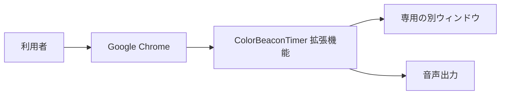

# SW105 ソフトウェア要求仕様書

- **文書ID**: SW105
- **プロジェクト名**: ColorBeaconTimer
- **版数**: 1.0（承認ごとに更新）
- **最終更新日**: 2026-11-13
- **承認状態**: 承認済み（2026-11-13、Product Owner マサ）

## 1. 概要
### 1.1 目的と位置づけ
ColorBeaconTimer は、残時間に応じて色と点滅と音が変わるカウントダウン・タイマーである。青色の安定点灯から、点滅と音を経て赤色の加速点滅へ移り、終了時に掛け声を鳴らし、地球から宇宙へ飛び去る演出を行う。

本ソフトウェアは、名古屋大学の山本雅基が担当する enPiT-Pro Emb 社会人向け講座「生成AI時代のソフトウェア開発プロセス」の演習教材である。受講者は、AIエージェントとの開発対話の実例として本ソフトウェアの要求・設計・実装を見る。完成後は GitHub で公開する予定である。開発は DADAプロセス（従来型プログラム × 承認ゲート型 × Major）に従う。

デザインと音はすべてオリジナルとする。特定の映像作品や商品との公式な関係があるように見せてはならない（詳細は REQ-006 および第3章・第6章）。

### 1.2 適用範囲
- **対象（スコープ内）**:
  - Google Chrome の拡張機能（Manifest V3）として動作するタイマー。表示と操作は、chrome.windows で開く専用の別ウィンドウで行う
  - 起動のたびに表示するオープニング（便器の線画、三面の存在、カラービーコンへの遷移。クリックでスキップ可能）
  - 設定時刻の変更（初期値 3:00、1秒単位、範囲 10秒〜5分）
  - 出撃操作と開始演出、開始後は終了まで止まらないカウントダウン（専用ウィンドウを閉じた場合を除く）
  - 残時間に応じたカラービーコンの色・点滅と、点滅に同期するピコン音
  - 残時間 0 のときの掛け声「ジュワッ！」
  - 残時間 0 と掛け声のあとの終了演出（地球が小さくなり点になったあと、星が流れ続ける映像）
  - 著作権・商標を侵害しない表示・音・文言
- **対象外（スコープ外）**:
  - 一時停止、再開、リセット（開始後に設定へ戻す操作を含む）
  - 複数タイマーの同時実行、時刻の保存・復元、履歴
  - 通知（OS 通知、バッジ、メール等）、バックグラウンドでの作業リマインド
  - アカウント、サーバ通信、課金、データ同期
  - スマートフォン向けアプリ、Chrome 以外のブラウザ向け配布
  - Windows 11 以外の OS、および最新版以外の Google Chrome での動作保証
  - 消音ボタン、および点滅や音の強さを変更する機能
  - 点滅する光への特別な安全対策
  - 専用ウィンドウを閉じたあとのカウントダウン継続（閉じたらプログラムを終了する）
  - 公式キャラクタ・公式音源・公式映像の利用、および公式との関係を示す文言

### 1.3 用語定義
| 用語 | 定義 |
| :--- | :--- |
| ColorBeaconTimer | 本ソフトウェアの製品名。Chrome 拡張機能として提供するカウントダウン・タイマー |
| カラービーコン | 残時間を色と点滅で示す、オリジナルの丸いランプ表示。胸の位置を連想させるが、特定作品の意匠を模写したものではない |
| 設定時刻 | 出撃前に利用者が決めるカウントダウンの長さ。表示は分:秒（例: 3:00） |
| 残時間 | カウントダウン開始後、終了までに残っている時間。表示は分:秒 |
| 出撃ボタン | カウントダウンを開始するボタン。ラベルは「ジュワッチ！」（終了時の掛け声「ジュワッ！」とは表記を区別する） |
| オープニング | 起動のたびに、設定画面の前に再生する短い映像（便器の線画と三面の存在）。クリックでスキップできる |
| 便器の線画 | デュシャンのレディメイド《泉》へのオマージュとして描く、オリジナルの単純な線画。写真のトレースではない |
| 三面の存在 | オープニングに登場する、オリジナルの幾何学的なキャラクタ。3つの顔を順に切り替える。特定作品のキャラクタ名や意匠は用いない |
| 専用ウィンドウ | chrome.windows で開く、本タイマーの表示と操作用の別ウィンドウ。このウィンドウを閉じるとプログラムは終了する |
| ピコン音 | カラービーコンの点滅に同期して鳴らす、オリジナルの合成音。公式音源およびそれに似せた録音は用いない。青色では1周期（2秒）に1回、明るさが最大になる時点で鳴らす。赤色では点滅1回（間隔ごと）に1回鳴らす |
| 掛け声 | 残時間 0 のときに再生する、人の声に近い「ジュワッ！」（この表記で統一する。出撃ボタンのラベル「ジュワッチ！」とは区別する）。ヒーローが宇宙へ帰ることを表す。音声合成で作る |
| 終了演出 | 残時間 0 と掛け声のあと、地球の写真が 5秒間で点になるまで縮小し、その後、星が放射状に流れ続ける映像 |

## 2. システム全体構成
### 2.1 システム構成概要
利用者の PC 上の Google Chrome に、本ソフトウェアを拡張機能として導入する。表示と操作は、chrome.windows で開く専用の別ウィンドウで行う。ピコン音と掛け声は PC の音声出力で再生する。外部サーバとは通信しない。

専用ウィンドウを閉じたらプログラムを終了する。カウントダウンは続けない。再度開いたときは、起動からやり直す（オープニングから始まる）。

### 2.2 ソフトウェアの構成要素
本ソフトウェアが担うかたまりは次の5つである。内部のモジュール分割は SW205 で定める。

- **オープニング**: 便器の線画と三面の存在を再生し、設定画面へ移る
- **時刻設定**: 設定時刻の表示と増減、出撃の受け付け
- **カウントダウンとカラービーコン**: 残時間の更新、色と点滅の状態遷移
- **音の再生**: ピコン音と終了の掛け声
- **終了演出**: 残時間 0 のあと、地球が小さくなり点になったあと、星が流れ続ける映像を再生する

## 3. 制約条件と前提事項
### 3.1 ハードウェア制約
利用者が操作できる画面と、音を再生できる音声出力を備えた PC を対象とする。専用の装置は対象外である。画面の大きさやスピーカの規格は定めない。

### 3.2 ソフトウェア環境
- 実行形態は Google Chrome の拡張機能（Manifest V3）とする。
- 対応環境は、Windows 11 上の最新版 Google Chrome とする。他の OS および旧版の Chrome は動作を保証しない。
- プログラミング言語とライブラリは、本要求では指定しない（SW205 で定める）。
- ピコン音は合成する。合成の手段（例: Web Audio API）は設計で定める。
- 掛け声は音声合成で作る。録音は用いない。公式の声優の声色は真似ない。用いる音声合成のエンジンと声の利用許諾（再配布が可能であること）は、設計（SW205）で確認する。

### 3.3 準拠規格
Product Owner から指定された法令・業界標準はない。ただし公開と配布に先立ち、次を守る。

- 著作権および商標を侵害しない（REQ-006）。
- 公開前に、Product Owner（マサ）がデザインと音と文言を確認する。著作権・商標の最終判断はマサが行う。大学の知的財産担当には確認しない。

## 4. 機能要求

### 4.1 ユースケースとシナリオ
利用者は Chrome のツールバー等から本拡張機能を開く。起動のたびに専用の別ウィンドウでオープニングが始まる。利用者は最後まで見るか、クリックして省く。設定画面で設定時刻を変え（または初期値 3:00 のまま）、出撃ボタン（ラベルは「ジュワッチ！」）を押す。開始演出のあとカウントダウンが始まり、カラービーコンと残時間が残時間の区分に応じて変化する。残時間 0 で掛け声「ジュワッ！」が鳴り、続けて終了演出が始まる。地球の写真が 5秒間かけて点になるまで縮小し、その後、星が放射状に流れ続ける映像が、ウィンドウを閉じるまで再生される。設定画面へは戻らない。専用ウィンドウを閉じるとプログラムは終了し、カウントダウンは続けない。

### 4.2 機能詳細

#### REQ-001: オープニングの再生とスキップ
- **概要**: 起動のたびにオープニングを再生し、三面の存在が3つの顔を切り替えたあと、カラービーコンの画面へ移る。クリックで省略できる。
- **入力 / 処理 / 出力**:
  - 入力: 拡張機能の起動（起動のたびにオープニングを開始する）、再生中のクリック
  - 処理: 次の順序で再生する。(1) 便器の線画を表示する。線画はオリジナルで、《泉》の写真をトレースしない。(2) 署名は `R.MUTT` のみとする。年は書かない。書体はオリジナルの手書き風とし、デュシャンの筆跡を真似ない。(3) 便器が揺れ、三面の存在が現れる。姿はオリジナルの幾何学図形とする。白黒の縦縞、特定作品の顔の形、特定作品のキャラクタ名は用いない。(4) 顔を3回切り替える。顔1は単純な線の人の顔、顔2は回路または点の模様の AI の顔、顔3は丸いランプ（カラービーコン）の顔とする。(5) 顔3のランプが青く光り、拡大して設定画面（カラービーコンと時刻の画面）へ移る
  - 出力: 上記のオープニング映像と、その後の設定画面。スキップ時は設定画面
- **異常系**: 再生中にクリックされた場合、残りのオープニングを打ち切り、その時点で設定画面へ移る。クリックがない場合は、途中で止めずに最後まで再生して設定画面へ移る。専用ウィンドウを閉じた場合は、プログラムを終了する。
- **検証条件 (Acceptance Criteria)**:
  - 拡張機能を起動するたびにオープニングが表示されること。
  - オープニングを最後まで再生すると、所要時間は 2秒以上 3秒以下であり、顔1・顔2・顔3がこの順に1回ずつ現れ、その後に設定画面が表示されること。
  - オープニング再生中の最初の1回のクリックで、3秒を待たずに設定画面へ移ること。
  - 便器の線画に年が無く、署名が `R.MUTT` のみであること。画面上の名称に特定作品のキャラクタ名が無いこと。
- **優先度**: Must

#### REQ-002: 設定時刻の変更
- **概要**: 設定画面で、カウントダウンの長さを1秒単位で変えられる。範囲を超える操作は、範囲の端に止める。
- **入力 / 処理 / 出力**:
  - 入力: ＋ボタン、−ボタン、各ボタンの長押し
  - 処理: 初期の設定時刻は 3:00 とする。＋は設定時刻を1秒増やし、−は1秒減らす。押し続けているあいだは、同じ方向の1秒増減を繰り返す（早送り）。設定時刻の下限は 10秒（0:10）、上限は 5分（5:00）とする。範囲を超える増減は行わず、端の値に固定する（クランプ）
  - 出力: 現在の設定時刻（分:秒）
- **異常系**: 設定時刻が 0:10 のときに − を押しても（押し続けても）0:10 のままとする。設定時刻が 5:00 のときに ＋ を押しても（押し続けても）5:00 のままとする。専用ウィンドウを閉じた場合は、プログラムを終了する。
- **検証条件 (Acceptance Criteria)**:
  - 設定画面を開いた直後（オープニング直後、またはオープニング省略直後）の設定時刻が 3:00 であること。
  - 設定時刻 3:00 で ＋ を1回押すと 3:01 になり、− を1回押すと 2:59 になること。
  - 設定時刻 0:10 で − を1回押しても、表示は 0:10 のままであること。設定時刻 5:00 で ＋ を1回押しても、表示は 5:00 のままであること。
  - 設定時刻 3:00 で ＋ を1秒以上押し続けると、指を離すまでに設定時刻が 3:01 以上へ2回以上増え、離したあとの値は 5:00 以下であること。
- **優先度**: Must

#### REQ-003: 出撃によるカウントダウン開始
- **概要**: 出撃ボタンだけでカウントダウンを始める。一時停止とリセットは提供しない。開始後は残時間 0 まで動き続ける。ただし、専用ウィンドウを閉じた場合はプログラムを終了し、カウントダウンは続けない。
- **入力 / 処理 / 出力**:
  - 入力: 設定画面における出撃ボタンの押下
  - 処理: 出撃ボタンは円形で光る。ラベルは「ジュワッチ！」とする（終了時の掛け声「ジュワッ！」とは表記を区別する）。押すと、(1) 中心から光が広がる、(2) 遠くの小さな光点が近づく、(3) 着地する、(4) カラービーコンが REQ-004 の状態になり、残時間の減少が始まる。この演出は、公式の変身アイテム（器具・形状・発光の仕方）を真似ない
  - 出力: 開始演出のあと、残時間とカラービーコンを示すカウントダウン画面
- **異常系**: カウントダウンの開始後は、出撃ボタン・一時停止・リセットを操作できない（画面に出さないか、出しても反応しない）。出撃ボタンを続けて押しても、カウントダウンは1回だけ始まる。専用ウィンドウを閉じたらプログラムを終了する。カウントダウンは続けず、再度開いたときは起動からやり直す。
- **検証条件 (Acceptance Criteria)**:
  - 設定時刻 3:00 で出撃ボタンを1回押すと、開始演出のあと残時間が 3:00 から減少を始めること。
  - カウントダウンの開始後、一時停止とリセットの操作では残時間が止まらず、設定画面にも戻らないこと。
  - 出撃ボタンのラベルが「ジュワッチ！」であること。掛け声の表記「ジュワッ！」と異なること。
  - カウントダウンの途中で専用ウィンドウを閉じると、プログラムが終了し、カウントダウンが続かないこと。再度開いたときは、残時間の途中からではなく、起動（オープニング）から始まること。
- **優先度**: Must

#### REQ-004: 残時間に応じたカラービーコンとピコン音
- **概要**: カラービーコンの色・点滅・音は、残時間だけで決まる。設定時刻が短いときは、開始直後からその残時間に対応する状態で始める。
- **入力 / 処理 / 出力**:
  - 入力: 現在の残時間（および出撃時の設定時刻）
  - 処理: 次の規則で状態を決める
    - 残時間 が 2:00 より長い: 青色、点灯したまま、無音
    - 残時間 が 2:00 以下、かつ 1:00 より長い: 青色のゆっくり点滅。1秒かけて青がゆっくり消え、1秒かけてゆっくり明るく光る（フェードアウト 1秒＋フェードイン 1秒、1周期 2秒）。ピコン音は、青点滅の1周期に1回、明るさが最大になる時点（フェードインの完了時、周期の区切り）で鳴らす。青点滅の開始時点で明るさはすでに最大であるため、この時点でもピコン音を1回鳴らす
    - 残時間 が 1:00 以下: 赤色、点滅し、点滅間隔とピコン音の間隔は「間隔[秒] = max(残時間[秒] / 60, 0.33)」とする（残 1:00 で 1秒間隔。下限は 0.33秒で、残時間が約 0:20 以下のときは 0.33秒で一定）。設定時刻が 1:00 より短い場合も、開始直後から赤色とし、同じ式を用いる。ピコン音は、点滅1回（間隔ごと）に1回鳴らす
    - 設定時刻が 2:00 より短い場合は、開始直後から点滅を始める。設定時刻が 1:00 以下の場合は、開始直後から赤色とする
  - 出力: カラービーコンの表示、残時間の表示、ピコン音（該当する区分のとき）
- **異常系**: 残時間が区分の境界をまたいだときは、その時点の残時間に対応する状態へ切り替える。開始後に利用者が状態を選べる操作は設けない。専用ウィンドウを閉じた場合は、プログラムを終了する。
- **検証条件 (Acceptance Criteria)**:
  - 設定時刻 3:00 で開始したとき、残時間が 2:01 以上のあいだはカラービーコンが青色の点灯のままで、ピコン音が鳴らないこと。
  - 同じ計測で、残時間が 2:00 になった時点から 1:01 までは、カラービーコンが青色で、フェードアウト 1秒＋フェードイン 1秒（1周期 2秒）の点滅をすること。ピコン音が1周期に1回、明るさが最大になる時点で鳴ること。
  - 同じ計測で、残時間が 1:00 になった時点の点滅間隔とピコン音の間隔が 1秒であること。その後、間隔[秒] = max(残時間[秒] / 60, 0.33) に従うこと。残時間が約 0:20 以下のときは、間隔が 0.33秒で一定であること。
  - 設定時刻 1:30 で開始すると、開始直後から青色のゆっくり点滅（1周期 2秒）と、最大輝度時のピコン音になること。設定時刻 0:30 で開始すると、開始直後から赤色の点滅とピコン音になり、開始直後の間隔が 0.5秒（max(30/60, 0.33)）であること。
  - 残時間の表示が、1秒ごとに1秒減ること。
- **優先度**: Must

#### REQ-005: 終了時の掛け声
- **概要**: 残時間が 0 になったとき、掛け声「ジュワッ！」を再生してカウントダウンを終え、終了演出（REQ-007）へ移る。
- **入力 / 処理 / 出力**:
  - 入力: 残時間が 0 になったこと
  - 処理: 人の声に近い掛け声を1回再生する。表記と読みは「ジュワッ！」で統一する（出撃ボタンのラベル「ジュワッチ！」とは区別する）。掛け声は音声合成で作る。録音は用いない。公式の声優の声色は真似ない。用いる音声合成のエンジンと声の利用許諾（再配布が可能であること）は、設計（SW205）で確認する。再生のあと、カウントダウンは終了し、REQ-007 の終了演出へ移る
  - 出力: 掛け声の再生、残時間 0 の表示、カウントダウンの停止、終了演出への遷移
- **異常系**: 掛け声の音声を再生できない場合でも、残時間 0 の時点でカウントダウンを止め、REQ-007 の終了演出へ移る。残時間を増やしたり出撃し直したりはしない。専用ウィンドウを閉じた場合は、プログラムを終了する。
- **検証条件 (Acceptance Criteria)**:
  - 残時間が 0 になったとき、掛け声が1回再生され、その内容が「ジュワッ！」であること（出撃ボタンの「ジュワッチ！」ではないこと）。
  - 掛け声の再生後（または再生できない場合は残時間 0 の到達後）、残時間が減り続けず、REQ-007 の終了演出が始まること。
- **優先度**: Must

#### REQ-006: 著作権・商標を侵害しない表示と音
- **概要**: 画面、音、拡張機能の名前、説明文のどこにも、特定作品の公式な名称・意匠・音を使わない。公式との関係があるように読める書き方も避ける。
- **入力 / 処理 / 出力**:
  - 入力: 本ソフトウェアが表示・再生・同梱するすべての画像、映像、文字、音
  - 処理: 次を満たすこと。(1) 特定の映像作品や商品の公式名称（日本語および欧文）、および特定のキャラクタ名を使わない。(2) 公式のロゴ、公式画像、公式の効果音・音声を使わない。(3) 図はすべてオリジナルで描く（終了演出の地球の写真を除く）。(4) ピコン音は合成したオリジナル音とする。(5) 掛け声は音声合成とし、録音は用いない。公式の声優の声色を真似ない。(6) 「公認」「公式」「〜風」など、公式との関係や模倣を示す文言を使わない。(7) 《泉》の写真をトレースしない。(8) 終了演出の地球の画像は、再配布可能なパブリックドメインまたはフリーライセンスの写真とする（候補: NASA が公開している地球の写真）。オリジナルの描画は用いない。NASA のロゴ等は使わず、NASA による推奨と誤認させない。出典とライセンスは README 等に記載する。公式の映像・画像は用いない
  - 出力: 上記を満たす画面・音・文言だけが利用者に届くこと
- **異常系**: 禁止する名称・素材・文言が混入した場合は、公開前の確認（第7章の引き継ぎ事項）で取り除く。実行時に公式素材を外部から取得する処理は設けない。
- **検証条件 (Acceptance Criteria)**:
  - 拡張機能の名前、画面上の文字、ストアまたはリポジトリ向け説明文に、特定作品の公式名称および特定のキャラクタ名が無いこと。
  - 同梱する画像・音声に、公式素材ファイルを含まないこと（出典が公式である素材がリポジトリに無いこと）。
  - ピコン音が、録音素材の再生ではなく合成で作られていること。掛け声が、録音ではなく音声合成で作られていること。
  - 画面と説明文に、「公認」「公式」および公式作品の名称を含む「〜風」が無いこと。
  - 終了演出の地球の画像が、再配布可能なパブリックドメインまたはフリーライセンスの写真であること。NASA のロゴ等が入っておらず、NASA による推奨と読める表示が無いこと。出典とライセンスが README 等に記載されていること。
- **優先度**: Must

#### REQ-007: 終了演出
- **概要**: 残時間 0 と掛け声のあと、地球から宇宙へ飛び去る映像を再生する。設定画面には戻らず、リセットもしない。
- **入力 / 処理 / 出力**:
  - 入力: 残時間 0 の到達と、掛け声の再生（または再生できない場合の残時間 0 の到達）
  - 処理: (1) 地球の写真を表示し、5秒間かけて徐々に小さくし、点にする（地球から飛び出して宇宙へ飛び去る表現）。地球の画像は、再配布可能なパブリックドメインまたはフリーライセンスの写真とする（候補: NASA が公開している地球の写真）。オリジナルの描画は用いない。NASA のロゴ等は使わず、NASA による推奨と誤認させない。出典とライセンスは README 等に記載する。公式の映像・画像は用いない。(2) 地球が点になったら、中央から周囲へ放射状にランダムに星が流れる映像を、専用ウィンドウを閉じるまで流し続ける。(3) 設定画面への自動復帰、およびリセット操作は行わない
  - 出力: 縮小する地球の映像、その後の星の流れの映像
- **異常系**: 掛け声を再生できない場合でも、残時間 0 の到達後に本演出を開始する。演出の途中でウィンドウを閉じた場合は、プログラムを終了する（設定画面へは戻らず、再開もしない）。
- **検証条件 (Acceptance Criteria)**:
  - 残時間 0 と掛け声のあと（掛け声を再生できない場合は残時間 0 の到達後）、地球の写真が連続して小さくなり、開始から 5秒で点になること。
  - 地球が点になったあと、中央から周囲へ放射状にランダムに星が流れる映像が始まること。
  - 星の流れの映像は、専用ウィンドウを閉じるまで続き、設定画面に自動では戻らないこと。ウィンドウを閉じるとプログラムが終了すること。
  - 地球の画像が、再配布可能なパブリックドメインまたはフリーライセンスの写真であること。NASA のロゴ等が入っておらず、NASA による推奨と読める表示が無いこと。出典とライセンスが README 等に記載されていること。
- **優先度**: Must

## 5. 外部インタフェース要求
### 5.1 ユーザインタフェース (UI)
画面の状態は次の4つとする。いずれも専用の別ウィンドウに表示する。配置の詳細は SW205 で定める。専用ウィンドウを閉じると、どの状態からでもプログラムは終了する。

| 状態 | 主な表示 | 主な操作 |
| :--- | :--- | :--- |
| オープニング | 便器の線画、署名 `R.MUTT`、三面の存在、3つの顔 | クリックでスキップ（REQ-001）。起動のたびに表示する |
| 設定 | カラービーコン、設定時刻、＋ / −、出撃ボタン（ラベル「ジュワッチ！」） | 時刻の増減、出撃（REQ-002、REQ-003） |
| カウントダウン | カラービーコン、残時間 | 開始後は操作しない（REQ-003、REQ-004、REQ-005）。ウィンドウを閉じると終了する |
| 終了演出 | 縮小する地球、その後の星の流れ | ウィンドウを閉じるまで再生する。設定へは戻らない（REQ-007） |

出撃ボタンは円形で光る。ラベルは「ジュワッチ！」とする。開始演出（光の拡散、光点の接近と着地）はオリジナルとし、公式の変身アイテムを真似ない。

### 5.2 ハードウェアインタフェース
特になし。専用のセンサや装置は使わない。画面表示と音声出力のみを用いる。

### 5.3 ソフトウェアインタフェース
他システムや外部 API とは通信しない。Chrome の拡張機能として導入し、利用者がツールバー等から開くと、chrome.windows で専用の別ウィンドウを開く。専用ウィンドウを閉じたらプログラムを終了する。カウントダウンは続けない。再度開いたときは、起動からやり直す。

## 6. 非機能要求（性能・品質等）

### 6.1 性能・効率性
- オープニングを最後まで再生したときの所要時間は、2秒以上 3秒以下とする（REQ-001）。
- 残時間の表示は、1秒ごとに1秒減る（REQ-004）。
- 青色のゆっくり点滅（残 2:00〜1:00）は、フェードアウト 1秒＋フェードイン 1秒（1周期 2秒）とする。ピコン音は、1周期に1回、明るさが最大になる時点で鳴らす。
- 赤色（残 1:00 以下）の点滅・ピコン間隔は、間隔[秒] = max(残時間[秒] / 60, 0.33) とする（下限 0.33秒。残時間が約 0:20 以下のときは 0.33秒で一定）。ピコン音は、点滅1回につき1回鳴る。
- 終了演出で、地球の写真が点になるまでの時間は 5秒とする（REQ-007）。

### 6.2 信頼性・安全性
- 出撃後のカウントダウンは、残時間 0 まで一時停止もリセットもしない（REQ-003）。
- 専用ウィンドウを閉じたらプログラムを終了する。カウントダウンは続けない。再度開いたときは、起動からやり直す（TBD-h、REQ-003）。
- 点滅する光の安全対策はとらない。消音ボタン、および点滅や音の強さを変更する機能は設けない（スコープ外）。赤色点滅の間隔の下限は 0.33秒とする（REQ-004）。
- 著作権・商標の違反を防ぐ（REQ-006）。公開前に、Product Owner（マサ）がデザイン・音・文言を確認する。著作権・商標の最終判断はマサが行う。大学の知的財産担当には確認しない。

### 6.3 保守性・拡張性
- 1日の講座のなかで、要求定義から実装まで一通り終えられる規模に収める（本版の機能は第1章の対象に限る）。
- 後から段階的に機能を足せる余地を残す。ただし本版では、一時停止・リセット・複数タイマー・通知は対象外とする。足す場合は、要求の改訂（Phase 1 への戻り）を経る。

### 6.4 セキュリティ
利用者の認証、個人情報の収集、サーバへの送信は対象外である。追加の認証要求は設けない。拡張機能が外部へ通信する処理を追加してはならない。

## 7. その他・特記事項
| # | TBD項目 / 引き継ぎ事項 | 状態 |
| :--- | :--- | :--- |
| TBD-a | タイマーの表示と操作は、chrome.windows で開く専用の別ウィンドウで行う。ウィンドウを閉じたあとの扱いは TBD-h に分離した | 解決済み |
| TBD-b | 赤色（残 1:00 以下）の点滅・ピコン間隔は、間隔[秒] = max(残時間[秒] / 60, 0.33) とする（下限 0.33秒。残時間が約 0:20 以下のときは 0.33秒で一定）。設定時刻が 1:00 より短い場合も同じ式を用いる。青色のゆっくり点滅（残 2:00〜1:00）は、1秒かけて青がゆっくり消え、1秒かけてゆっくり明るく光る（フェードアウト 1秒＋フェードイン 1秒、1周期 2秒）。ピコン音は、青点滅の1周期に1回、明るさが最大になる時点で鳴らす | 解決済み |
| TBD-c | 掛け声「ジュワッ！」は音声合成で作る（録音は用いない）。公式の声優の声色は真似ない。用いる音声合成のエンジンと声の利用許諾（再配布が可能であること）は、設計（SW205）で確認する | 解決済み |
| TBD-d | 残時間 0 と掛け声のあと、地球の写真が 5秒間かけて徐々に小さくなり点になる（地球から飛び出して宇宙へ飛び去る表現）。点になったら、中央から周囲へ放射状にランダムに星が流れる映像を、ウィンドウを閉じるまで流し続ける。リセットや設定画面への自動復帰は行わない（REQ-007）。地球の画像は、再配布可能なパブリックドメインまたはフリーライセンスの写真とする（REQ-006、REQ-007） | 解決済み |
| TBD-e | オープニングは起動のたびに表示する。クリックによるスキップは維持する（REQ-001） | 解決済み |
| TBD-f | 対応環境は、Windows 11 上の最新版 Google Chrome とする。他の OS および旧版の Chrome は動作を保証しない | 解決済み |
| TBD-g | 点滅する光の安全対策はとらない。消音ボタンは設けない（スコープ外） | 解決済み |
| TBD-h | 専用ウィンドウを閉じたらプログラムを終了する。カウントダウンは続けない。再度開いたときは、起動からやり直す | 解決済み |
| TBD-i | 出撃ボタンのラベルは「ジュワッチ！」。終了時の掛け声は「ジュワッ！」のままとし、表記を区別する | 解決済み |
| 引き継ぎ | 公開前に、Product Owner（マサ）がデザイン・音・文言を確認する。著作権・商標の最終判断はマサが行う。大学の知的財産担当には確認しない | 未実施 |

### 改版履歴
| 版数 | 日付 | 内容 |
| :--- | :--- | :--- |
| 0.1 | 2026-11-12 | 初版（下書き）。未決事項 TBD-a〜TBD-g を含む |
| 0.2 | 2026-11-13 | Product Owner の決定を反映。TBD-a〜TBD-f を更新（TBD-b は一部解決）。REQ-007（終了演出）を追加。TBD-h（ウィンドウを閉じたあとのカウントダウン）、TBD-i（出撃ボタンのラベル）を追加。著作権・商標の最終判断は Product Owner が行う旨を明記 |
| 0.3 | 2026-11-13 | Product Owner の決定を反映。TBD-b（赤の間隔下限 0.33秒、青はフェード点滅 1周期 2秒、ピコンは最大輝度時）、TBD-g（安全対策・消音ボタンは設けない）、TBD-h（ウィンドウを閉じたら終了）、TBD-i（出撃ボタンのラベルは「ジュワッチ！」）をすべて解決済みとした。地球の画像は再配布可能なフリーの写真とし、オリジナル描画の選択肢を削除 |
| 1.0 | 2026-11-13 | Product Owner（マサ）が承認。Phase 1 完了 |

