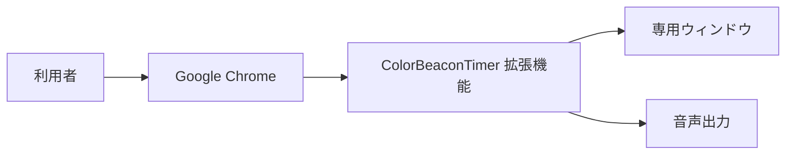

# SW105 ソフトウェア要求仕様書

- **文書ID**: SW105
- **プロジェクト名**: ColorBeaconTimer
- **版数**: 1.1
- **最終更新日**: 2026-11-13
- **承認状態**: 未承認（v1.0 は 2026-11-13 承認済み。REV101 対応の改版）

## 1. 概要
### 1.1 目的と位置づけ
ColorBeaconTimer は、残時間に応じて色と点滅と音が変わるカウントダウン・タイマーである。設定時刻が初期値 3:00 のとき、カラービーコンは青色の安定点灯から始まる。その後、点滅と音を経て、赤色の加速点滅へ移る。設定時刻が 2:00 以下のときの色と点滅は、初期値 3:00 の経路とは別であり、REQ-004 の区分に従う。終了時には掛け声を鳴らし、地球から宇宙へ飛び去る演出を行う。

本ソフトウェアは、名古屋大学の山本雅基が担当する enPiT-Pro Emb 社会人向け講座「生成AI時代のソフトウェア開発プロセス」の演習教材である。受講者は、AIエージェントとの開発対話の実例として本ソフトウェアの要求・設計・実装を見る。完成後は GitHub で公開する予定である。開発は DADAプロセス（従来型プログラム × 承認ゲート型 × Major）に従う。

デザインと音はすべてオリジナルとする。禁止名称リストの作品またはキャラクタと、公式な関係があるように見せてはならない（REQ-006）。

### 1.2 適用範囲
- **対象（スコープ内）**:
  - Google Chrome の拡張機能（Manifest V3）として動作するタイマー。表示と操作は、chrome.windows で開く専用ウィンドウで行う
  - 起動のたびに表示するオープニング（便器の線画、三面の存在、カラービーコンへの遷移。クリックでスキップ可能）
  - 設定時刻の変更（初期値 3:00、1秒単位、範囲 10秒〜5分）
  - 出撃操作と出撃演出（状態「出撃演出中」、長さ 2秒）、開始後は終了まで止まらないカウントダウン（専用ウィンドウを閉じた場合を除く）
  - 残時間に応じたカラービーコンの色・点滅と、点滅に同期するピコン音
  - 残時間 0 のときの掛け声「ジュワッ！」
  - 残時間 0 と掛け声のあとの終了演出（地球が小さくなり点になったあと、星が流れ続ける映像）
  - 著作権・商標を侵害しない表示・音・文言
- **対象外（スコープ外）**:
  - 一時停止、再開、リセット（開始後に設定へ戻す操作を含む）
  - 複数タイマーの同時実行、時刻の保存・復元、履歴
  - 通知（OS 通知、バッジ、メール等）、バックグラウンドでの作業リマインド
  - アカウント、サーバ通信、課金、データ同期
  - スマートフォン向けアプリ、Chrome 以外のブラウザ向け配布
  - Windows 11 以外の OS、および最新版以外の Google Chrome での動作保証
  - 消音ボタン、および点滅や音の強さを変更する機能
  - 点滅する光への特別な安全対策
  - 専用ウィンドウを閉じたあとのカウントダウン継続（閉じたらプログラムを終了する）
  - 禁止名称リストの作品・キャラクタの公式素材と公式名称の利用、および「公認」「公式」という文言

### 1.3 用語定義
| 用語 | 定義 |
| :--- | :--- |
| ColorBeaconTimer | 本ソフトウェアの製品名。Chrome 拡張機能として提供するカウントダウン・タイマー |
| 禁止名称リスト | 禁止する名称の閉じた一覧。作品名は「ウルトラマン」と、同じ名称の英字表記「Ultraman」。キャラクタ名は「三面星人ダダ」と、同じ名称のローマ字表記「Sanmen Seijin Dada」。英字とローマ字は大文字と小文字を区別しない。一覧に含む文字列は4つだけである。画面に表示する文字、再生する音声の発話、ファイル名、ストアの掲載文のいずれかに一覧の名称が含まれるとき、その文字・発話・ファイル名・掲載文を禁止する。「風」という語だけでは禁止しない。一覧の名称を含まない「風」付きの表現も禁止しない。一覧の名称を含む表現は禁止する |
| カラービーコン | 残時間を色と点滅で示す、オリジナルの丸いランプ表示。胸の位置を連想させるが、禁止名称リストのキャラクタの意匠を模写したものではない |
| 設定時刻 | 出撃前に利用者が決めるカウントダウンの長さ。表示は分:秒（例: 3:00） |
| 残時間 | カウントダウン開始後、終了までに残っている時間。計測の単位はミリ秒。画面の表示は、残ミリ秒を 1000 で割った値の小数点以下を切り上げた秒を、分:秒で示す。残ミリ秒が 1000 の倍数のときは、その秒をそのまま表示する |
| 出撃ボタン | カウントダウンを開始するボタン。ラベルは「ジュワッチ！」（終了時の掛け声「ジュワッ！」とは表記を区別する） |
| 出撃演出 | 出撃ボタンを押したあと、カウントダウンの前に再生する映像。中心から光が広がり、遠くの小さな光点が近づき、着地する。長さは 2秒（許容誤差 ±0.1秒） |
| 出撃演出中 | 出撃演出を再生している状態。長さは 2秒。出撃演出中、ColorBeaconTimer は＋ボタン、−ボタン、出撃ボタンの入力を無視する |
| オープニング | 起動のたびに、設定画面の前に再生する短い映像（便器の線画と三面の存在）。クリックでスキップできる。便器の署名はカタカナの「アール・マット」 |
| 便器の線画 | デュシャンのレディメイド《泉》へのオマージュとして描く、オリジナルの単純な線画。写真のトレースではない。トレースか否かは、公開前に Product Owner（マサ）が目視で判定する（REQ-001） |
| 三面の存在 | オープニングに登場する、オリジナルの幾何学的なキャラクタ。3つの顔を順に切り替える。禁止名称リストの名称と、禁止名称リストのキャラクタの意匠は用いない。白黒の縦縞は用いない |
| 専用ウィンドウ | chrome.windows で開く、本タイマーの表示と操作用のウィンドウ。専用ウィンドウを閉じるとプログラムは終了する |
| ピコン音 | カラービーコンの点滅に同期して鳴らす、オリジナルの合成音。公式音源、および公式音源に似せた録音は用いない。青色では1周期（フェードアウト 1秒とフェードイン 1秒）に1回、明るさが最大になる時点で鳴らす。赤色では点滅1回（間隔ごと）に1回鳴らす |
| 掛け声 | 残時間 0 のときに再生する、人の声に近い「ジュワッ！」（表記は「ジュワッ！」で統一する。出撃ボタンのラベル「ジュワッチ！」とは区別する）。ヒーローが宇宙へ帰ることを表す。開発時に音声合成で1回生成し、音声ファイルとして保存する。実行時はそのファイルを再生する。再生はオフラインで行う。人の声の録音は用いない |
| 終了演出 | 残時間 0 と掛け声のあと、地球の写真が 5秒間で点になるまで縮小し、その後、星が放射状に流れ続ける映像。点とは、画面上の地球の写真の直径が 4 px 以下になった状態である。直径は、地球の写真を囲む最小の正方形の一辺の長さとする。地球の縮小を開始した時点で、残時間 0:00 の表示を消す |
| 点 | 終了演出において、画面上の地球の写真の直径が 4 px 以下になった状態。直径は、地球の写真を囲む最小の正方形の一辺の長さとする |

## 2. システム全体構成
### 2.1 システム構成概要
利用者の PC 上の Google Chrome に、本ソフトウェアを拡張機能として導入する。表示と操作は、chrome.windows で開く専用ウィンドウで行う。ピコン音と掛け声は PC の音声出力で再生する。外部サーバとは通信しない。

専用ウィンドウを閉じたらプログラムを終了する。カウントダウンは続けない。再度開いたときは、起動からやり直す（オープニングから始まる）。

### 2.2 ソフトウェアの構成要素
本ソフトウェアが担うかたまりは次の5つである。内部のモジュール分割は SW205 で定める。

- **オープニング**: 便器の線画と三面の存在を再生し、設定画面へ移る
- **時刻設定**: 設定時刻の表示と増減、出撃の受け付け、および長さ 2秒の出撃演出
- **カウントダウンとカラービーコン**: 残時間の更新、色と点滅の状態遷移
- **音の再生**: ピコン音と終了の掛け声
- **終了演出**: 残時間 0 のあと、地球が小さくなり点になったあと、星が流れ続ける映像を再生する

## 3. 制約条件と前提事項
### 3.1 ハードウェア制約
利用者が操作できる画面と、音を再生できる音声出力を備えた PC を対象とする。専用の装置は対象外である。画面の大きさやスピーカの規格は定めない。

### 3.2 ソフトウェア環境
- 実行形態は Google Chrome の拡張機能（Manifest V3）とする。
- 対応環境は、Windows 11 上の最新版 Google Chrome とする。他の OS および旧版の Chrome は動作を保証しない。
- プログラミング言語とライブラリは、本要求では指定しない（SW205 で定める）。
- ピコン音は合成する。合成の手段（例: Web Audio API）は設計で定める。
- 掛け声は、開発時に音声合成で1回だけ生成し、音声ファイルとして保存する。実行時は、保存したファイルを再生する。実行のたびに合成し直さない。再生に通信は不要であり、オフラインで再生できる。人の声の録音は用いない。禁止名称リストの作品の公式の声は使わない。音声合成のエンジンと声の利用許諾は、再配布を許すものであること。許諾の確認は、設計（SW205）で行う。

### 3.3 準拠規格
Product Owner から指定された法令・業界標準はない。ただし公開と配布に先立ち、次を守る。

- 著作権および商標を侵害しない（REQ-006）。
- 公開前に、Product Owner（マサ）がデザインと音と文言を確認する。便器の線画が《泉》の写真のトレースか否か、および署名「アール・マット」の書体がデュシャンの筆跡の模倣か否かは、マサが目視で判定する（REQ-001）。著作権・商標の最終判断はマサが行う。大学の知的財産担当には確認しない。

## 4. 機能要求

### 4.1 ユースケースとシナリオ
利用者は、Chrome のツールバーにある本拡張機能のアイコンをクリックして、専用ウィンドウを開く。アイコンのクリック以外の操作では、専用ウィンドウは開かない。専用ウィンドウが既に開いているときに同じアイコンをクリックした場合、ColorBeaconTimer は新しい専用ウィンドウを開かない。ColorBeaconTimer は、開いている専用ウィンドウを前面に出す。

起動のたびに、専用ウィンドウでオープニングが始まる。利用者は最後まで見るか、クリックしてスキップする。設定画面では、カラービーコンは青色で点灯したまま、無音である。利用者は設定時刻を変えるか、初期値 3:00 のままにする。出撃ボタンのラベルは「ジュワッチ！」である。

出撃ボタンを押すと、状態は「出撃演出中」になる。長さは 2秒である。出撃演出中、ColorBeaconTimer は＋ボタン、−ボタン、出撃ボタンの入力を無視する。出撃演出のあとカウントダウンが始まる。カラービーコンと残時間は、REQ-004 の区分に従って変わる。

残時間が 0 になると、掛け声「ジュワッ！」が鳴る。掛け声のあいだ、残時間は 0:00 と表示する。続けて終了演出が始まる。地球の縮小を開始した時点で、0:00 の表示は消える。地球の写真は 5秒で、直径 4 px 以下の点になるまで縮小する。その後、星が放射状に流れ続ける映像が、専用ウィンドウを閉じるまで再生される。設定画面へは戻らない。専用ウィンドウを閉じるとプログラムは終了し、カウントダウンは続けない。

### 4.2 機能詳細

#### REQ-001: オープニングの再生とスキップ
- **概要**: 起動のたびにオープニングを再生し、三面の存在が3つの顔を切り替えたあと、カラービーコンの画面へ移る。クリックでスキップできる。
- **入力 / 処理 / 出力**:
  - 入力: 専用ウィンドウの起動（第5.3節。起動のたびにオープニングを開始する）、再生中のクリック
  - 処理: 次の順序で再生する。
    - (1) 便器の線画を表示する。線画はオリジナルとする。《泉》の写真をトレースしない。
    - (2) 署名はカタカナの「アール・マット」だけとする。年は書かない。書体はオリジナルの手書き風とする。デュシャンの筆跡は真似ない。
    - (3) 便器が揺れ、三面の存在が現れる。姿はオリジナルの幾何学図形とする。白黒の縦縞は使わない。禁止名称リストのキャラクタの顔の形は使わない。禁止名称リストの名称は使わない。
    - (4) 顔を3回切り替える。顔1は単純な線の人の顔とする。顔2は回路または点の模様の AI の顔とする。顔3は丸いランプ（カラービーコン）の顔とする。
    - (5) 顔3のランプが青く光り、拡大して設定画面へ移る。出撃前の設定画面では、カラービーコンを青色で点灯したままにする。点滅はしない。音は出さない。
  - 出力: 処理 (1) から (5) の映像と、その後の設定画面。スキップ時は設定画面
- **異常系**: 再生中にクリックされた場合、残りのオープニングを打ち切り、その時点で設定画面へ移る。クリックがない場合は、途中で止めずに最後まで再生して設定画面へ移る。専用ウィンドウを閉じた場合は、プログラムを終了する。
- **検証条件 (Acceptance Criteria)**:
  - Chrome のツールバーにある本拡張機能のアイコンをクリックしたときだけ、専用ウィンドウが開くこと。
  - 専用ウィンドウが既に開いているときに同じアイコンをクリックすると、新しい専用ウィンドウは開かず、開いている専用ウィンドウが前面に出ること。オープニングは最初からやり直さないこと。
  - 専用ウィンドウを開くたびにオープニングが表示されること。
  - オープニングを最後まで再生すると、所要時間は 2秒以上 3秒以下であること。
  - 同じ再生で、顔1、顔2、顔3の順に1回ずつ現れ、その後に設定画面が表示されること。
  - オープニング再生中の最初の1回のクリックで、3秒を待たずに設定画面へ移ること。
  - 便器の線画に年が無いこと。署名がカタカナの「アール・マット」だけであること。
  - 画面上の文字、ファイル名、ストアの掲載文に、禁止名称リストの名称が無いこと。
  - 便器の線画と三面の存在に、白黒の縦縞が無いこと。
  - 出撃前の設定画面では、カラービーコンが青色で、点灯したままで、点滅せず、音が出ないこと。
  - 便器の線画が《泉》の写真のトレースか否か、および署名「アール・マット」の書体がデュシャンの筆跡の模倣か否かは、公開前に Product Owner（マサ）が画面を目視して判定すること。トレースでないこと、および筆跡の模倣でないことにマサが合格としたとき、本条件を満たすこと。
- **優先度**: Must

#### REQ-002: 設定時刻の変更
- **概要**: 設定画面で、カウントダウンの長さを1秒単位で変えられる。範囲を超える操作は、範囲の端に止める。
- **入力 / 処理 / 出力**:
  - 入力: ＋ボタン、−ボタン、各ボタンの長押し
  - 処理: 初期の設定時刻は 3:00 とする。＋は設定時刻を1秒増やし、−は1秒減らす。押し続けているあいだは、同じ方向の1秒増減を繰り返す（早送り）。設定時刻の下限は 10秒（0:10）、上限は 5分（5:00）とする。範囲を超える増減は行わず、端の値に固定する（クランプ）
  - 出力: 現在の設定時刻（分:秒）
- **異常系**: 設定時刻が 0:10 のときに − を押しても（押し続けても）0:10 のままとする。設定時刻が 5:00 のときに ＋ を押しても（押し続けても）5:00 のままとする。専用ウィンドウを閉じた場合は、プログラムを終了する。
- **検証条件 (Acceptance Criteria)**:
  - 設定画面を開いた直後（オープニング直後、またはオープニングをスキップした直後）の設定時刻が 3:00 であること。
  - 設定時刻 3:00 で ＋ を1回押すと 3:01 になり、− を1回押すと 2:59 になること。
  - 設定時刻 0:10 で − を1回押しても、表示は 0:10 のままであること。設定時刻 5:00 で ＋ を1回押しても、表示は 5:00 のままであること。
  - 設定時刻 3:00 で ＋ を1秒以上押し続けると、指を離すまでに設定時刻が 3:01 以上へ2回以上増え、離したあとの値は 5:00 以下であること。
- **優先度**: Must

#### REQ-003: 出撃によるカウントダウン開始
- **概要**: 出撃ボタンだけでカウントダウンを始める。一時停止とリセットは提供しない。開始後は残時間 0 まで動き続ける。ただし、専用ウィンドウを閉じた場合はプログラムを終了し、カウントダウンは続けない。
- **入力 / 処理 / 出力**:
  - 入力: 設定画面における出撃ボタンの押下
  - 処理: 出撃ボタンは円形で光る。ラベルは「ジュワッチ！」とする。終了時の掛け声「ジュワッ！」とは表記を区別する。
    - 出撃ボタンを押すと、状態は「出撃演出中」になる。
    - 出撃演出の長さは 2秒とする。許容誤差は ±0.1秒とする。出撃演出のあいだ、残時間は減少しない。
    - 出撃演出は次の順で進む。(1) 中心から光が広がる。(2) 遠くの小さな光点が近づく。(3) 着地する。(4) 状態がカウントダウンに移る。カラービーコンは REQ-004 の状態になる。残時間の減少が始まる。
    - 出撃演出中、ColorBeaconTimer は＋ボタン、−ボタン、出撃ボタンの入力を無視する。設定時刻は変わらない。出撃演出は最初からやり直さない。
    - 出撃演出は、禁止名称リストの作品の公式の変身アイテムについて、器具、形状、発光の仕方を真似ない。
  - 出力: 出撃演出のあと、残時間とカラービーコンを示すカウントダウン画面
- **異常系**: 出撃演出中およびカウントダウンの開始後は、＋ボタン、−ボタン、出撃ボタンを操作しても時刻も演出も変わらない。一時停止とリセットは操作できない（画面に出さないか、出しても反応しない）。出撃ボタンを続けて押しても、カウントダウンは1回だけ始まる。出撃演出中またはカウントダウン中に専用ウィンドウを閉じたら、プログラムを終了する。カウントダウンは続けない。再度開いたときは起動からやり直す。
- **検証条件 (Acceptance Criteria)**:
  - 設定時刻 3:00 で出撃ボタンを1回押すと、状態が「出撃演出中」になること。出撃演出は 2秒続き、許容誤差は ±0.1秒であること。出撃演出のあいだ残時間は減少しないこと。出撃演出のあと、残時間が 3:00 から減少を始めること。
  - 出撃演出中に＋ボタン、−ボタン、出撃ボタンを押しても、設定時刻が変わらないこと。出撃演出が最初からやり直されないこと。2秒（許容誤差 ±0.1秒）のあと、残時間が押下前の設定時刻から減少を始めること。
  - カウントダウンの開始後、一時停止とリセットの操作では残時間が止まらず、設定画面にも戻らないこと。
  - 出撃ボタンのラベルが「ジュワッチ！」であること。掛け声の表記「ジュワッ！」と異なること。
  - 出撃演出中またはカウントダウンの途中で専用ウィンドウを閉じると、プログラムが終了し、カウントダウンが続かないこと。再度開いたときは、残時間の途中からではなく、起動（オープニング）から始まること。
- **優先度**: Must

#### REQ-004: 残時間に応じたカラービーコンとピコン音
- **概要**: カウントダウン開始後のカラービーコンの色・点滅・音は、残時間だけで決まる。設定時刻が短いときは、開始直後からその残時間に対応する状態で始める。出撃前の色と音は REQ-001 に従い、REQ-004 の対象外である。
- **入力 / 処理 / 出力**:
  - 入力: 現在の残時間（ミリ秒）、および出撃時の設定時刻
  - 処理: 残時間の計測単位はミリ秒とする。画面の残時間表示は、残ミリ秒を 1000 で割った値の小数点以下を切り上げた秒を、分:秒で示す。残ミリ秒が 1000 の倍数のときは、その秒をそのまま表示する。色と点滅の区分は、表示上の整数秒ではなく、残時間のミリ秒で判定する。
    - 残時間が 120000ミリ秒より長い: 青色、点灯したまま、無音。表示は 2:01 以上である。
    - 残時間が 120000ミリ秒以下、かつ 60000ミリ秒より長い: 青色のゆっくり点滅。120000ミリ秒（表示 2:00）は青の点滅である。60001ミリ秒（表示 1:01）も青の点滅である。青は 1秒かけてゆっくり消える（フェードアウト）。続いて 1秒かけてゆっくり明るく光る（フェードイン）。フェードアウトとフェードインの各時間の許容誤差は ±0.1秒とする。ピコン音は、青点滅の1周期に1回、明るさが最大になる時点（フェードインの完了時）で鳴らす。青点滅の開始時点で明るさはすでに最大であるため、開始時点でもピコン音を1回鳴らす。
    - 残時間が 60000ミリ秒以下: 赤色で点滅する。60000ミリ秒（表示 1:00）も赤である。点滅間隔とピコン音の間隔は、各点滅の開始時点の残時間（ミリ秒）から計算する。計算式は「間隔[秒] = max(残時間[秒] / 60, 0.33)」とする。残時間[秒] は、残時間[ミリ秒] / 1000 である。計算した間隔は、その点滅が終わるまで変えない。次の点滅の開始時に、その時点の残時間で再計算する。残時間 60000ミリ秒で開始した点滅の間隔は 1秒である。残時間が 19.8秒（19800ミリ秒）以下のときに開始した点滅の間隔は 0.33秒である。残時間 20000ミリ秒（20秒）で開始した点滅の間隔は 20/60秒であり、0.33秒ではない。間隔の実測値の許容誤差は、式の値に対して ±0.1秒とする。設定時刻が 60000ミリ秒より短い場合も、開始直後から赤色とし、同じ式を用いる。ピコン音は、点滅1回（間隔ごと）に1回鳴らす。
    - 設定時刻が 120000ミリ秒より短い場合は、開始直後から点滅を始める。設定時刻が 60000ミリ秒以下の場合は、開始直後から赤色とする。
  - 出力: カラービーコンの表示、残時間の表示、ピコン音（該当する区分のとき）
- **異常系**: 残時間が区分の境界をまたいだときは、またいだ時点の残時間（ミリ秒）に対応する状態へ切り替える。赤へ切り替えた最初の点滅の間隔は、切り替えた時点の残時間（ミリ秒）で計算する。開始後に利用者が状態を選べる操作は設けない。専用ウィンドウを閉じた場合は、プログラムを終了する。
- **検証条件 (Acceptance Criteria)**:
  - 設定時刻 3:00（180000ミリ秒）で開始したとき、残時間が 120000ミリ秒より長いあいだは、カラービーコンが青色の点灯のままで、ピコン音が鳴らないこと。残時間が 120000ミリ秒より長い区間の表示は 2:01 以上であること。
  - 同じ計測で、残時間が 120000ミリ秒以下かつ 60000ミリ秒より長いあいだは、カラービーコンが青色で点滅すること。120000ミリ秒（表示 2:00）は青の点滅であること。フェードアウトは 1秒、フェードインは 1秒であり、各時間の許容誤差は ±0.1秒であること。ピコン音が1周期に1回、明るさが最大になる時点で鳴ること。
  - 同じ計測で、残時間が 60000ミリ秒（表示 1:00）のときに開始した点滅の間隔とピコン音の間隔が 1秒であること。許容誤差は ±0.1秒であること。間隔は、各点滅の開始時の残時間（ミリ秒）から「間隔[秒] = max(残時間[秒] / 60, 0.33)」で計算し、その点滅のあいだは変えないこと。
  - 残時間が 19800ミリ秒以下のときに開始した点滅の間隔が 0.33秒であること。許容誤差は ±0.1秒であること。残時間が 20000ミリ秒のときに開始した点滅の間隔が 20/60秒であること。許容誤差は ±0.1秒であること。
  - 設定時刻 1:30（90000ミリ秒）で開始すると、開始直後から青色のゆっくり点滅と、最大輝度時のピコン音になること。設定時刻 0:30（30000ミリ秒）で開始すると、開始直後から赤色の点滅とピコン音になり、開始直後の間隔が 0.5秒（max(30 / 60, 0.33)）であること。許容誤差は ±0.1秒であること。
  - 残時間の表示が 1秒ごとに 1秒減ること。表示が切り替わる間隔の許容誤差は ±0.2秒であること。120000ミリ秒は 2:00、120001ミリ秒は 2:01、60000ミリ秒は 1:00 と表示すること。
- **優先度**: Must

#### REQ-005: 終了時の掛け声
- **概要**: 残時間が 0 になったとき、掛け声「ジュワッ！」を再生してカウントダウンを終え、終了演出（REQ-007）へ移る。
- **入力 / 処理 / 出力**:
  - 入力: 残時間が 0 になったこと
  - 処理: 開発時に音声合成で1回だけ生成し、保存した音声ファイルを1回再生する。実行のたびに合成し直さない。再生に通信は不要であり、オフラインで再生できる。表記と読みは「ジュワッ！」で統一する。出撃ボタンのラベル「ジュワッチ！」とは区別する。人の声の録音は用いない。禁止名称リストの作品の公式の声は使わない。音声合成のエンジンと声の利用許諾は、再配布を許すものであること。許諾の確認結果は、設計（SW205）に書く。再生のあと、カウントダウンは終了し、REQ-007 の終了演出へ移る。
  - 出力: 掛け声の再生、掛け声のあいだの残時間 0:00 の表示、カウントダウンの停止。地球の縮小を開始した時点で、残時間 0:00 の表示を消す（REQ-007）
- **異常系**: 掛け声の音声ファイルを再生できない場合でも、残時間 0 の時点でカウントダウンを止め、REQ-007 の終了演出へ移る。その場合も、地球の縮小を開始した時点で残時間 0:00 の表示を消す。残時間を増やしたり出撃し直したりはしない。専用ウィンドウを閉じた場合は、プログラムを終了する。
- **検証条件 (Acceptance Criteria)**:
  - 残時間が 0 になったとき、保存済みの音声ファイルが1回再生され、その内容が「ジュワッ！」であること。出撃ボタンの「ジュワッチ！」ではないこと。
  - 掛け声の音声ファイルが、開発時の音声合成で1回生成して保存したものであること。実行時に合成し直さないこと。人の声を録音したファイルでないこと。再生時に通信せず、オフラインで再生できること。
  - 音声合成のエンジンと声について、再配布を許す利用許諾であることの確認結果が、SW205 に書かれていること。
  - 掛け声の再生中は残時間 0:00 を表示すること。地球の縮小を開始した時点で、0:00 の表示が消えること。
  - 掛け声の再生後（または再生できない場合は残時間 0 の到達後）、残時間が減り続けず、REQ-007 の終了演出が始まること。
- **優先度**: Must

#### REQ-006: 著作権・商標を侵害しない表示と音
- **概要**: 画面、音、拡張機能の名前、説明文のどこにも、禁止名称リストの名称を使わない。公式との関係があるように読める「公認」と「公式」も書かない。
- **入力 / 処理 / 出力**:
  - 入力: 本ソフトウェアが表示・再生・同梱するすべての画像、映像、文字、音、ファイル名
  - 処理: 次の (1) から (8) を満たす。
    - (1) 禁止名称リストの名称を、画面に表示する文字、再生する音声の発話、ファイル名、ストアの掲載文に含めない。日本語の名称と、英字またはローマ字の名称のどちらも含めない。英字とローマ字は大文字と小文字を区別しない。
    - (2) 禁止名称リストの作品およびキャラクタについて、公式ロゴ、公式画像、公式の効果音、公式の音声を使わない。
    - (3) 図はオリジナルで描く。終了演出の地球の写真だけは、次の (8) の写真を使う。
    - (4) ピコン音は合成したオリジナル音とする。
    - (5) 掛け声は、開発時に音声合成で1回生成して保存した音声ファイルを再生する。実行のたびに合成し直さない。人の声の録音は使わない。禁止名称リストの作品の公式の声は使わない。
    - (6) 画面に表示する文字とストアの掲載文に、「公認」および「公式」を書かない。「風」という語だけでは禁止しない。禁止名称リストの名称を含まない「風」付きの表現は禁止しない。禁止名称リストの名称を含む表現は禁止する。
    - (7) 《泉》の写真をトレースしない。トレースか否かの判定は、REQ-001 の検証条件に従う。
    - (8) 終了演出の地球の画像は写真とする。ライセンスは、パブリックドメイン（public domain）、CC0、CC BY のいずれかとする。CC BY の場合はクレジットを付ける。オリジナルの描画は使わない。NASA のロゴを表示しない。NASA の記章「ミートボール」を表示しない。NASA の記章「ワーム」を表示しない。NASA による推奨、または NASA による後援と読める表示をしない。出典とライセンスは、README の見出し「クレジット」の節だけに書く。禁止名称リストの作品またはキャラクタの映像および画像は使わない。
  - 出力: 処理 (1) から (8) を満たす画面、音、文言
- **異常系**: 禁止名称リストの名称、禁止する素材、または「公認」「公式」が混入した場合は、公開前の確認（第7章の引き継ぎ事項）で取り除く。実行時に外部から素材を取得する処理は設けない。
- **検証条件 (Acceptance Criteria)**:
  - 拡張機能の名前、画面上の文字、ストアの掲載文、リポジトリのファイル名に、禁止名称リストの名称が無いこと。英字とローマ字は大文字と小文字を区別しない。
  - 同梱する画像と音声が、禁止名称リストの作品またはキャラクタの公式ロゴ、公式画像、公式の効果音、公式の音声でないこと。
  - ピコン音が合成音であること。ピコン音として人の声の録音を再生しないこと。
  - 掛け声が、開発時に音声合成で1回生成して保存した音声ファイルの再生であること。人の声を録音したファイルでないこと。再生時に通信しないこと。
  - 画面上の文字とストアの掲載文に、「公認」および「公式」が無いこと。禁止名称リストの名称を含む表現が無いこと。「風」という語だけでは不合格にしないこと。
  - 地球の写真のライセンスが、パブリックドメイン（public domain）、CC0、CC BY のいずれかであること。CC BY の場合は、README の見出し「クレジット」の節にクレジットがあること。パブリックドメインと CC0 の場合も、出典とライセンスが同じ節にあること。
  - 地球の写真および画面に、NASA のロゴ、NASA の記章「ミートボール」、NASA の記章「ワーム」が無いこと。NASA による推奨、または NASA による後援と読める表示が無いこと。
- **優先度**: Must

#### REQ-007: 終了演出
- **概要**: 残時間 0 と掛け声のあと、地球から宇宙へ飛び去る映像を再生する。設定画面には戻らず、リセットもしない。
- **入力 / 処理 / 出力**:
  - 入力: 残時間 0 の到達と、掛け声の再生（または再生できない場合の残時間 0 の到達）
  - 処理: 次の順で行う。
    - (1) 地球の縮小を開始した時点で、残時間 0:00 の表示を消す。終了演出のあいだ、残時間は表示しない。
    - (2) 地球の写真を表示し、5秒間かけて小さくする。5秒の許容誤差は ±0.1秒とする。点とは、画面上の地球の写真の直径が 4 px 以下になった状態である。直径は、地球の写真を囲む最小の正方形の一辺の長さとする。縮小開始から 5秒経過した時点で、直径は 4 px 以下である。
    - (3) 地球の画像は写真とする。ライセンスは、パブリックドメイン（public domain）、CC0、CC BY のいずれかとする。CC BY の場合はクレジットを付ける。オリジナルの描画は使わない。NASA のロゴを表示しない。NASA の記章「ミートボール」を表示しない。NASA の記章「ワーム」を表示しない。NASA による推奨、または NASA による後援と読める表示をしない。出典とライセンスは、README の見出し「クレジット」の節だけに書く。
    - (4) 地球が点になったら、中央から周囲へ放射状にランダムに星が流れる映像を、専用ウィンドウを閉じるまで流し続ける。
    - (5) 設定画面への自動復帰、およびリセット操作は行わない。
  - 出力: 縮小する地球の映像（残時間 0:00 は表示しない）、その後の星の流れの映像
- **異常系**: 掛け声を再生できない場合でも、残時間 0 の到達後に本演出を開始する。その場合も、地球の縮小開始時に残時間 0:00 の表示を消す。演出の途中でウィンドウを閉じた場合は、プログラムを終了する（設定画面へは戻らず、再開もしない）。
- **検証条件 (Acceptance Criteria)**:
  - 地球の縮小を開始した時点で、残時間 0:00 の表示が消えること。終了演出のあいだ、0:00 が再表示されないこと。
  - 残時間 0 と掛け声のあと（掛け声を再生できない場合は残時間 0 の到達後）、地球の写真が連続して小さくなること。縮小開始から 5秒経過した時点で直径が 4 px 以下であること。5秒の許容誤差は ±0.1秒であること。
  - 地球が点になったあと、中央から周囲へ放射状にランダムに星が流れる映像が始まること。
  - 星の流れの映像は、専用ウィンドウを閉じるまで続き、設定画面に自動では戻らないこと。ウィンドウを閉じるとプログラムが終了すること。
  - 地球の写真のライセンスが、パブリックドメイン（public domain）、CC0、CC BY のいずれかであること。CC BY の場合は、README の見出し「クレジット」の節にクレジットがあること。パブリックドメインと CC0 の場合も、出典とライセンスが同じ節にあること。
  - 地球の写真および画面に、NASA のロゴ、NASA の記章「ミートボール」、NASA の記章「ワーム」が無いこと。NASA による推奨、または NASA による後援と読める表示が無いこと。
- **優先度**: Must

## 5. 外部インタフェース要求
### 5.1 ユーザインタフェース (UI)
画面の状態は次の5つとする。いずれも専用ウィンドウに表示する。配置の詳細は SW205 で定める。専用ウィンドウを閉じると、どの状態からでもプログラムは終了する。

| 状態 | 主な表示 | 主な操作 |
| :--- | :--- | :--- |
| オープニング | 便器の線画、署名「アール・マット」、三面の存在、3つの顔 | クリックでスキップ（REQ-001）。起動のたびに表示する |
| 設定 | カラービーコン（青色、点灯したまま、無音）、設定時刻、＋ / −、出撃ボタン（ラベル「ジュワッチ！」） | 時刻の増減、出撃（REQ-001、REQ-002、REQ-003） |
| 出撃演出中 | 光の広がり、光点の接近、着地 | ＋ボタン、−ボタン、出撃ボタンの入力を無視する。長さは 2秒、許容誤差は ±0.1秒（REQ-003） |
| カウントダウン | カラービーコン、残時間 | 開始後は操作しない（REQ-003、REQ-004、REQ-005）。ウィンドウを閉じると終了する |
| 終了演出 | 縮小する地球（残時間 0:00 は表示しない）、その後の星の流れ | ウィンドウを閉じるまで再生する。設定へは戻らない（REQ-005、REQ-007） |

出撃ボタンは円形で光る。ラベルは「ジュワッチ！」とする。出撃演出（光の拡散、光点の接近と着地）の長さは 2秒である。出撃演出中は、＋ボタン、−ボタン、出撃ボタンの入力を無視する。出撃演出はオリジナルとし、禁止名称リストの作品の公式の変身アイテムを真似ない。

### 5.2 ハードウェアインタフェース
特になし。専用のセンサや装置は使わない。画面表示と音声出力のみを用いる。

### 5.3 ソフトウェアインタフェース
他システムや外部 API とは通信しない。Chrome の拡張機能として導入する。利用者が Chrome のツールバーにある本拡張機能のアイコンをクリックしたとき、chrome.windows で専用ウィンドウを開く。アイコンのクリック以外の操作では、専用ウィンドウを開かない。専用ウィンドウが既に開いているときに同じアイコンをクリックした場合、新しい専用ウィンドウは開かない。開いている専用ウィンドウを前面に出す。専用ウィンドウを閉じたらプログラムを終了する。カウントダウンは続けない。再度開いたときは、起動からやり直す。

## 6. 非機能要求（性能・品質等）

### 6.1 性能・効率性
- オープニングを最後まで再生したときの所要時間は、2秒以上 3秒以下とする（REQ-001）。
- 出撃演出の長さは 2秒とする。許容誤差は ±0.1秒とする（REQ-003）。
- 残時間の表示は、1秒ごとに1秒減る。表示が切り替わる間隔の許容誤差は ±0.2秒とする（REQ-004）。
- 青色のゆっくり点滅は、残時間が 120000ミリ秒以下、かつ 60000ミリ秒より長い区間とする。60000ミリ秒（表示 1:00）は赤とする。フェードアウトは 1秒、フェードインは 1秒とする。各時間の許容誤差は ±0.1秒とする。ピコン音は、1周期に1回、明るさが最大になる時点で鳴らす。
- 赤色（残時間 60000ミリ秒以下）の点滅間隔は、各点滅の開始時に、その時点の残時間（ミリ秒）から計算する。計算式は、間隔[秒] = max(残時間[秒] / 60, 0.33) とする。残時間が 19.8秒（19800ミリ秒）以下のときに開始した点滅の間隔は 0.33秒とする。残時間 20000ミリ秒で開始した点滅の間隔は 20/60秒とする。間隔の許容誤差は、式の値に対して ±0.1秒とする。ピコン音は、点滅1回につき1回鳴る。
- 終了演出で、地球の写真の直径が 4 px 以下の点になるまでの時間は 5秒とする。許容誤差は ±0.1秒とする（REQ-007）。

### 6.2 信頼性・安全性
- 出撃後のカウントダウンは、残時間 0 まで一時停止もリセットもしない（REQ-003）。
- 専用ウィンドウを閉じたらプログラムを終了する。カウントダウンは続けない。再度開いたときは、起動からやり直す（REQ-003）。
- 点滅する光の安全対策はとらない。消音ボタン、および点滅や音の強さを変更する機能は設けない（スコープ外）。赤色点滅の間隔の下限は 0.33秒とする（REQ-004）。
- 著作権・商標の違反を防ぐ（REQ-006）。公開前に、Product Owner（マサ）がデザイン・音・文言を確認する。著作権・商標の最終判断はマサが行う。大学の知的財産担当には確認しない。

### 6.3 保守性・拡張性
- 1日の講座のなかで、要求定義から実装まで一通り終えられる規模に収める（本版の機能は第1章の対象に限る）。
- 後から段階的に機能を足せる余地を残す。ただし本版では、一時停止・リセット・複数タイマー・通知は対象外とする。足す場合は、要求の改訂（Phase 1 への戻り）を経る。

### 6.4 セキュリティ
利用者の認証、個人情報の収集、サーバへの送信は対象外である。追加の認証要求は設けない。拡張機能が外部へ通信する処理を追加してはならない。掛け声の再生も、外部への通信を行わない（REQ-005）。

## 7. その他・特記事項
| # | TBD項目 / 引き継ぎ事項 | 状態 |
| :--- | :--- | :--- |
| TBD-a | タイマーの表示と操作は、chrome.windows で開く専用ウィンドウで行う。2026-11-13、Product Owner が決定し、第2章と第5章へ反映済み | 解決済み |
| TBD-b | 赤の点滅間隔は、各点滅の開始時の残時間（ミリ秒）から、間隔[秒] = max(残時間[秒] / 60, 0.33) を計算する。残時間が 19.8秒以下のときは 0.33秒とする。青の点滅は、残時間が 120000ミリ秒以下かつ 60000ミリ秒より長い区間とし、フェードアウト 1秒とフェードイン 1秒とする。60000ミリ秒（表示 1:00）は赤とする。2026-11-13、Product Owner が決定し、REQ-004 と第6.1節へ反映済み | 解決済み |
| TBD-c | 掛け声「ジュワッ！」は、開発時に音声合成で1回生成して保存した音声ファイルを再生する。人の声の録音は用いない。オフラインで再生できる。エンジンと声の再配布を許す利用許諾は、設計（SW205）で確認する。2026-11-13、Product Owner が決定し、REQ-005 へ反映済み | 解決済み |
| TBD-d | 残時間 0 と掛け声のあと、地球の縮小開始時に残時間 0:00 の表示を消す。地球の写真は 5秒で直径 4 px 以下の点になる。ライセンスはパブリックドメイン（public domain）、CC0、CC BY のいずれかとする。出典とライセンスは README の「クレジット」節に書く。2026-11-13、Product Owner が決定し、REQ-007 へ反映済み | 解決済み |
| TBD-e | オープニングは起動のたびに表示する。クリックによるスキップは維持する（REQ-001）。2026-11-13、Product Owner が決定し、REQ-001 へ反映済み | 解決済み |
| TBD-f | 対応環境は、Windows 11 上の最新版 Google Chrome とする。他の OS および旧版の Chrome は動作を保証しない。2026-11-13、Product Owner が決定し、第3.2節へ反映済み | 解決済み |
| TBD-g | 点滅する光の安全対策はとらない。消音ボタンは設けない（スコープ外）。2026-11-13、Product Owner が決定し、第1.2節と第6.2節へ反映済み | 解決済み |
| TBD-h | 専用ウィンドウを閉じたらプログラムを終了する。カウントダウンは続けない。再度開いたときは、起動からやり直す。2026-11-13、Product Owner が決定し、REQ-003 へ反映済み | 解決済み |
| TBD-i | 出撃ボタンのラベルは「ジュワッチ！」。終了時の掛け声は「ジュワッ！」のままとし、表記を区別する。2026-11-13、Product Owner が決定し、REQ-003 と REQ-005 へ反映済み | 解決済み |
| 引き継ぎ | 公開前に、Product Owner（マサ）がデザイン・音・文言を確認する。便器の線画が《泉》の写真のトレースか否か、および署名「アール・マット」の書体がデュシャンの筆跡の模倣か否かは、マサが目視で判定する（REQ-001 の検証条件）。著作権・商標の最終判断はマサが行う。大学の知的財産担当には確認しない | 未実施 |

### 改版履歴
| 版数 | 日付 | 内容 |
| :--- | :--- | :--- |
| 0.1 | 2026-11-12 | 初版（下書き）。初版の時点では TBD-a〜TBD-g は未決だった |
| 0.2 | 2026-11-13 | Product Owner の決定を反映。TBD-a〜TBD-f を更新（TBD-b は一部解決）。REQ-007（終了演出）を追加。TBD-h（ウィンドウを閉じたあとのカウントダウン）、TBD-i（出撃ボタンのラベル）を追加。著作権・商標の最終判断は Product Owner が行う旨を明記 |
| 0.3 | 2026-11-13 | Product Owner の決定を反映。TBD-b（赤の間隔下限 0.33秒、青はフェード点滅 1周期 2秒、ピコンは最大輝度時）、TBD-g（安全対策・消音ボタンは設けない）、TBD-h（ウィンドウを閉じたら終了）、TBD-i（出撃ボタンのラベルは「ジュワッチ！」）をすべて解決済みとした。地球の画像は再配布可能な写真とし、オリジナル描画の選択肢を削除 |
| 1.0 | 2026-11-13 | Product Owner（マサ）が承認。Phase 1 完了 |
| 1.1 | 2026-11-13 | REV101 の R001〜R021 に対応して改版した。禁止名称リスト、状態「出撃演出中」（2秒、ボタン入力を無視）、赤点滅間隔の計算時点、時間の許容誤差、地球の点（直径 4 px 以下）、署名「アール・マット」、ツールバーのアイコンによる起動、掛け声の音声ファイル、NASA の記章と地球写真のライセンスを要求へ反映した。承認状態は未承認。v1.0 は 2026-11-13 に Product Owner（マサ）が承認済み |
