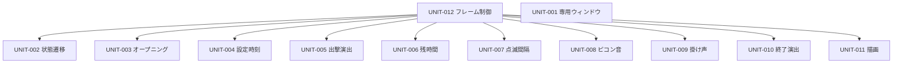
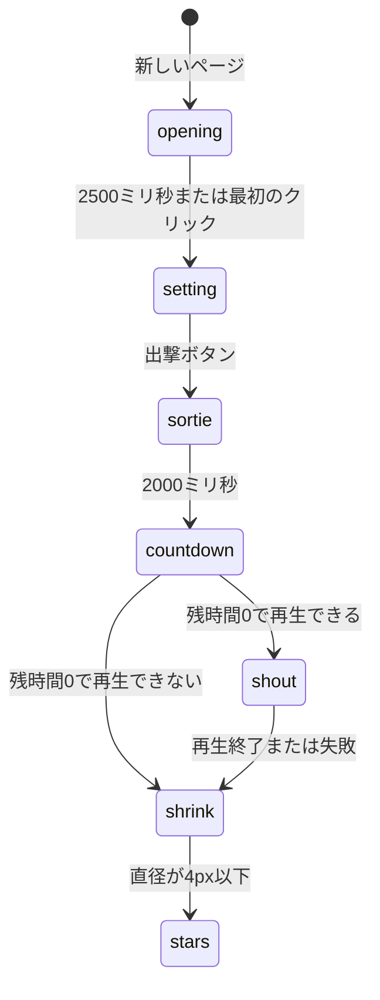
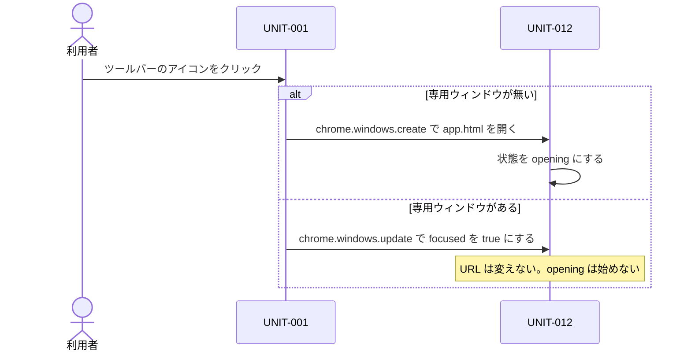
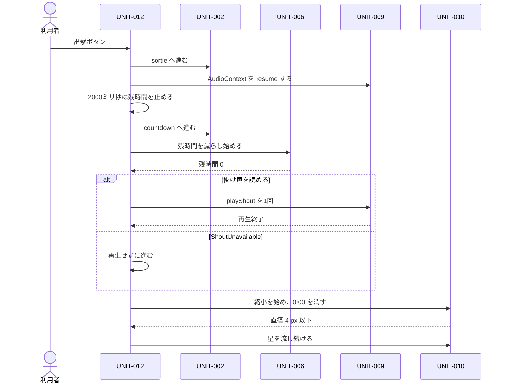

# SW205 ソフトウェアアーキテクチャ設計書

- **文書ID**: SW205
- **プロジェクト名**: ColorBeaconTimer
- **版数**: 0.1
- **最終更新日**: 2026-11-13
- **承認状態**: 未承認

## 1. 概要
### 1.1 目的と位置づけ
本設計書は、承認済みの SW105 版数 1.1 と SWP6 版数 1.0 を、Chrome 拡張機能として実現する構造を定める。
対象は専用ウィンドウと状態遷移である。
タイミング、描画、音、終了演出も対象である。
ファイル構成とユニット分割も対象である。
SW105 に無い機能は追加しない。
禁止名称リストの4文字列は SW105 第1.3節を正とし、本設計書には書き写さない。

### 1.2 適用範囲
実行形態は Google Chrome の拡張機能（Manifest V3）とする。
対応環境は Windows 11 上の最新版 Google Chrome とする。
表示と操作は、chrome.windows で開く専用ウィンドウだけとする。
外部サーバとは通信しない。
専用ウィンドウを閉じると、その実行は終わる。
一時停止、リセット、時刻の保存、通知、アカウントは対象外である。

### 1.3 参照ドキュメント
- `docs/artifacts/SW105_ソフトウェア要求仕様書.md`（版数: 1.1、承認日: 2026-11-13、承認者: Product Owner マサ）
- `docs/artifacts/SWP6_ソフトウェア総合テスト仕様書・報告書.md`（版数: 1.0、承認日: 2026-11-13、承認者: Product Owner マサ）
- `docs/artifacts/TM101_トレーサビリティマトリクス.md`（SW105 版数 1.1、SWP6 版数 1.0）

### 1.4 用語定義
SW105 第1.3節の用語は、本設計書でも同じ意味で使う。
本設計書で追加する用語は次のとおりである。

| 用語 | 定義 |
| :--- | :--- |
| サービスワーカー | Manifest V3 のバックグラウンドスクリプト。アイコンのクリックを受け、専用ウィンドウを開くか前面へ出す。残時間は持たない |
| ViewModel | 1フレームの描画に必要な値の組。状態名、残時間、表示文字列、色、不透明度、地球の直径、星の位置を含む |
| 観測属性 | 専用ウィンドウのルート要素に置く data 属性。自動テストが読む。利用者向けの文言ではない |
| 印 | performance.now() の時点に付ける名前。経過時間は、2つの印の差で測る |

## 2. システム構成
### 2.1 システム全体構成
利用者の PC で、Windows 11 上の最新版 Google Chrome が本拡張機能を読み込む。
サービスワーカーは、ツールバーのアイコンのクリックだけを受ける。
ページ、新しいタブ、アドレスバーの入力では、専用ウィンドウを開かない。
専用ウィンドウのページが、オープニングから星の流れまでを実行する。
ピコン音と掛け声は、そのページの音声出力で再生する。
サービスワーカーはカウントダウンを持たない。
専用ウィンドウを閉じるとページが破棄され、残時間は消える。

### 2.2 主たるソフトウェア要素
言語は JavaScript（ES modules）とする。
バンドラは使わない。
ライブラリは、製品コードには置かない。
理由は、拡張機能をそのまま読み込めて、1日の講座でビルドを増やさないためである。
捨てた選択肢は、TypeScript とバンドラである。
変換手順が増え、Manifest V3 の読み込みとずれるためである。

要素は SW105 第2.2節の5つに対応する。
オープニング、時刻設定、カウントダウンとカラービーコン、音、終了演出である。
内部の分割は第3.2節の UNIT-001 から UNIT-012 とする。

ファイルは次の場所に置く。
Phase 4 が実ファイルを作る。
本設計書はパスを定めるだけで、ソースは置かない。

| パス | 役割 | 対応ユニット |
| :--- | :--- | :--- |
| `extension/manifest.json` | Manifest V3。ポップアップは付けない | UNIT-001 |
| `extension/src/background/window-launcher.js` | アイコンから専用ウィンドウを開くか前面へ出す | UNIT-001 |
| `extension/app.html` | 専用ウィンドウの文書 | UNIT-011 |
| `extension/app.css` | 配置と色 | UNIT-011 |
| `extension/src/domain/app-state.js` | 状態遷移 | UNIT-002 |
| `extension/src/domain/opening-timeline.js` | オープニングの時刻表 | UNIT-003 |
| `extension/src/domain/setting-time.js` | 設定時刻の増減とクランプ | UNIT-004 |
| `extension/src/domain/sortie-timeline.js` | 出撃演出の時刻表 | UNIT-005 |
| `extension/src/domain/remaining-time.js` | 残時間、表示、色の区分 | UNIT-006 |
| `extension/src/domain/blink-interval.js` | 青のフェードと赤の間隔 | UNIT-007 |
| `extension/src/audio/picon-synth.js` | ピコン音の合成 | UNIT-008 |
| `extension/src/audio/shout-player.js` | 掛け声ファイルの再生 | UNIT-009 |
| `extension/src/domain/ending-timeline.js` | 地球の直径と星の位置 | UNIT-010 |
| `extension/src/view/renderer.js` | DOM と Canvas と img への描画 | UNIT-011 |
| `extension/src/app/controller.js` | 1フレームの呼び出し | UNIT-012 |
| `extension/src/app/main.js` | ページの起動。時計と音声を渡す | UNIT-012 |
| `extension/assets/audio/shout.wav` | 開発時に1回生成した掛け声 | UNIT-009 |
| `extension/assets/images/earth.jpg` | 終了演出の地球の写真 | UNIT-010 |
| `extension/assets/SOURCES.md` | 地球以外の同梱ファイルの出典 | UNIT-009 |
| `extension/icons/icon128.png` | 自作の円アイコン。16 と 48 も同じ図 | UNIT-011 |
| `extension/store-listing.txt` | ストア掲載文 | UNIT-011 |
| `tests/unit/` | node:test による純粋関数のテスト | 対象外 |
| `tests/system/` | Playwright による画面と通信のテスト | 対象外 |

## 3. ソフトウェア構成（静的構造）
### 3.1 ソフトウェア全体構成
構造は、純粋な計算と、画面と音の入出力を分ける。
UNIT-002 から UNIT-007 と UNIT-010 は、時刻と数値だけを受け取る。
UNIT-008 と UNIT-009 は、注入された音声ポートだけを呼ぶ。
UNIT-011 は、ViewModel を描く。
UNIT-012 が、時計と音声ポートと描画先を受け取り、1フレームで各ユニットを呼ぶ。
UNIT-001 は別プロセスのサービスワーカーであり、ページのユニットを呼ばない。
依存の矢印は、呼ぶ側から呼ばれる側へ向く。

### 3.2 機能ユニットの定義

#### UNIT-001: 専用ウィンドウの起動
- **責務**: ツールバーのアイコンで専用ウィンドウを1つ開き、既にあれば前面へ出す。
- **対応要求**: REQ-001, REQ-002, REQ-003, REQ-004, REQ-005, REQ-007
- **公開インターフェース**: `openOrFocus(windowsApi, sessionStore)` を公開する。戻り値は `opened` または `focused`。失敗時は `WindowOpenFailed`。
- **依存先**: なし
- **検証条件**: ウィンドウが無いときの1回のクリックで、app.html のウィンドウが1つ開く。2回目は増えない。前面に出る。ページは再読み込みされない。ページ、新しいタブ、アドレスバーでは開かない。閉じたあと、残時間も変えた設定時刻も残らない。

#### UNIT-002: 画面状態の遷移
- **責務**: 現在の状態とイベントから、次の状態を1つ返す。
- **対応要求**: REQ-001, REQ-003, REQ-005, REQ-007
- **公開インターフェース**: `nextState(state, event)` を公開する。戻り値は次の状態名。未知のイベントは現在の状態を返す。
- **依存先**: なし
- **検証条件**: 新しいページの初期状態は opening である。opening は最初の click または 2500 ミリ秒で setting になる。setting は sortie ボタンで sortie になる。sortie は 2000 ミリ秒で countdown になる。countdown は残時間 0 で、再生できるなら shout、できないなら shrink になる。shout は再生終了で shrink になる。shrink は直径 4 px 以下で stars になる。stars から setting へは戻らない。

#### UNIT-003: オープニングの時刻表
- **責務**: オープニング開始からの経過ミリ秒を、表示ステップへ変換する。
- **対応要求**: REQ-001
- **公開インターフェース**: `openingStep(elapsedMs)` を公開する。戻り値の名前は検証条件の各文と同じである。引数が 2500 以上のときは done。
- **依存先**: なし
- **検証条件**: 0 以上 700 未満は toilet。700 以上 1100 未満は shake。1100 以上 1500 未満は face1。1500 以上 1900 未満は face2。1900 以上 2300 未満は face3。2300 以上 2500 未満は expand。2500 以上は done。クリックの打ち切りは UNIT-002 が行う。

#### UNIT-004: 設定時刻
- **責務**: 設定時刻を 1000 ミリ秒単位で変え、10000 から 300000 の外へ出さない。
- **対応要求**: REQ-002
- **公開インターフェース**: `adjustSetting(currentMs, deltaMs)` を公開する。戻り値はクランプ後のミリ秒。保存用の関数は持たない。
- **依存先**: なし
- **検証条件**: 初期値は 180000。180000 に 1000 を足すと 181000。180000 から 1000 を引くと 179000。10000 から 1000 を引くと 10000。300000 に 1000 を足すと 300000。

#### UNIT-005: 出撃演出の時刻表
- **責務**: 出撃演出開始からの経過ミリ秒を、映像ステップへ変換する。
- **対応要求**: REQ-003
- **公開インターフェース**: `sortieStep(elapsedMs)` を公開する。戻り値は spread、approach、land、done のいずれか。
- **依存先**: なし
- **検証条件**: 0 以上 700 未満は spread。700 以上 1400 未満は approach。1400 以上 2000 未満は land。2000 以上は done。ボタン入力を捨てる判定は UNIT-002 の sortie 中の無視である。

#### UNIT-006: 残時間と表示と色区分
- **責務**: 残時間のミリ秒から、表示文字列と色の区分を計算する。
- **対応要求**: REQ-004, REQ-005
- **公開インターフェース**: `remainingMs(startMs, elapsedMs)`、`formatRemaining(ms)`、`beaconZone(ms)` を公開する。負の経過は 0 として扱う。
- **依存先**: なし
- **検証条件**: 残時間は startMs から elapsedMs を引いた値であり、0 未満にはしない。1000 の倍数はその秒を表示する。1000 は 0:01。1001 は 0:02。119999 は 2:00。120000 は 2:00。120001 は 2:01。60000 は 1:00。60001 は 1:01。区分は、120000 より大きいとき blue-solid、60000 より大きく 120000 以下のとき blue-blink、0 より大きく 60000 以下のとき red-blink、0 のとき zero である。

#### UNIT-007: 点滅間隔
- **責務**: 青のフェード時間と、赤の点滅間隔を、点滅の開始時に計算する。
- **対応要求**: REQ-004
- **公開インターフェース**: `bluePhase(elapsedInCycleMs)` と `redIntervalSec(remainingMs)` を公開する。計算後に残時間が変わっても、呼んだ側が値を保持する。
- **依存先**: なし
- **検証条件**: 青の1周期は fade-out 1000 ミリ秒のあと fade-in 1000 ミリ秒である。合計は 2000 ミリ秒である。合計には別の許容誤差を置かない。合否は各 1000 ミリ秒の ±0.1 秒である。赤の間隔[秒]は max(残時間[秒] / 60, 0.33) である。残時間[秒]は残時間[ミリ秒] / 1000 である。60000 ミリ秒の値は 1 秒。30000 ミリ秒の値は 0.5 秒。20000 ミリ秒の値は 20/60 秒。19800 ミリ秒以下の値は 0.33 秒である。

#### UNIT-008: ピコン音
- **責務**: ピコン音を、注入された AudioContext の正弦波で1回鳴らす。
- **対応要求**: REQ-004, REQ-006
- **公開インターフェース**: `playPicon(audioCtx, startMs)` を公開する。周波数は 880 Hz。長さは 80 ミリ秒。audioCtx が閉じているときは `AudioUnavailable` を返す。
- **依存先**: なし
- **検証条件**: 出力は oscillator の正弦波である。音声ファイルは読まない。人の声の録音は再生しない。通信しない。青では明るさが最大の時点で1回鳴る。赤では点滅の開始時に1回鳴る。

#### UNIT-009: 掛け声の再生
- **責務**: 保存済みの掛け声ファイルを1回再生し、読めないときは失敗を返す。
- **対応要求**: REQ-005, REQ-006
- **公開インターフェース**: `loadShout(readFile)` と `playShout(audioCtx, buffer, whenMs)` を公開する。読込失敗または再生失敗は `ShoutUnavailable`。
- **依存先**: なし
- **検証条件**: 成功時に再生するのは extension/assets/audio/shout.wav のバイト列だけである。実行時に音声合成しない。speechSynthesis は呼ばない。通信しない。失敗時は例外をページの外へ出さず、ShoutUnavailable を返す。

#### UNIT-010: 終了演出の計算
- **責務**: 縮小開始からの経過ミリ秒で地球の直径を計算し、その後の星の位置を計算する。
- **対応要求**: REQ-006, REQ-007
- **公開インターフェース**: `earthDiameterPx(elapsedMs)` と `starPositions(elapsedMs, random01)` を公開する。random01 は 0 以上 1 未満の乱数関数として注入する。
- **依存先**: なし
- **検証条件**: 直径は 240 px から 4 px へ、5000 ミリ秒で直線的に減る。5000 ミリ秒未満では、後の値の方が小さい。5000 ミリ秒で 4 px になり、その後も 4 px である。星は中心から外へ向かう。設定画面へ戻す値は返さない。

#### UNIT-011: 描画
- **責務**: ViewModel を専用ウィンドウの DOM、Canvas、img へ描く。
- **対応要求**: REQ-001, REQ-003, REQ-004, REQ-006, REQ-007
- **公開インターフェース**: `render(viewModel, dom)` を公開する。未知の状態名は描かず、`UnknownState` を返す。
- **依存先**: なし
- **検証条件**: 署名の文字は DOM の `#signature` に置く。出撃ボタンの文字は `#sortie` に置く。時刻は `#time` に置く。地球は `#earth` の img である。禁止名称リストの文字列は描かない。「公認」と「公式」は描かない。一時停止とリセットのボタンは作らない。

#### UNIT-012: フレーム制御
- **責務**: 1フレームごとに計算ユニットを呼び、音と描画へ結果を渡す。
- **対応要求**: REQ-001, REQ-002, REQ-003, REQ-004, REQ-005, REQ-007
- **公開インターフェース**: `createController(clock, audioPort, view, scheduler)` を公開する。clock.nowMs はミリ秒。失敗した掛け声は終了演出へ進む。
- **依存先**: UNIT-002, UNIT-003, UNIT-004, UNIT-005, UNIT-006, UNIT-007, UNIT-008, UNIT-009, UNIT-010, UNIT-011
- **検証条件**: 出撃演出のあいだ残時間は減らない。カウントダウン開始後は 1 本だけ減る。＋の長押しは、押下時点と、その後 300 ミリ秒ごとである。1000 ミリ秒の押下では adjustSetting が 2 回以上呼ばれる。残時間 0 の打ち切り点滅は、実測を待たずに shout または shrink へ進む。外部 URL は呼ばない。

## 4. 制御方式（動的振る舞いとリソース割り当て）
### 4.1 メモリ構成とレイアウト
メモリマップの指定は対象外である。
理由は、本ソフトウェアが組込み機器ではなく、Chrome のページ内ヒープだけで動くためである。
残時間、設定時刻、状態名はページの変数だけが持つ。
chrome.storage.session に書くのは、開いている専用ウィンドウの windowId だけである。
残時間と設定時刻は書かない。
chrome.storage.local と chrome.storage.sync は使わない。
サービスワーカーは chrome.alarms を作らない。
専用ウィンドウを閉じると、ページの変数は破棄される。

### 4.2 ソフトウェア制御方式
ページは単一のスレッドで、requestAnimationFrame ごとに UNIT-012 を1回呼ぶ。
並行するワーカーは置かない。
時刻の基準は、注入された clock.nowMs である。
製品では performance.now() を渡す。
アニメーションの進みは、フレーム枚数ではなく、印からの経過ミリ秒で決める。
遅れたフレームの次の値は、その時点の経過から計算する。
専用ウィンドウを閉じたときの遷移は、ページの破棄である。
次に開くページの初期状態は、常に opening である。

状態名と、SW105 第5.1節の画面状態の対応は次のとおりである。

| 内部状態 | SW105 の画面状態 | 残時間の表示 |
| :--- | :--- | :--- |
| opening | オープニング | 出さない |
| setting | 設定 | 設定時刻を出す |
| sortie | 出撃演出中 | 設定時刻のまま。減らさない |
| countdown | カウントダウン | formatRemaining の文字列 |
| shout | カウントダウン | 0:00 を出す |
| shrink | 終了演出 | 出さない |
| stars | 終了演出 | 出さない |

opening のクリックは、そのページの最初の1回だけをスキップに使う。
sortie と countdown では、＋、−、出撃ボタンが見えていても、UNIT-002 が入力を捨てる。
設定時刻は変わらない。
出撃演出は最初からやり直さない。
カウントダウンは2本目を始めない。
一時停止ボタンとリセットボタンは、HTML に置かない。
shrink と stars では、設定画面へ戻すイベントを定義しない。

赤の点滅は、各点滅の開始時にだけ redIntervalSec を呼ぶ。
その戻り値を、その点滅が終わるまで保持する。
次の点滅の開始時に、その時点の残時間で再計算する。
残時間が 0 になり、保持中の間隔が終わる前なら、その点滅を打ち切る。
打ち切った点滅は、開始時の計算値だけを観測属性へ残す。
実測の合否には使わない。
青の点滅へ入った時点の明るさは最大である。
その時点でピコン音を1回鳴らす。
その後は、fade-in が終わって明るさが最大になった時点で1回鳴らす。
同じ時刻に2回は鳴らさない。
青の開始時刻のピコンと、直前の fade-in 完了のピコンは、同じ1回である。
最初の入場だけは、直前の fade-in が無いので、入場時の1回だけを鳴らす。

地球の縮小を始めたフレームで、`#time` を非表示にする。
以降の shrink と stars では、0:00 を再び出さない。
星は、直径が 4 px 以下になったフレームから、ウィンドウを閉じるまで Canvas に描く。

専用ウィンドウの起動と前面化の流れは次のとおりである。

出撃から星の流れまでの流れは次のとおりである。

chrome.windows.create の url は app.html である。
type は popup である。
width は 480、height は 720 である。
focused は true である。
既に windowId があるときは、url を渡さずに focused を true にする。
url を渡すと再読み込みになり、opening が始まるためである。
windowId は chrome.storage.session のキー windowId に置く。
windows.onRemoved でそのキーを消す。
manifest の action に default_popup は置かない。
default_popup があると、アイコンのクリックがサービスワーカーへ届かないためである。
permissions は storage だけとする。
host_permissions は空とする。

配置は、幅 480 px、高さ 720 px の縦画面とする。
中央上に直径 160 px のカラービーコンを置く。
その下に時刻を置く。
設定と出撃演出中とカウントダウンでは、三つのボタンを時刻の下に置く。
三つのボタンは、＋と − と出撃ボタンである。
出撃ボタンは円形で、ラベルは「ジュワッチ！」とする。
オープニング、縮小、星の流れでは、ボタンを出さない。
オープニングの署名「アール・マット」は、便器の線画のあいだだけ `#signature` に出す。
年は出さない。

オープニングの線画と三つの顔と出撃演出と星は、`#stage` の Canvas 2D に描く。
文字は Canvas に描かない。
地球は `#earth` の img に、パッケージ内の写真を出す。
写真の表示サイズは earthDiameterPx の正方形とする。
直径の観測は、getBoundingClientRect() の幅と高さのうち大きい方である。
正方形なので、幅と高さは同じ値になる。

色は次のとおりとする。
合否は色名で判定する。
RGB の値自体は SW105 の合否対象外である。

| 色名 | CSS | 用途 |
| :--- | :--- | :--- |
| 青 | `#1a5cff` | blue-solid と blue-blink |
| 赤 | `#ff2a2a` | red-blink |
| 消灯 | opacity 0 | 赤の間隔の後半、終了演出 |

赤の1間隔のうち、前半は点灯、後半は消灯とする。
この比率は SW105 の合否対象外である。
理由は、点滅として見え、合否は間隔の実測だからである。
青の不透明度は、fade-out では 1 から 0 へ、fade-in では 0 から 1 へ、経過に比例して変わる。

オープニングの揺れは 3 回、中心から左右へ 8 度とする。
回数と角度は SW105 の合否対象外である。
SWP6 の TC-014 が、角度と回数を合否に使わないためである。
顔の順は face1、face2、face3 である。
face1 は線の人の顔、face2 は点と線の模様、face3 は青い丸いランプである。
便器と三面の存在に、白黒の縦縞は描かない。
便器は座標の線で描き、写真は読み込まない。

＋または − の pointerdown で、adjustSetting を1回呼ぶ。
押しているあいだは 300 ミリ秒ごとに同じ方向でもう1回呼ぶ。
pointerup で繰り返すのを止める。
300 ミリ秒は、1000 ミリ秒の押下で 2 回以上変わるための設計値である。
SW105 は繰り返し間隔の数値を持たない。
合否は、TC-019 の「2回以上」と上限 5:00 である。

### 4.3 性能見積り
目標値は SW105 第6.1節と同じである。
見積りは、Windows 11 の最新版 Google Chrome で、専用ウィンドウ 1 枚を対象とする。
進みが経過ミリ秒に従うため、フレーム落ちは総時間を延ばさない。
1フレームの描画は、Canvas 1 枚、img 1 枚、DOM 文字数箇所である。
デスクトップの Chrome では、1フレームは 16 ミリ秒前後に収まる。
許容誤差 ±0.1 秒は 100 ミリ秒であり、1フレームより大きい。
したがって、次の目標は設計の時刻表のまま達成できる。

| 項目 | 設計値 | 要求の範囲 | 対応要求 |
| :--- | :--- | :--- | :--- |
| オープニング完走 | 2500 ミリ秒 | 2秒以上 3秒以下 | REQ-001 |
| 出撃演出 | 2000 ミリ秒 | 2秒、許容誤差 ±0.1秒 | REQ-003 |
| 青の fade-out | 1000 ミリ秒 | 1秒、許容誤差 ±0.1秒 | REQ-004 |
| 青の fade-in | 1000 ミリ秒 | 1秒、許容誤差 ±0.1秒 | REQ-004 |
| 赤の間隔 | 開始時の式の値 | 式の値に対して ±0.1秒 | REQ-004 |
| 時刻表示の減り | 1000 ミリ秒ごと | 1秒、許容誤差 ±0.2秒 | REQ-004 |
| 地球が 4 px 以下になるまで | 5000 ミリ秒 | 5秒、許容誤差 ±0.1秒 | REQ-007 |

残時間 0 より前に終わる赤の点滅の実測は、0.23 秒より短くしない。
下限 0.33 秒と許容誤差 ±0.1 秒の下側が 0.23 秒であるためである。
残時間 0 で打ち切られた点滅は、この実測の対象外である。

## 5. 機能ユニット詳細
UNIT-012 が各ユニットへ渡す値と、描画が読む ViewModel をここに固定する。
第3.2節の公開インターフェースは、この節の型で実装する。

clock は `{ nowMs(): number }` である。
scheduler は `{ set(fn, ms): id, clear(id) }` である。
製品の scheduler は setTimeout と clearTimeout である。
audioPort は `{ resume(), playPicon(), loadShout(), playShout() }` である。
loadShout の失敗は ShoutUnavailable である。
view は `{ render(viewModel) }` である。

ViewModel のフィールドは次のとおりである。

| フィールド | 型 | 意味 |
| :--- | :--- | :--- |
| state | 文字列 | opening、setting、sortie、countdown、shout、shrink、stars |
| settingMs | 数 | 設定時刻。単位はミリ秒 |
| remainingMs | 数 | 残時間。単位はミリ秒。opening と setting と sortie では settingMs と同じ |
| displayTime | 文字列 | `#time` の文字。非表示のときは空文字 |
| timeVisible | 真偽 | false のとき `#time` を隠す |
| beaconColor | 文字列 | blue、red、off |
| beaconOpacity | 数 | 0 以上 1 以下 |
| openingStep | 文字列 | toilet から expand。opening 以外は空文字 |
| sortieStep | 文字列 | spread、approach、land。sortie 以外は空文字 |
| earthDiameterPx | 数 | shrink のとき 240 から 4。shrink 以外の状態では 0 |
| stars | 配列 | stars のとき、中心からの位置。単位は px |
| buttonsVisible | 真偽 | setting と sortie と countdown のとき true |

観測属性は、ルート要素 `#app` に毎フレーム書く。
自動テストは、この属性と DOM の textContent を読む。
属性は利用者向けの文言ではない。

| 属性 | 内容 |
| :--- | :--- |
| data-state | ViewModel.state |
| data-remaining-ms | remainingMs の整数 |
| data-setting-ms | settingMs の整数 |
| data-display-time | displayTime |
| data-time-visible | true または false |
| data-beacon-color | beaconColor |
| data-beacon-opacity | beaconOpacity |
| data-earth-diameter-px | `#earth` の表示直径。単位は px |
| data-shout-url | 読み込んだ掛け声の拡張機能内 URL。失敗時は空文字 |
| data-blink-log | 点滅ごとの開始残時間、計算間隔、実測、打ち切りフラグの JSON |
| data-marks | 印の名前と performance.now() の JSON |

印の名前は次のとおりである。

| 印 | 付ける時点 |
| :--- | :--- |
| opening-shown | オープニングの最初の画面を出した |
| setting-shown | 設定画面を出した |
| sortie-started | 出撃演出中になった |
| countdown-started | 残時間の減少を始めた |
| blink-started | 点滅を1回始めた |
| shout-started | 掛け声の再生を始めた |
| shrink-started | 地球の縮小を始め、0:00 を消した |
| point-reached | 直径が 4 px 以下になった |
| stars-started | 星の流れを始めた |

data-blink-log の1件は、startRemainingMs、intervalMs、measuredMs、truncated を持つ。
truncated が true のとき、measuredMs は null である。
青の1件は、phase が fade-out または fade-in であり、plannedMs は 1000 である。

ファイル先頭のコメントには、対応する UNIT-ID を書く。
Phase 4 の実装が、そのコメントを付ける。

## 6. システムで扱うデータ
実行時に永続化するデータは、windowId だけである。
キー名は windowId。
置き場は chrome.storage.session。
ウィンドウを閉じたときに削除する。
データベースは使わない。

設計定数は次のとおりである。
実装は、この表の値を1か所に書く。
各ユニットはその定数を参照する。

| 名前 | 値 | 単位 | 根拠 |
| :--- | :--- | :--- | :--- |
| OPENING_MS | 2500 | ミリ秒 | REQ-001 の 2秒以上 3秒以下の内側 |
| SORTIE_MS | 2000 | ミリ秒 | REQ-003 |
| BLUE_PHASE_MS | 1000 | ミリ秒 | REQ-004 のフェードアウトとフェードイン |
| RED_FLOOR_SEC | 0.33 | 秒 | REQ-004 の式の下限 |
| ZONE_BLUE_BLINK_MS | 120000 | ミリ秒 | この値以下かつ 60000 より大きいとき青点滅 |
| ZONE_RED_MS | 60000 | ミリ秒 | この値以下のとき赤 |
| SETTING_INITIAL_MS | 180000 | ミリ秒 | 3:00 |
| SETTING_MIN_MS | 10000 | ミリ秒 | 0:10 |
| SETTING_MAX_MS | 300000 | ミリ秒 | 5:00 |
| SETTING_STEP_MS | 1000 | ミリ秒 | 1秒 |
| HOLD_REPEAT_MS | 300 | ミリ秒 | 1000 ミリ秒の押下で 2回以上変わる設計値 |
| EARTH_SHRINK_MS | 5000 | ミリ秒 | REQ-007 |
| EARTH_START_PX | 240 | px | 窓の幅 480 px の半分 |
| EARTH_POINT_PX | 4 | px | REQ-007 |
| WINDOW_W | 480 | px | 専用ウィンドウの幅 |
| WINDOW_H | 720 | px | 専用ウィンドウの高さ |
| PICON_HZ | 880 | Hz | 正弦波の周波数。合否対象外 |
| PICON_MS | 80 | ミリ秒 | 正弦波の長さ。合否対象外 |

同梱ファイルの出典は、次の2か所に分ける。
地球の写真の出典とライセンスの本文は、README の見出し「クレジット」だけに書く。
他のファイルへ、その本文を複製しない。
理由は、SWP6 の TC-056 が、地球の出典の場所をその節だけに限るためである。
地球以外の画像と音声は、`extension/assets/SOURCES.md` に1ファイル1行で書く。
TC-052 は、各ファイルに出典があることを、このファイルと README のクレジット節から読む。

SOURCES.md の列は、ファイル、種別、出典、である。
種別は画像または音声である。
出典が自作のときは、出典欄を「自作」とする。
自作でないときは、作品名と入手元とライセンス名を書く。
禁止名称リストの作品とキャラクタを出典にしてはならない。
文字列の照合は、実施時に SW105 第1.3節を読む。
地球の行には、ファイル名と「出典本文は README の見出しクレジット」だけを書く。
その行に、ライセンス名、権利者名、URL は書かない。

アイコンは自作の青い円とする。
便器と顔は、画像ファイルにしない。
出撃演出と星は、Canvas の座標で描く。
したがって、画像ファイルは地球の写真とアイコンだけである。
音声ファイルは shout.wav だけである。
ピコン音のファイルは置かない。

ストア掲載文 `extension/store-listing.txt` と、manifest の description は、次の1文とする。
「ColorBeaconTimer は、残時間に応じて色と点滅と音が変わるカウントダウンタイマーです。」
manifest の name は ColorBeaconTimer とする。
「公認」と「公式」は、掲載文にも画面にも使わない。

掛け声の生成記録は次のとおりである。
TC-047 は、本節の3点を読む。

1. 掛け声ファイルは、開発時に音声合成で1回だけ生成して保存する。
2. 人の声の録音ではない。
3. エンジンと声の利用許諾は、生成した音声ファイルの再配布を許す。

実行時は、保存したファイルを1回再生する。
実行のたびに合成し直さない。
speechSynthesis は使わない。
再生に通信は使わない。
エンジンのプログラムは、拡張機能に同梱しない。
2026-11-13 の時点では、wav は未生成である。
Phase 4 で1回生成したあと、次の表の生成日へ日付を記入する。
具体的なエンジンの採用は、第8章のオープンクエスチョン OQ-1 とする。

| 項目 | 内容 |
| :--- | :--- |
| 方式 | 開発時に音声合成で1回だけ生成して保存する |
| 人の声の録音 | 使わない |
| 保存先 | `extension/assets/audio/shout.wav` |
| 実行時 | 保存ファイルを1回再生する。再合成しない。通信しない |
| 生成日 | 未生成。Phase 4 で1回生成した日を記入する |
| 採用エンジン | 未採用。OQ-1 で Product Owner が Phase 4 開始前に決定する |
| 再配布 | 生成した音声ファイルの再配布を許す利用許諾に限る |

## 7. 例外・異常処理一覧

| # | 異常ケース | 検知方法 | リカバリ手順 | 対応要求 |
| :--- | :--- | :--- | :--- | :--- |
| 1 | オープニング中の最初のクリック | opening 中の pointerdown | 残りの時刻表を捨て、setting へ移る | REQ-001 |
| 2 | オープニング中にクリックが無い | elapsed が 2500 ミリ秒以上 | 最後まで再生し、setting へ移る | REQ-001 |
| 3 | オープニング中にウィンドウを閉じた | windows.onRemoved | ページを破棄する。残時間は保存しない。次は opening | REQ-001 |
| 4 | 設定時刻 0:10 で − | adjustSetting の下限 | 10000 ミリ秒のまま返す | REQ-002 |
| 5 | 設定時刻 5:00 で ＋ | adjustSetting の上限 | 300000 ミリ秒のまま返す | REQ-002 |
| 6 | 設定中にウィンドウを閉じた | windows.onRemoved | ページを破棄する。変えた時刻は残らない。次は opening | REQ-002 |
| 7 | 出撃演出中の ＋、−、出撃 | state が sortie | 入力を捨てる。演出はやり直さない。設定時刻は変えない | REQ-003 |
| 8 | カウントダウン中の ＋、−、出撃 | state が countdown | 入力を捨てる。減少は止めない。2本目は始めない | REQ-003 |
| 9 | 一時停止またはリセット | ボタン要素の不在 | 要素が無いので操作できない | REQ-003 |
| 10 | 出撃演出中またはカウントダウン中に閉じた | windows.onRemoved | ページを破棄する。続きは保存しない。次は opening | REQ-003 |
| 11 | 残時間が区分の境界をまたいだ | beaconZone の変化 | そのミリ秒の区分へ切り替える。赤の最初の間隔はその時点で計算する | REQ-004 |
| 12 | 色または点滅を選ぶ操作 | 選択用要素の不在 | 要素が無い。色は残時間のミリ秒だけで決まる | REQ-004 |
| 13 | 点滅中にウィンドウを閉じた | windows.onRemoved | ページを破棄する。次は opening | REQ-004 |
| 14 | 掛け声ファイルを再生できない | loadShout または playShout の ShoutUnavailable | 残時間 0 で止め、shrink へ進む。縮小開始で 0:00 を消す。残時間は増やさない | REQ-005 |
| 15 | 掛け声中または終了演出中に閉じた | windows.onRemoved | ページを破棄する。設定画面へは戻さない。星の続きは保存しない | REQ-005 |
| 16 | 禁止名称、禁止素材、「公認」、「公式」の混入 | 実行時の自動検査はしない | 公開前に Product Owner が取り除く。手順は SW105 第7章 | REQ-006 |
| 17 | 実行時に外部から素材を取ろうとする経路 | 製品コードに fetch、XHR、WebSocket が無いこと | 経路を作らない。素材はパッケージ内だけを読む | REQ-006 |
| 18 | 掛け声が無くても終了演出を始める必要がある | 残時間 0 かつ ShoutUnavailable | shrink を始め、その時点で 0:00 を消す | REQ-007 |

## 8. その他・特記事項
### 8.1 アーキテクチャ決定記録（ADR）

#### ADR-001: 製品コードは JavaScript の ES modules とし、バンドラを使わない
- **背景**: SW105 第3.2節は、言語とライブラリを SW205 で定める。
- **決定**: 製品は JavaScript の ES modules とする。バンドラとフレームワークは使わない。
- **理由**: Manifest V3 のディレクトリを、そのまま Chrome へ読み込める。講座の1日に変換手順を足さない。
- **捨てた選択肢**: TypeScript。型は設計の表で足りる。変換が Chrome の読み込みとずれる。

#### ADR-002: 自動テストは node:test と Playwright を分ける
- **背景**: SWP6 第2.2節のテストフレームワークは、Phase 3 で確定する。
- **決定**: 純粋関数は Node.js 標準の node:test で呼ぶ。画面、時刻、通信は Playwright で見る。Playwright の channel は chrome とする。
- **理由**: 計算はブラウザ無しで再現できる。画面の合格条件は、最新版 Google Chrome で観測する必要がある。Playwright 同梱の Chromium は、その Chrome ではない。
- **捨てた選択肢**: すべてを Playwright に寄せる案。式の四点を実時刻の1ミリ秒に当てるのが不安定である。すべてを node:test に寄せる案。専用ウィンドウを開けない。

#### ADR-003: アニメーションは経過ミリ秒で進める
- **背景**: 許容誤差が ±0.1 秒の項目と、±0.2 秒の表示更新がある。
- **決定**: フレーム枚数ではなく、clock.nowMs の差でステップを決める。
- **理由**: フレームが遅れても、次の値は経過時刻から計算できる。総時間がフレーム数に比例して伸びない。
- **捨てた選択肢**: setInterval の回数で進める案。負荷で間隔が伸び、許容誤差を外す。

#### ADR-004: 文字は DOM、演出は Canvas、地球は img
- **背景**: テストは文字、色名、地球の直径 px を観測する。演出は線と星である。
- **決定**: 署名、時刻、ボタン文字は DOM に置く。オープニング、出撃演出、星は Canvas 2D に描く。地球は img の正方形とする。
- **理由**: textContent で文字を読める。getBoundingClientRect() で直径を測れる。星の本数を DOM 要素にしない。
- **捨てた選択肢**: すべて Canvas。文字の読み取りが画像判定になる。すべて DOM。星の要素数が毎フレーム増える。

#### ADR-005: ピコンは実行時に合成し、掛け声は保存ファイルを AudioContext で再生する
- **背景**: SW105 は、ピコンを合成と定め、掛け声を開発時の1回の音声合成ファイルと定める。
- **決定**: ピコンは AudioContext の正弦波 880 Hz、80 ミリ秒とする。掛け声は shout.wav をデコードし、同じ AudioContext の BufferSource で1回再生する。出撃ボタンの押下で resume する。
- **理由**: 出撃の操作で音声を解禁すれば、数分後の再生も同じコンテキストで開始できる。HTMLAudioElement の遅延した play は、操作から時間が経つとブラウザが拒むことがある。
- **捨てた選択肢**: 掛け声を speechSynthesis で毎回合成する案。SW105 が、実行時の再合成と通信を禁止している。ピコンを音声ファイルにする案。SW105 が合成と定めている。

#### ADR-006: 保存するのは専用ウィンドウの ID だけとする
- **背景**: サービスワーカーは再起動する。再起動後も、既に開いたウィンドウを前面へ出す必要がある。時刻の保存はスコープ外である。
- **決定**: chrome.storage.session に windowId だけを書く。閉じたら消す。残時間は書かない。
- **理由**: session はブラウザを終了すると消える。ウィンドウを閉じた時点でもキーを消すので、次のクリックは新しいページになる。
- **捨てた選択肢**: 変数だけに持つ案。サービスワーカーの再起動で ID を失い、ウィンドウが2つ開く。chrome.storage.local に残時間を書く案。SW105 の対象外である時刻の保存になる。

#### ADR-007: 再生できない掛け声は、ファイルを消した複製で作る
- **背景**: SWP6 の TC-050 と TC-063 は、再生できない状態の作り方を Phase 3 で確定する。
- **決定**: テストは拡張機能ディレクトリを複製し、shout.wav を削除して、その複製を読み込む。製品コードは、読込失敗を ShoutUnavailable として shrink へ進む。
- **理由**: 製品に試験用のスイッチを足さなくてよい。SW105 の異常系は、ファイルを再生できない場合の振る舞いである。
- **捨てた選択肢**: URL クエリで再生をスキップする案。利用者の起動経路に、要求に無い分岐が増える。

### 8.2 SWP6のTBD解消
SWP6 第2.2節と、TC-050 と TC-063 の作り方を、次のとおり確定した。
期待値の数値は変えていない。
同じ内容を SWP6 の該当セルへ記入した。

| SWP6のTBD項目 | 確定内容 |
| :--- | :--- |
| テストフレームワーク | 純粋関数は node:test。画面と時刻と通信は Playwright。channel は chrome |
| 残時間ミリ秒の読み取り | `#app` の data-remaining-ms。表示文字は `#time` の textContent。1000、1001、119999、60001 の表示は formatRemaining を node:test で呼ぶ。描画は formatRemaining 以外で時刻文字を作らない |
| 経過時間の計測 | 第5節の印の performance.now() の差。開始点と終了点は各 TC のシナリオに従う |
| 画面上の直径の計測 | `#earth` の getBoundingClientRect() の幅と高さのうち大きい方。単位は px。data-earth-diameter-px に同じ値を書く |
| 音声ファイルの同一性 | data-shout-url から読んだバイト列と、パッケージ内の shout.wav を比較する。実行時に合成した音声は不合格 |
| 通信の有無 | Playwright の request のうち、scheme が http または https の件数。0 件が合格 |
| 掛け声を再生できない状態 | 拡張機能の複製から shout.wav を削除して読み込む。TC-050 と TC-063 |

自動テストと観測口の対応は次のとおりである。
手動テストは、AI が最新版 Google Chrome の専用ウィンドウを見て、音を聴いて、期待値の文字または数値と照合する。

| 観測口 | 自動テスト |
| :--- | :--- |
| ウィンドウ数と focused | TC-001, TC-002, TC-065 |
| data-state と印 | TC-003, TC-004, TC-006, TC-007, TC-013, TC-022, TC-023, TC-026, TC-043, TC-049, TC-062 |
| textContent とファイル名 | TC-008, TC-009, TC-015, TC-016, TC-017, TC-018, TC-019, TC-020, TC-021, TC-025, TC-048, TC-051, TC-055 |
| ボタン要素の不在 | TC-024, TC-044 |
| data-remaining-ms の減少 | TC-027, TC-064 |
| data-blink-log | TC-031, TC-032, TC-034, TC-040, TC-042 |
| node:test の純粋関数 | TC-033, TC-037, TC-038 |
| バイト列と http(s) の件数 | TC-046, TC-054, TC-058 |
| 本設計書の第6節 | TC-047 |
| 複製から shout.wav を削除 | TC-050, TC-063 |
| SOURCES.md と README のクレジット節 | TC-052, TC-056 |
| data-earth-diameter-px と timeVisible | TC-059, TC-060 |

手動の顔と線画は TC-005、TC-010、TC-011、TC-012、TC-014 である。
手動の出撃演出は TC-028、TC-029、TC-030 である。
手動の色と点滅は TC-035、TC-036、TC-039、TC-041 である。
手動の音と星は TC-045、TC-053、TC-057、TC-061 である。
TC-012 が読む `docs/process/po_visual_judgment.md` は、Product Owner マサの記録である。
本設計では、そのファイルを作らない。

### 8.3 トレーサビリティ表（REQ ↔ UNIT）

| 要求ID (SW105) | 対応設計ユニットID |
| :--- | :--- |
| REQ-001 | UNIT-001, UNIT-002, UNIT-003, UNIT-011, UNIT-012 |
| REQ-002 | UNIT-001, UNIT-004, UNIT-012 |
| REQ-003 | UNIT-001, UNIT-002, UNIT-005, UNIT-011, UNIT-012 |
| REQ-004 | UNIT-001, UNIT-006, UNIT-007, UNIT-008, UNIT-011, UNIT-012 |
| REQ-005 | UNIT-001, UNIT-002, UNIT-006, UNIT-009, UNIT-012 |
| REQ-006 | UNIT-008, UNIT-009, UNIT-010, UNIT-011 |
| REQ-007 | UNIT-001, UNIT-002, UNIT-010, UNIT-011, UNIT-012 |

**オープンクエスチョン**

実際のファイルを選ぶ項目は、ここで止める。
Product Owner が Phase 4 の実装開始前に決定する。
決定までは、地球の写真と掛け声の wav をリポジトリへ置かない。
推奨案を却下する場合も、SW105 のライセンス条件と、第6節の3点は変えない。

| ID | 決めること | 推奨案 | 決定者と時期 |
| :--- | :--- | :--- | :--- |
| OQ-1 | 掛け声の音声合成エンジンと話者 | VOICEVOX の四国めたん（ノーマル）で「ジュワッ！」を1回合成し、wav だけを保存する。ソフトウェアは同梱しない。クレジットは「VOICEVOX:四国めたん」とし、README の見出し「クレジット」に書く | Product Owner が Phase 4 開始前に決定する |
| OQ-2 | 終了演出の地球の写真 | NASA Visible Earth の画像 54388「Earth - The Blue Marble」（2000-04-26）。パブリックドメイン。記章とロゴが写っていないファイルだけを使う | Product Owner が Phase 4 開始前に決定する |

OQ-1 の確認結果は、2026-11-13 に次の文書を読んで得た。
VOICEVOX ソフトウェア利用規約は、作成した音声の利用を各音声ライブラリの規約へ委ねる。
同じ規約は、ソフトウェアの無断再配布を禁止している。
文書の場所は https://voicevox.hiroshiba.jp/term/ である。
四国めたんの項は、生成音声を「VOICEVOX:四国めたん」のクレジットで商用・非商用に利用できると書いている。
文書の場所は https://github.com/VOICEVOX/voicevox_resource/blob/main/core/README.md である。
詳細規約は https://zunko.jp/con_ongen_kiyaku.html である。
採用時に、Product Owner がその全文を読む。
エンジン本体は再配布しない。
再配布するのは、生成した音声ファイルだけである。
人の声の録音は使わない。

OQ-2 の候補と、採用してよいライセンスは次のとおりである。
NASA のロゴは使わない。
NASA の記章「ミートボール」は使わない。
NASA の記章「ワーム」は使わない。
NASA による推奨、または NASA による後援と読める表示はしない。
採用した写真の出典とライセンスの本文は、README の見出し「クレジット」だけに書く。
CC BY-SA は、SW105 が許す3種に入らないので使わない。

| 候補 | 入手元 | ライセンス | 採用条件 |
| :--- | :--- | :--- | :--- |
| A（推奨） | NASA Visible Earth 画像 54388「Earth - The Blue Marble」（2000-04-26）。https://visibleearth.nasa.gov/images/54388/earth-the-blue-marble | パブリックドメイン（米国では著作権の対象外である NASA の画像） | 画像の中に記章、ロゴ、推奨、後援が無いこと |
| B | NASA の原版 AS17-148-22727。加工前の写真に限る | パブリックドメイン | 色調整や切り抜きを加えた派生ファイルは使わない |
| C | Product Owner が選ぶ CC0 の地球写真 | CC0 | 記章が無いこと。出典とライセンスを README のクレジット節に書く |
| D | Product Owner が選ぶ CC BY の地球写真 | CC BY | クレジットを README のクレジット節に書く。CC BY-SA は不可 |

採用が決まったあと、候補表の URL は残してよい。
ただし、同梱ファイルの出典本文（権利者、ライセンス名、URL の組）は README のクレジット節だけに置く。
SOURCES.md の地球の行には、その組を書かない。
