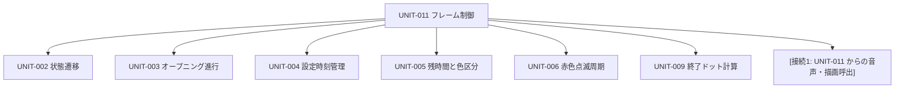
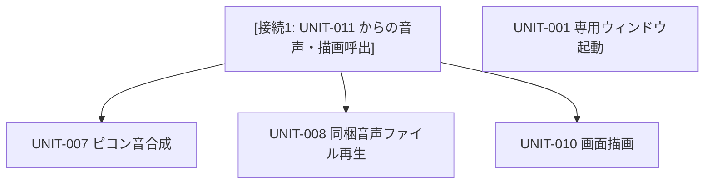
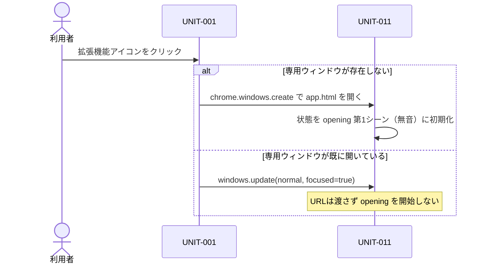
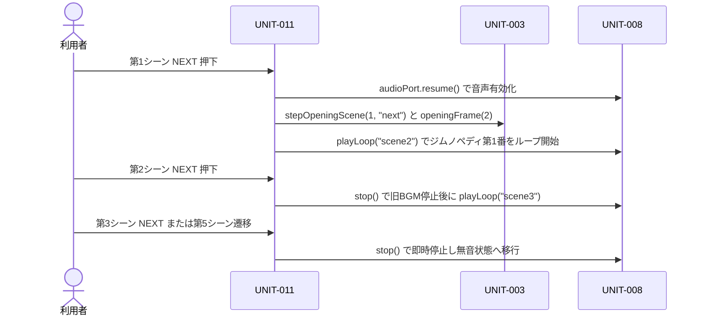
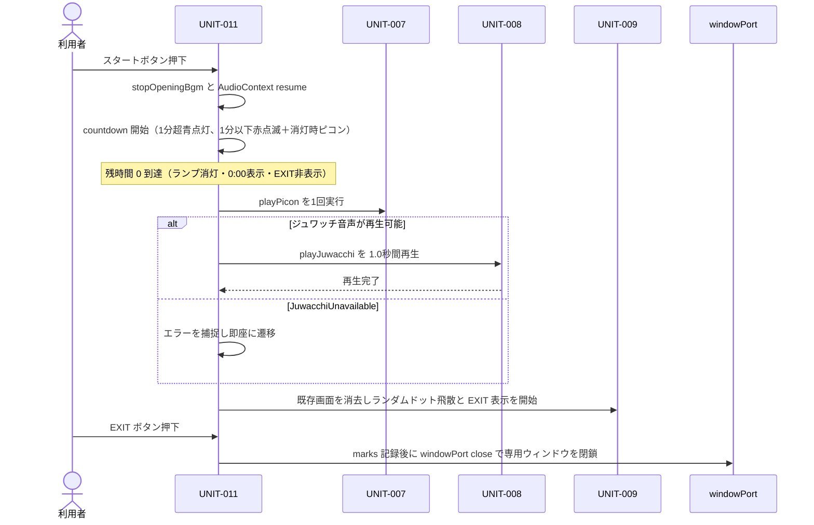

# SW205 ソフトウェアアーキテクチャ設計書

- **文書ID**: SW205
- **プロジェクト名**: ColorBeaconTimer
- **版数**: 4.5
- **最終更新日**: 2026-11-25
- **承認状態**: 承認済（2026-11-25、Product Owner マサ）

## 1. 概要
### 1.1 目的と位置づけ
本設計書は、承認済みの SW105 版数 4.5 および計画承認済みの SWP6 版数 4.5 に基づき、開発者およびテスト担当者が参照する ColorBeaconTimer の設計構造を定める。本ソフトウェアは、DADAプロセスを用いたプログラム開発例であり、教育用途の公開物ではない（Document-and-Agent-Driven Agile 開発の非教育用途実例）。本開発では、DADAプロセスの次の 2つの特徴を発揮している。(1) 開発文書（`SW105`・`SWP6`・`SW205`）を作成し、工程別レビュー記録表（`REV101_Requirements.md`・`REV101_Test.md`・`REV101_Design.md`・`REV101_Code.md`）と機械チェックで自己校正レビューを行っている。(2) Phase 5 の評価を起点とした開発 Loop により、アジャイル的にプログラムの要求改訂を頻繁に行っている。

実行形態は Google Chrome 拡張機能（Manifest V3）とする。設計対象は次の3領域である。

- ウィンドウ制御および状態遷移: 専用ウィンドウ（実ビューポート幅 `640px` 以上、`700×720px`）の起動制御と画面状態遷移を扱う。あわせてオープニング手動遷移、第5シーン拡大、設定時刻変更、および `EXIT` ボタン終了制御を対象とする
- カウントダウンと音声・映像出力: カラービーコン表示、オープニング BGM 制御と音量調整、ピコン音合成、および終了ドット飛散を扱う。あわせて単一の元気な成人男性話者（`VOICEVOX:玄野武宏`）一括合成によるジュワッチ音声再生を対象とする
- 静的構造: ファイル構成、日英常時併記と `100%` レスポンシブレイアウト設計、機能ユニット分割、および同梱アセットの権利整合方針

SW105 にない機能は追加しない。禁止名称リストの8文字列（SW105 第1.3節）および旧教育用途の禁止5語句（SW105 第4.2節 REQ-006 処理（11））は SW105 を正とし、本設計書には転記しない。

### 1.2 適用範囲
本設計書の適用範囲は次の条件に従う。

- 実行形態は Google Chrome の拡張機能（Manifest V3）とする。
- 動作保証対象は Windows 11 上の最新版 Google Chrome とする。
- 表示と操作は、`chrome.windows` で開く専用ウィンドウ（Windows 11 上の Chrome ポップアップウィンドウ実表示領域で実ビューポート幅 `640px` 以上）のみで行う。
- 外部サーバとは通信しない。実行時に外部から画像・BGM・音声を取得または生成しない。
- `EXIT` ボタン押下または専用ウィンドウを閉じる操作により専用ウィンドウが閉じられると、プログラムは終了し、設定時刻・残時間・再生中 BGM は破棄・停止する。
- 次の機能は対象外とする（理由: SW105 第1.2節でスコープ外と定められているため）。
  - オープニング第1〜第4シーンの自動遷移、処理バーの表示、および画面全体クリックによるスキップ
  - 言語切替ボタン（専用ウィンドウに表示する各日本語に英語を常時併記するため設けない）
  - ストップボタン、一時停止、再開、リセット
  - 複数タイマーの同時実行、時刻の保存・復元
  - OS 通知、アカウント機能、消音ボタン
  - 第三者著作物の既存楽曲メロディー複製・引用および実写特撮キャラクタ写真の使用

### 1.3 参照ドキュメント
- `docs/artifacts/SW105_ソフトウェア要求仕様書.md`（版数: 4.5、承認日: 2026-11-25、承認状態: 承認済（2026-11-25、Product Owner マサ））
- `docs/artifacts/SWP6_ソフトウェア総合テスト仕様書・報告書.md`（版数: 4.5、承認日: 2026-11-25、承認状態: 計画承認済（2026-11-25、Product Owner マサ））

### 1.4 用語定義
SW105 第1.3節の用語定義を本設計書でも同じ意味で用いる。本設計書で追加する技術用語を表1に示す。

表1 追加用語定義一覧
| 用語 | 定義 |
| :--- | :--- |
| サービスワーカー | Manifest V3 のバックグラウンドスクリプト。ツールバーアイコンのクリックを受け、専用ウィンドウを新規作成または前面化する。残時間は保持しない |
| ViewModel | 1フレームの描画に必要な値の組。状態名、オープニングシーン名・番号・画像種別、`Back` / `NEXT` ボタン表示状態、BGM トラック名・URL・操作記録配列（`gain` を含む）、拡大縮小率、設定時刻、残時間、表示文字列、ランプ色・点灯状態、ドット配列、および `EXIT` ボタン表示状態（`exitVisible`）を含む |
| 観測属性 | 専用ウィンドウのルート要素 `#app` に付与する `data-*` 属性。自動テストの観測口として用いる |
| 印 | `performance.now()` の時刻に付ける名前。区間所要時間、表示切り替わり間隔、および `EXIT` ボタン押下時点の計測に用いる |
| BGM トラック識別子 | オープニング BGM の対象トラックを表す識別文字列。`'none'`（無音）、`'scene2'`（『ジムノペディ第1番』）、`'scene3'`（オリジナル・宇宙冒険SF映画風シンセサイザー楽曲）の3値とする |
| BGM 再生ゲイン | Web Audio API の `GainNode` を用いて、オープニング第2・第3シーン BGM の再生時実効音量（全区間 RMS 基準の dBFS）を合わせる線形倍率定数（`OPENING_BGM_GAINS`） |
| リクエスト世代ID | `UNIT-008`（`opening-bgm-player.js`）が非同期の音声読込・デコード完了時に最新要求との一致を照合する単調増加整数（`requestId`）。高速なシーン遷移連打による古い BGM の残留再生や重複再生を防ぐために用いる |
| ジュワッチ音声プロソディ | 発話「ジュワッチ」における総発音時間、全体ピーク、全区間 RMS、全体および前後半各区間の有声区間基本周波数（`F0`）中央値、後半 35% 有音部ピーク比、および後半 `3kHz〜8kHz` 帯域 RMS の時間・音高・振幅・帯域特性の総称 |
| ウィンドウ操作ポート | `UNIT-011`（`createController`）へ任意で注入する専用ウィンドウ制御ポート（`windowPort`）。`{ close(): void }` を持ち、終了演出画面での `EXIT` ボタン押下時に専用ウィンドウを閉じるために用いる |

## 2. システム構成
### 2.1 システム全体構成
利用者の PC 上で Windows 11 の最新版 Google Chrome が本拡張機能を読み込む。サービスワーカーはツールバーの拡張機能アイコンのクリックのみを受け付ける。Web ページ上のクリック、新規タブ作成、アドレスバー入力では専用ウィンドウを開かない。専用ウィンドウのページはオープニングから終了演出（ランダムドット飛散）までを単一スレッドで実行する。オープニング BGM（第2・第3シーン）、ピコン音、およびジュワッチ音声は専用ウィンドウの音声出力で再生する。専用ウィンドウを閉じるとページが破棄される。この閉鎖時点で再生中の BGM は停止し、プログラムも終了する。図1にシステム全体構成を示す。

図1 システム全体構成図

### 2.2 主たるソフトウェア要素
実装言語は JavaScript（ES modules）とし、バンドラおよび外部ライブラリは製品コードに使用しない（根拠は ADR-001 に記録する）。構成要素は SW105 第2.2節に定義された5要素（オープニング、時刻設定、カウントダウンとカラービーコン、音の再生、終了演出）である。内部は `UNIT-001` から `UNIT-011` に分割する。Phase 4 で作成・更新するファイル配置を表2に示す。

表2 ファイル構成と対応ユニット一覧
| パス | 役割 | 対応ユニット |
| :--- | :--- | :--- |
| `extension/manifest.json` | Manifest V3 定義（版数 `4.5.0`、「DADAプロセスを用いたプログラム開発例」位置づけと日英併記の `description` 132文字以内、`background.type` は `module`、ポップアップなし） | UNIT-001 |
| `extension/src/background/window-launcher.js` | アイコン押下で専用ウィンドウ（`700×720px`・実ビューポート幅 `640px` 以上）を開くか前面化する | UNIT-001 |
| `extension/app.html` | 専用ウィンドウの HTML 文書（`100%` レスポンシブ描画領域、処理バーと言語切替ボタンなし、`#opening-title` 要素、`#opening-nav` 内 `#btn-opening-back` / `#btn-opening-next`、日英併記 `#btn-start`、`#dots-canvas` `700×720`、直後に `<button id="btn-exit" type="button" hidden>EXIT</button>`） | UNIT-010 |
| `extension/app.css` | 専用ウィンドウの `100%` レスポンシブ配置（`html, body, #app` 幅・高さ `100%`、`overflow: hidden`）、書体・色・ランプ装飾、日英併記領域の非重複・見切れなし装飾、`#dots-canvas` (`z-index: 1`) 前面下部中央オーバーレイ `#btn-exit` (`z-index: 2`、`[hidden]` 完全非表示) | UNIT-010 |
| `extension/src/domain/constants.js` | 設計定数の一元管理（`WINDOW_W = 700`, `WINDOW_H = 720` を含む） | UNIT-011 |
| `extension/src/domain/app-state.js` | 画面状態遷移の純粋関数 | UNIT-002 |
| `extension/src/domain/opening-timeline.js` | オープニング第1〜第4シーンの前後遷移、BGM トラック識別子、および第5シーンの拡大率計算 | UNIT-003 |
| `extension/src/domain/setting-time.js` | 設定時刻の10秒単位増減、クランプ、および長押し早送りステップ計算 | UNIT-004 |
| `extension/src/domain/remaining-time.js` | 残時間、切り上げ分:秒表示、色区分の計算 | UNIT-005 |
| `extension/src/domain/blink-interval.js` | 赤色点滅の線形加速間隔計算 | UNIT-006 |
| `extension/src/audio/picon-synth.js` | Web Audio API によるピコン音の合成再生 | UNIT-007 |
| `extension/src/audio/juwacchi-player.js` | 保存済みジュワッチ音声ファイルの読込と再生 | UNIT-008 |
| `extension/src/audio/opening-bgm-player.js` | オープニング第2・第3シーン BGM の読込・`GainNode` 音量調整ループ再生・停止・`requestId` キャンセル制御 | UNIT-008 |
| `extension/src/domain/ending-dots.js` | 中央から360度方向へ飛散するドットの生成と位置計算 | UNIT-009 |
| `extension/src/view/renderer.js` | ViewModel に基づく DOM（日英常時併記と `#btn-exit` 制御）・Canvas・観測属性の描画 | UNIT-010 |
| `extension/src/app/controller.js` | 1フレームの計算呼び出し、BGM 同期切替（`gain` 記録含む）、`windowPort` 経由の `onExit()` 制御、およびイベント処理 | UNIT-011 |
| `extension/src/app/main.js` | 専用ウィンドウのエントリポイント。実環境ポート（`windowPort` 含む）注入、`#btn-exit` クリック接続、および `pagehide` 時停止 | UNIT-011 |
| `extension/assets/audio/gymnopedie1.ogg` | 第2シーン BGM『ジムノペディ第1番』（Wikimedia Commons PD/CC0/CC BY 録音、再生ゲイン `1.0`） | UNIT-008 |
| `extension/assets/audio/space-adventure-synth.wav` | 第3シーン BGM オリジナル・宇宙冒険SF映画風シンセサイザー楽曲（1970〜80年代レトロフューチャー寄り、44100Hz / 16bit / ステレオ 2ch PCM WAV、長さ 16.000秒、MIT License、再生時は `GainNode` ゲイン代表値 `0.22` を起点に Phase 4 実測 RMS で確定） | UNIT-008 |
| `extension/assets/audio/juwacchi.wav` | 開発時に単一の元気な成人男性話者（`VOICEVOX:玄野武宏`、第一候補スタイル `喜び`［`speaker=39`］・代替候補 `ノーマル`［`speaker=11`］）の一括合成と境界調整・ピーク正規化で1回生成し保存した音声（総長 `0.80〜1.20秒`、`24000Hz / 16bit / モノラル PCM WAV`、全体ピーク `0.85〜0.99`、全区間 RMS `0.18` 以上、全体 `F0` `110〜180 Hz`、前後半各区間 `F0` `85〜200 Hz`、後半 35% ピーク比 `0.25〜0.85`、クレジット `VOICEVOX:玄野武宏`） | UNIT-008 |
| `extension/assets/images/fountain-stieglitz.jpg` | スティーグリッツ撮影《泉》写真（`PD-1923` パブリックドメイン） | UNIT-010 |
| `extension/assets/images/three-face-dadaism.svg` | 自作の白黒幾何学模様・三面シルエット風 SVG イラスト | UNIT-010 |
| `extension/assets/images/blue-lamp.svg` | 自作の立体青色ランプイラスト | UNIT-010 |
| `extension/assets/SOURCES.md` | 同梱画像・音声ファイルの出典・ライセンス・SHA-256 記録（`space-adventure-synth.wav` v4.5 仕様と音量調整補足、`juwacchi.wav` `VOICEVOX:玄野武宏` 一括合成・定量仕様・SHA-256、DADA開発例位置づけ、`700×720px`・日英併記・`EXIT` ボタン仕様を含む） | UNIT-008 |
| `extension/icons/icon16.png` | 自作の拡張機能アイコン（16px） | UNIT-010 |
| `extension/icons/icon48.png` | 自作の拡張機能アイコン（48px） | UNIT-010 |
| `extension/icons/icon128.png` | 自作の拡張機能アイコン（128px） | UNIT-010 |
| `extension/store-listing.txt` | Chrome ウェブストア向けの日英併記掲載文（DADA開発例位置づけ、`EXIT` ボタン仕様、および `VOICEVOX:玄野武宏` クレジット表記を含む） | UNIT-010 |
| `README.md` | v4.5 対応の DADA開発例位置づけと 2つの特徴、簡素化した「機能概要」節（`SW105` 誘導、個別文言・式・許容誤差・波形個別数値なし）、「開発状況」節削除、維持する「クレジット」節および「ライセンス・著作権表示」節（`space-adventure-synth.wav`・`juwacchi.wav`・SHA-256・`EXIT` ボタン・`700×720px` を含む） | 対象外 |
| `LICENSE` | MIT License および v4.5 対応の Third-Party Notices 節（`space-adventure-synth.wav` 仕様と音量調整補足、`juwacchi.wav` `VOICEVOX:玄野武宏` 一括合成・SHA-256、`EXIT` ボタン、および DADA開発例位置づけを含む） | 対象外 |
| `tests/unit/` | `node:test` による純粋関数、BGM ゲイン・音量バランス判定、PCM WAV 品質解析、単一男性話者ジュワッチ定量解析、`onExit` 終了制御、および配布文書・`README.md` 節構成検査 | 対象外 |
| `tests/system/` | Playwright による総合テスト自動実行群（`viewport: null` 実ポップアップ計測および `EXIT` ボタン検証含む）と共有検証ハーネス | 対象外 |

Phase 4 では `extension/manifest.json`（`4.5.0`・日英併記 `description` 維持）を更新する。Python 標準ライブラリ非人声シンセサイザー合成で `extension/assets/audio/space-adventure-synth.wav` を生成して同梱し、旧 `extension/assets/audio/kaiju-orchestra.wav` を削除する。さらに `opening-bgm-player.js`（アセットパスと再生ゲイン）および `renderer.js`（連想ゲーム2本文3行目）を更新し、`README.md`・`LICENSE`・`SOURCES.md`・`tests/` を v4.5 へ同期する。

## 3. ソフトウェア構成（静的構造）
### 3.1 ソフトウェア全体構成
Agentic Testability を満たすため、純粋な計算ロジック（`UNIT-002`〜`UNIT-006`, `UNIT-009`）を DOM・音声・時刻の入出力から分離する。音声ユニット（`UNIT-007`, `UNIT-008`）と描画ユニット（`UNIT-010`）は注入されたポートのみを使用する。フレーム制御（`UNIT-011`）が時刻・乱数・音声ポート・描画先を注入し、1フレームごとに計算ユニットを呼び出す。サービスワーカー（`UNIT-001`）は独立したバックグラウンドプロセスであり、ページ側ユニットを呼び出さない。

全ユニット数は11個である。Mermaid 図の1図10ノード上限を守るため、図2（制御・計算系）と図3（音声・描画・独立系）に分割し、接続ノード `[接続1: UNIT-011 からの音声・描画呼出]` で対応付ける。

図2 ソフトウェア全体構成（制御・ドメイン計算ユニット依存関係）

図3 ソフトウェア全体構成（音声・描画・独立バックグラウンドユニット依存関係）

### 3.2 機能ユニットの定義

#### UNIT-001: 専用ウィンドウ起動
- **責務**: ツールバーの拡張機能アイコンクリックを受け、専用ウィンドウを1つ新規作成し、既にあれば前面に出す。
- **対応要求**: REQ-001, REQ-002, REQ-003, REQ-004, REQ-005, REQ-006, REQ-007
- **公開インターフェース**: `openOrFocus(windowsApi, sessionStore): Promise<'opened' | 'focused'>`（ウィンドウ作成失敗時は `WindowOpenFailed` を送出）、および `extension/manifest.json`（`version: "4.5.0"`、日英併記 `description` 132文字以内）
- **依存先**: なし
- **検証条件**: ウィンドウが存在しない状態でのアイコン1回クリックで `app.html` のポップアップウィンドウが幅 `700px`（`WINDOW_W`）×高さ `720px`（`WINDOW_H`）で1つ開くこと。この外寸設定により Windows 11 上の Chrome ポップアップ実表示領域で実ビューポート幅 `640px` 以上を確保すること。既に開いている状態での再クリックでは増えず、既存ウィンドウの `state` を `normal`、`focused` を `true` にして前面化すること（URL 再設定による再読み込みを行わないこと）。`EXIT` ボタン押下またはウィンドウ閉鎖時に `chrome.windows.onRemoved` が `sessionStore` の `windowId` を削除すること。`extension/manifest.json` の `"version"` は `"4.5.0"` とする。`"description"` は Chrome 仕様上限 132文字以内で日英併記および DADA開発例位置づけに準拠した 126文字の文字列（`"ColorBeaconTimer（DADAプロセスを用いたプログラム開発例）: 残時間に応じ色・点滅・音が変わるタイマー / Timer changing color, blink & sound (DADA development example)."`）を維持すること。あわせて、禁止名称・禁止表現・旧教育用途禁止5語句を含まないこと。

#### UNIT-002: 画面状態遷移
- **責務**: 現在の状態と発生イベントから、次の画面状態を1つ返す。
- **対応要求**: REQ-001, REQ-003, REQ-005, REQ-007
- **公開インターフェース**: `nextState(state: string, event: string): string`（状態は `'opening' | 'setting' | 'countdown' | 'endingAudio' | 'endingDots'`。未知イベントまたは無効イベントは現在の `state` をそのまま返す）
- **依存先**: なし
- **検証条件**: `opening` は `OPENING_DONE` または `SKIP_OPENING` で `setting` へ遷移すること。`setting` は `START` で `countdown` へ遷移すること。`countdown` は `TIMER_ZERO` で `endingAudio` へ遷移し、`ADJUST` や `START` を無視すること。`endingAudio` は `AUDIO_DONE` または `AUDIO_UNAVAILABLE` で `endingDots` へ遷移すること。`endingDots` からはどのイベントでも `setting` へ戻らないこと。

#### UNIT-003: オープニング進行計算
- **責務**: オープニングの各シーン番号と第5シーン経過ミリ秒から、シーン状態・ボタン表示・画像種別・BGM識別子・拡大倍率を計算する。
- **対応要求**: REQ-001
- **公開インターフェース**: `stepOpeningScene(sceneIndex: number, action: 'next' | 'back'): number`（第1〜第4シーンの `next` / `back` 操作に対する次シーン番号を返す。範囲外および第5シーンの操作時は `sceneIndex` をそのまま返す）、`openingFrame(sceneIndex: number, scene5ElapsedMs: number): { step: 'scene1' | 'scene2' | 'scene3' | 'scene4' | 'scene5' | 'done', sceneIndex: number, scale: number, imageKind: 'none' | 'fountain' | 'threeFace' | 'blueLamp', bgmTrack: 'none' | 'scene2' | 'scene3', showBack: boolean, showNext: boolean }`（`scene5ElapsedMs < 0` は `0` として扱う）
- **依存先**: なし
- **検証条件**: `stepOpeningScene` は `1` での `'next'` に `2`、`'back'` に `1` を返すこと。`2`〜`4` での `'next'` に `sceneIndex + 1`、`'back'` に `sceneIndex - 1` を返すこと。`5` での `'next'` および `'back'` に `5` を返すこと。`openingFrame` は `sceneIndex = 1` で `step: 'scene1', sceneIndex: 1, scale: 1, imageKind: 'none', bgmTrack: 'none', showBack: false, showNext: true` を返すこと。`sceneIndex = 2` で `step: 'scene2', sceneIndex: 2, scale: 1, imageKind: 'fountain', bgmTrack: 'scene2', showBack: true, showNext: true` を返すこと。`sceneIndex = 3` で `step: 'scene3', sceneIndex: 3, scale: 1, imageKind: 'threeFace', bgmTrack: 'scene3', showBack: true, showNext: true` を返すこと。`sceneIndex = 4` で `step: 'scene4', sceneIndex: 4, scale: 1, imageKind: 'none', bgmTrack: 'none', showBack: true, showNext: true` を返すこと。`sceneIndex = 5` では `0 <= scene5ElapsedMs < 5000` で `step: 'scene5', sceneIndex: 5, scale: scene5ElapsedMs / 5000, imageKind: 'blueLamp', bgmTrack: 'none', showBack: false, showNext: false` を返し、`scene5ElapsedMs >= 5000` で `step: 'done', sceneIndex: 0, scale: 1, imageKind: 'none', bgmTrack: 'none', showBack: false, showNext: false` を返すこと。`sceneIndex` が `1`〜`5` 以外のときは `step: 'done', sceneIndex: 0, scale: 1, imageKind: 'none', bgmTrack: 'none', showBack: false, showNext: false` を返すこと。

#### UNIT-004: 設定時刻管理
- **責務**: 設定時刻を10000ミリ秒単位で増減して60000ミリ秒以上180000ミリ秒以下の範囲にクランプし、長押し早送りの追加ステップ数を計算する。
- **対応要求**: REQ-002
- **公開インターフェース**: `adjustSetting(currentMs: number, deltaMs: number): number`（クランプ後のミリ秒を返す）、`longPressRepeatSteps(holdElapsedMs: number, appliedRepeatCount: number): number`（2000ミリ秒経過後から200ミリ秒ごとに追加すべき増減ステップ数を返す）
- **依存先**: なし
- **検証条件**: 初期定数 `SETTING_INITIAL_MS` が `120000`（2:00）であること。`120000 + 10000` で `130000`、`120000 - 10000` で `110000` を返すこと。`60000 - 10000` で `60000`、`180000 + 10000` で `180000` を返すこと。`longPressRepeatSteps` は `holdElapsedMs < 2000` で `0`、`2000` で `0`、`2200`（`appliedRepeatCount = 0`）で `1`、`3000`（`appliedRepeatCount = 0`）で `5` を返すこと。

#### UNIT-005: 残時間と色区分計算
- **責務**: 残時間のミリ秒から、切り上げ秒の分:秒文字列とランプの色区分を計算する。
- **対応要求**: REQ-004, REQ-005
- **公開インターフェース**: `remainingMs(startMs: number, elapsedMs: number): number`、`formatRemaining(ms: number): string`、`beaconZone(ms: number): 'blue-solid' | 'red-blink' | 'off'`
- **依存先**: なし
- **検証条件**: `remainingMs` は `0` 未満を返さないこと。`formatRemaining` は `60001` で `'1:01'`、`60000` で `'1:00'`、`1001` で `'0:02'`、`1000` で `'0:01'`、`0` で `'0:00'` を返すこと。`beaconZone` は `ms > 60000` で `'blue-solid'`、`0 < ms <= 60000` で `'red-blink'`、`ms <= 0` で `'off'` を返すこと。

#### UNIT-006: 赤色点滅周期計算
- **責務**: 赤色点滅の1周期開始時点の残時間から、点灯時間および消灯時間を計算する。
- **対応要求**: REQ-004
- **公開インターフェース**: `redPhaseDurationMs(remainingMs: number): number`（点灯時間と等しい消灯時間のミリ秒を返す。`remainingMs <= 0` は `0`）
- **依存先**: なし
- **検証条件**: `t = remainingMs / 1000` とし、`60000` ミリ秒（`t = 60`）で `1000` ミリ秒、`35000` ミリ秒（`t = 35`）で `550` ミリ秒、`10000` ミリ秒（`t = 10`）および `5000` ミリ秒（`t = 5`）で `100` ミリ秒を返すこと。

#### UNIT-007: ピコン音合成
- **責務**: 注入された AudioContext を用いて、オリジナルのピコン音を正弦波発振で1回再生する。
- **対応要求**: REQ-004, REQ-005, REQ-006
- **公開インターフェース**: `playPicon(audioCtx, startSec: number): { ok: boolean, error?: 'AudioUnavailable' }`
- **依存先**: なし
- **検証条件**: 音声ファイルや外部通信を使わず OscillatorNode の正弦波で発音すること。`audioCtx` が未定義または `closed` 状態のとき、例外は送出せず `{ ok: false, error: 'AudioUnavailable' }` を返すこと。

#### UNIT-008: 同梱音声ファイル再生（ジュワッチ音声・オープニングBGM）
- **責務**: パッケージ同梱のジュワッチ音声（`juwacchi-player.js`）およびオープニング BGM（`opening-bgm-player.js`）を読み込み、オフライン再生・音量調整・停止制御を行う。
- **対応要求**: REQ-001, REQ-005, REQ-006
- **公開インターフェース**:
  - ジュワッチ音声（`extension/src/audio/juwacchi-player.js`、ヘッダに `UNIT-008, REQ-005, REQ-006` を明記）: `loadJuwacchi(readFile): Promise<{ ok: true, buffer: ArrayBuffer, url: string } | { ok: false, error: 'JuwacchiUnavailable' }>`、`playJuwacchi(audioCtx, audioBuffer, onEnded): { ok: boolean, error?: 'JuwacchiUnavailable' }`
  - オープニング BGM（`extension/src/audio/opening-bgm-player.js`、ヘッダに `UNIT-008, REQ-001, REQ-006` を明記）: `OPENING_BGM_ASSETS`（`{ scene2: 'assets/audio/gymnopedie1.ogg', scene3: 'assets/audio/space-adventure-synth.wav' }`）と `OPENING_BGM_GAINS`（`Object.freeze({ scene2: 1.0, scene3: 0.22 })`）を公開する。`scene3` ゲイン値は WAV 目標 RMS `-16 dBFS` に対する代表設計値であり、Phase 4 実測 RMS に基づき確定する。あわせて `loadOpeningBgm(trackKey: 'scene2' | 'scene3', readFile): Promise<{ ok: true, trackKey: 'scene2' | 'scene3', buffer: ArrayBuffer, url: string } | { ok: false, error: 'BgmUnavailable' }>` と `createOpeningBgmPlayer(getAudioCtx, loadBufferFn): { playLoop(trackKey: 'scene2' | 'scene3'): Promise<{ ok: boolean, trackKey?: string, url?: string, gain?: number, cancelled?: boolean, error?: 'BgmUnavailable' }>, stop(): void, getActiveTrack(): 'none' | 'scene2' | 'scene3', getActiveCount(): number }` を公開する
- **依存先**: なし
- **検証条件**:
  - `juwacchi-player.js` は `extension/assets/audio/juwacchi.wav` のみを読み込み、`speechSynthesis` や外部通信を一切呼び出さないこと。
  - `juwacchi.wav` は、開発時に単一の元気な成人男性話者（`VOICEVOX:玄野武宏`、第一候補スタイル `喜び`［`speaker=39`］・代替候補 `ノーマル`［`speaker=11`］）による一括音声合成で「ジュワッチ！」を 1回生成し、第6.2節の手順（Python 標準ライブラリのみでの無音境界調整と線形ピーク正規化）で保存した `24000Hz` 以上・`16bit`・モノラル PCM WAV とすること。
  - 女性話者によるピッチ下げ変換、後半「チ」の別音源合成結合（継ぎ接ぎ）、および人の声の録音は使用しないこと。公式音声、実行時再合成、および外部通信も使用しないこと。
  - `juwacchi.wav` の総発音時間は `0.80秒以上 1.20秒以下`（目標 `1.000秒`）、全体ピーク正規化振幅は `0.85以上 0.99以下`（クリッピング非発生）、全区間 RMS は `0.18以上`（`-14.9 dBFS` 以上）であること。
  - `juwacchi.wav` の全体有声区間フレーム基本周波数 `F0` 中央値は `110 Hz以上 180 Hz以下`（女性声域 `220 Hz以上` 不使用）であること。前半区間（先頭 `65%`）および後半区間（後半 `35%`）の各有声区間 `F0` 中央値は、いずれも `85 Hz以上 200 Hz以下`（声質断絶なし）であること。後半区間有音部ピーク振幅は前半区間ピーク振幅の `0.25以上 0.85以下` とし、後半 `3kHz〜8kHz` 帯域 RMS は前半全帯域 RMS 以下に抑えること。
  - ジュワッチ音声の読込失敗または再生失敗時は、例外は送出せず `JuwacchiUnavailable` を返し、後続の終了演出へ遷移できること。
  - `opening-bgm-player.js` は `OPENING_BGM_ASSETS` と `OPENING_BGM_GAINS`（`Object.freeze({ scene2: 1.0, scene3: 0.22 })`、Phase 4 で `space-adventure-synth.wav` 実測 RMS に基づき確定）を公開し、外部通信や `speechSynthesis` を一切呼び出さないこと。
  - `playLoop(trackKey)` は `AudioBufferSourceNode -> GainNode(gain.value = OPENING_BGM_GAINS[trackKey]) -> audioCtx.destination` の経路で接続し、成功時は `{ ok: true, trackKey, url, gain }` を返すこと。`scene3` の `GainNode` ゲインは代表設計値 `0.22` とし、Phase 4 で生成後の実測 RMS に基づき確定すること。第2シーン（実測 `-29.01 dBFS`、ゲイン `1.0`）との再生時実効音量差（全区間 RMS 基準の dBFS）は `±3.0 dB` 以内（設計目標 `±1.0 dB` 以内、音割れなし）へ収め、`TC-073` で検証すること。
  - `playLoop(trackKey)` 開始時および `stop()` 時に単調増加のリクエスト世代ID（`requestId`）を更新すること。同時に `stopCurrentSource()` で既存の `activeSource`（`stop(0)`・`disconnect()`）と `activeGain`（`disconnect()`）の両方を停止・切断し、`activeTrack` を `'none'`、`activeCount` を `0` に戻すこと。
  - 非同期の `loadBufferFn` 完了時に発行時の `requestId` が最新 `requestId` と一致しない場合、再生は開始せずに `{ ok: false, cancelled: true }` を返すこと。0.1秒間隔の高速連打時でも同時再生数 `getActiveCount()` が常に `1` 以下（`2` 以上は 0件）であること。有効再生時は `source.loop = true` で先頭 `start(0)` からシームレスループ再生すること。
  - 未知の `trackKey`・ファイル欠損・デコード失敗のときは、例外は送出せず `{ ok: false, error: 'BgmUnavailable' }` を返すこと。`getAudioCtx()` 未定義・`closed`・例外送出時も同じエラーを返し、`getActiveTrack() === 'none'` と `getActiveCount() === 0` の無音フォールバック状態を保つこと。

#### UNIT-009: 終了ドット飛散計算
- **責務**: 画面中央から360度全周囲方向へ飛び散る複数ドットの初期パラメータ生成と、経過時刻に応じた座標更新を行う。
- **対応要求**: REQ-007
- **公開インターフェース**: `createDotField(count: number, random01: () => number): Dot[]`、`dotPositions(dots: Dot[], elapsedMs: number, centerX: number, centerY: number, width: number, height: number): DotPoint[]`
- **依存先**: なし
- **検証条件**: 注入された `random01` を用いて全周囲方向（`0` 以上 `2π` 未満）の角度と正の速度が割り当てられること。`elapsedMs > 0` で各ドットが中央 `(centerX, centerY)` から外方向へ移動し、描画領域外に出たドットは中央から再飛散して時間経過に関わらずアニメーションが継続すること。

#### UNIT-010: 画面描画
- **責務**: ViewModel を専用ウィンドウの DOM 要素、終了演出 Canvas、`EXIT` ボタン、および観測属性へ描画する。
- **対応要求**: REQ-001, REQ-002, REQ-003, REQ-004, REQ-005, REQ-006, REQ-007
- **公開インターフェース**: `render(viewModel: ViewModel, dom): 'ok' | 'UnknownState'`
- **依存先**: なし
- **検証条件**:
  - 未知の状態名を受け取った場合は描画せずに `'UnknownState'` と返すこと。処理バー要素（`#opening-progress` および `role="progressbar"`）と言語切替ボタン（`button` 要素による切替UI）を生成・表示しないこと。
  - `scene1` では `#opening-title` を非表示（空文字）とし、`#opening-text` に日本語行 `このソフトウェアは、 DADA（Document-and-Agent-Driven Agile）プロセスで開発しました。`、空行、英語行 `This software was developed using the DADA (Document-and-Agent-Driven Agile) process.` を描画すること。同じ `scene1` で `#btn-opening-next`（ラベル「NEXT」）を表示し、`#btn-opening-back` を非表示にすること。
  - `scene2` では `#opening-image` に `assets/images/fountain-stieglitz.jpg` と日英 `imageAlt` を設定し、`#opening-title` に `連想ゲーム1 / Association Game 1`（全角コロンなし）を描画すること。同じ `scene2` で `#opening-text` に SW105 REQ-001 (2) の日本語3行・空行・英語3行を描画し、`#btn-opening-back`（ラベル「Back」）と `#btn-opening-next`（ラベル「NEXT」）を表示すること。
  - `scene3` では `#opening-image` に `assets/images/three-face-dadaism.svg` と日英 `imageAlt` を設定し、`#opening-title` に `連想ゲーム2 / Association Game 2`（全角コロンなし）を描画すること。同じ `scene3` で `#opening-text` に SW105 REQ-001 (3) の日本語3行・空行・英語3行を描画し、`#btn-opening-back` と `#btn-opening-next` を表示すること。あわせて日本語3行は `1967年1月22日放送のTV番組`、`お約束通りにヒーローに倒されたが`、および `・流れる曲は1970〜80年代レトロフューチャー風の宇宙冒険シンセサイザー音楽` を含み、英語3行目は `• The music playing is 1970s–80s retro-futuristic space-adventure synthesizer music.` を含むこと。
  - `scene4` では `#opening-image` を非表示にし、`#opening-title` に `連想ゲーム3 / Association Game 3`（全角コロンなし）を描画すること。同じ `scene4` で `#opening-text` に SW105 REQ-001 (4) の日本語2行・空行・英語2行を描画し、`#btn-opening-back` と `#btn-opening-next` を表示すること。
  - `scene5` 開始時点および `setting`・`countdown`・`endingAudio`・`endingDots` では `#opening-title`・`#opening-text`・`#opening-image`・`#opening-nav`・`#btn-opening-back`・`#btn-opening-next` を非表示にすること。`scene5` では `#opening-lamp`（`assets/images/blue-lamp.svg`）を `openingScale` に応じて拡大描画すること。
  - `#app` に観測属性 `data-opening-bgm`（`'none' | 'scene2' | 'scene3'`）、`data-opening-bgm-url`、`data-opening-bgm-log`（`gain` 記録付き JSON 配列）、および `data-exit-visible`（`'true' | 'false'`）を出力すること。設定画面には `#btn-plus`、`#btn-minus`、`#btn-start`（テキスト「`スタート / START`」）のみを配置し、ストップ・一時停止・リセット・`Back`・`NEXT`・言語切替・`EXIT` ボタンを表示しないこと。
  - `dom.btnExit`（未指定の既存モック互換時は安全にスキップ）に対して、`viewModel.state === 'endingDots' && Boolean(viewModel.exitVisible)` のときのみ `btnExit.hidden = false`・`btnExit.disabled = false`・`btnExit.textContent = 'EXIT'`・`data-exit-visible = 'true'` とすること。`opening`・`setting`・`countdown`・`endingAudio` では `viewModel.exitVisible` の値に関わらず `btnExit.hidden = true`・`btnExit.disabled = true`・`data-exit-visible = 'false'` を強制すること。
  - `700×720px` の専用ウィンドウ（実ビューポート幅 `640px` 以上、`app.html`・`app.css` の `100%` レスポンシブ配置）を対象とする。全シーン・設定・カウントダウン画面の全表示要素が互いに重ならず、見切れとスクロールバーなしで収まること。`endingDots` 状態では `#timer-ui` を非表示・消去し、`#dots-canvas`（`width="700" height="720"`、`z-index: 1`）にドット群を描画する。さらにその前面下部中央オーバーレイ（`z-index: 2`）に `#btn-exit` を見切れ・スクロールなし・操作可能に配置すること。全表示テキストおよび日英併記 `extension/store-listing.txt` に禁止名称リスト8文字列、「公認」、「公式」、および旧教育用途禁止5語句を含めないこと。

#### UNIT-011: フレーム制御
- **責務**: 1フレームごとに各計算ユニットを呼び出し、状態遷移・BGM切替・長押し早送り・点滅周期・音声再生・描画・終了ボタン制御を統合実行する。
- **対応要求**: REQ-001, REQ-002, REQ-003, REQ-004, REQ-005, REQ-007
- **公開インターフェース**: `createController(clock, audioPort, view, random01, windowPort = null)`（`clock.nowMs()`、任意 `windowPort`、イベントハンドラ `onOpeningNext()`, `onOpeningBack()`, `onClickScreen()`, `onAdjust(deltaMs)`, `onAdjustPressStart(deltaMs)`, `onAdjustPressEnd(cancelled?: boolean)`, `onStart()`, `onExit()`, `tick()`, `setJuwacchiUrl(url)` を公開）
- **依存先**: UNIT-002, UNIT-003, UNIT-004, UNIT-005, UNIT-006, UNIT-007, UNIT-008, UNIT-009, UNIT-010
- **検証条件**:
  - `opening` の第1〜第4シーンでは時間経過で自動遷移せず、`onClickScreen()` でもスキップしないこと。`onOpeningNext()` および `onOpeningBack()` では同期的に `audioPort.resume()` を呼び、遷移先シーンの `bgmTrack` に応じて `syncOpeningBgm(info.bgmTrack)` を実行すること（`scene2` で `playOpeningBgm('scene2')`、`scene3` で `playOpeningBgm('scene3')`、`scene1`/`scene4`/`scene5` で `stopOpeningBgm()`）。
  - `openingBgmLog` 各エントリへ操作種別・トラック名・時刻・同時再生数・ループフラグに加えて `gain`（`play` 時 `res.gain`、`stop`/`fallback` 時 `0`）を記録すること。
  - `onClickScreen()`（第5シーンスキップ）、`OPENING_DONE`（第5シーン完走）、`onStart()`、専用ウィンドウの `pagehide`、および `onExit()` で確実に `stopOpeningBgm()` または `syncOpeningBgm('none')` を実行すること。`playOpeningBgm` 失敗（`BgmUnavailable`）時は例外を送出せず無音フォールバックとして画面遷移・設定・タイマー動作を継続すること。
  - 第5シーンへ遷移した瞬間に `opening-scene5` を `data-marks` に記録すること。第5シーン開始から `5000` ミリ秒経過または `onClickScreen()` で `setting` へ遷移し、`setting-shown` を記録すること。終了ドット中心・領域計算には `WINDOW_W = 700`・`WINDOW_H = 720` を使用すること。
  - `setting` 状態で `onAdjustPressStart` の押下時間が 2000ミリ秒未満かつ `onAdjustPressEnd(false)` なら単押しとして 10000ミリ秒増減すること。2000ミリ秒以上押し続けた場合は、200ミリ秒間隔で 10000ミリ秒ずつ連続増減すること。押下終了時に単押し分を追加しないこと。`cancelled = true` または `onStart()` で長押し早送りを即座に停止すること。
  - `countdown` 中は `onAdjust`、`onAdjustPressStart`、`onStart()` を無効化すること。赤色点滅消灯時点と残時間0到達時点で `playPicon` を1回呼ぶこと。残時間0では続けて `playJuwacchi` を1回呼び、`JuwacchiUnavailable` 発生時は即座に `endingDots` へ遷移すること。
  - `onExit()` は `state !== 'endingDots'` のとき無操作とし、`windowPort`・BGM・印を変更しないこと。`state === 'endingDots'` のときのみ `syncOpeningBgm('none', now)`、`marks['exit-clicked'] = now` 記録、最新 `ViewModel` 描画、および `windowPort?.close?.()` の呼出を実行すること。あわせて `windowPort` 未指定・`close` 例外・連続押下時も例外は送出せず、正常な終了状態を保つこと。

## 4. 制御方式（動的振る舞いとリソース割り当て）
### 4.1 メモリ構成とレイアウト
本ソフトウェアは Chrome 拡張機能のページ内ヒープで動作する。そのため、組込み機器向けの固定メモリマップ定義は対象外とする（理由: ブラウザの仮想メモリ上で JavaScript ランタイムが自動管理するため）。設定時刻、残時間、状態名、点滅ログ、BGM 再生状態・デコード済み音声バッファキャッシュは専用ウィンドウのページ変数のみで保持する。`chrome.storage.session` には現在開いている専用ウィンドウの `windowId` のみを保存し、設定時刻や残時間は保存しない。`chrome.storage.local`、`chrome.storage.sync`、`chrome.alarms` は使用しない。専用ウィンドウを閉じるとページが破棄され、次に開いたときは初期状態 `opening`（設定時刻 2:00）から開始する。

### 4.2 ソフトウェア制御方式
専用ウィンドウのページは単一スレッドの `requestAnimationFrame` ループで毎フレーム `UNIT-011` の `tick()` を呼び出す。時刻基準には注入された `clock.nowMs()`（実環境では `performance.now()`）を使用し、フレーム数ではなく経過ミリ秒で進行を計算する。経過ミリ秒基準の計算により、フレーム落ちが発生しても総所要時間が延びない。

画面状態と SW105 第5.1節の対応を表3に示す。

表3 内部状態と画面状態の対応表
| 内部状態 | SW105 の画面状態 | 残時間の表示 |
| :--- | :--- | :--- |
| `opening` | オープニング | 非表示 |
| `setting` | 設定 | 設定時刻（初期値 `2:00`） |
| `countdown` | カウントダウン | `formatRemaining` の文字列 |
| `endingAudio` | カウントダウン（残時間0） | `0:00`（ランプ消灯、音再生中） |
| `endingDots` | 終了演出 | 非表示（全既存UI消去） |

オープニング（`opening` 状態）の入力、画面遷移、および BGM 同期制御は次の規則で行う。

1. `main.js` は `#btn-opening-next` の `click` イベントで `event.stopPropagation()` を実行し、`UNIT-011` の `onOpeningNext()` を呼び出す。
2. `main.js` は `#btn-opening-back` の `click` イベントで `event.stopPropagation()` を実行し、`UNIT-011` の `onOpeningBack()` を呼び出す。
3. `main.js` は `#opening-stage` の `click` イベントで `UNIT-011` の `onClickScreen()` を呼び出す。
4. `main.js` は `window` の `pagehide` イベントで `audioPort.stopOpeningBgm()` を呼び出し、専用ウィンドウ閉鎖時に再生中の BGM を即時停止する。
5. `UNIT-011` は第1〜第4シーンにおいて時間経過によるシーン自動遷移を行わず、`onClickScreen()` によるスキップも無効とする。
6. `onOpeningNext()` および `onOpeningBack()` が呼ばれた際、`UNIT-011` はユーザージェスチャ有効期間内に同期的に `audioPort.resume()` を実行し、そのうえで遷移先シーンの `openingFrame` から `bgmTrack` を取得する。
7. `UNIT-011` の `syncOpeningBgm(bgmTrack)` は、遷移前の BGM を即座に停止（`stopOpeningBgm()`）する。`bgmTrack` が `'scene2'` または `'scene3'` のときは `audioPort.playOpeningBgm(bgmTrack)` を実行し、`bgmTrack` が `'none'` のときは停止状態を維持する。
8. 第4シーンで `onOpeningNext()` が呼ばれて第5シーン（`scene5`）へ遷移した時点で、`UNIT-011` は `syncOpeningBgm('none')` により BGM を停止し、`scene5StartMs` に `clock.nowMs()` を記録する。以降の `tick()` では `UNIT-003` の `openingFrame(5, now - scene5StartMs)` で拡大率を計算する。
9. `scene5` の経過時間が `5000` ミリ秒に達すると、`UNIT-011` は `syncOpeningBgm('none')` を再確認したうえで `UNIT-002` の `nextState` で `setting` へ遷移する。`scene5` 再生中に `onClickScreen()` を受けたときも、`UNIT-011` は `syncOpeningBgm('none')` を実行して `setting` へ遷移する。

設定画面の `＋` ボタン（`#btn-plus`）および `−` ボタン（`#btn-minus`）の入力制御は次の規則で行う。

1. `main.js` は `#btn-plus` および `#btn-minus` に `pointerdown`、`pointerup`、`pointerleave`、`pointercancel` を登録し、`click` イベントによる二重増減は行わない。
2. `pointerdown` で `UNIT-011` の `onAdjustPressStart` を呼び、押下開始時刻 `clock.nowMs()` と増減方向を記録する。
3. 押下継続中の各フレーム `tick()` で `UNIT-004` の `longPressRepeatSteps` を呼び、2000ミリ秒経過後から 200ミリ秒間隔で `adjustSetting` を適用する。設定時刻が上限 `180000` ミリ秒または下限 `60000` ミリ秒に達した場合は値を固定する。
4. `pointerup`（`cancelled: false`）で押下時間が 2000ミリ秒未満かつ早送り未発動のときのみ単押し（`+10000` または `-10000` ミリ秒）を適用する。早送り発動後、または `pointerleave` / `pointercancel`（`cancelled: true`）受信時、および `onStart()` 実行時は、単押し分は加算せず、長押し状態を解除する。

赤色点滅（残時間 60000ミリ秒以下）の制御は次の規則で行う。
1. 各点滅周期（点灯開始時点）でのみ `UNIT-006` の `redPhaseDurationMs(remainingMs)` を呼び出し、点灯時間 `phaseMs` と消灯時間 `phaseMs` を確定してその1周期のあいだ保持する。
2. 経過時間が `phaseMs` に達した瞬間（点灯から消灯への切り替わりタイミング）で、ランプを消灯表示へ切り替え、同時に `UNIT-007` の `playPicon` を1回呼び出す。消灯から点灯への切り替わり時点では音を鳴らさない。
3. 経過時間が `2 * phaseMs` に達した時点で1周期を完了し、`data-blink-log` に `startRemainingMs`, `plannedPhaseMs`, `litMs`, `unlitMs`, `truncated: false` を記録する。
4. 周期の途中で残時間が `0` に到達した場合は、その点滅を打ち切り、`truncated: true` として記録し、即座に `endingAudio` へ遷移する。

終了演出（`endingDots` 状態）の `EXIT` ボタン操作制御は次の規則で行う。
1. `main.js` は `dom.btnExit` へ `click` リスナーを登録し、`controller.onExit()` を呼び出す。あわせてウィンドウ操作ポート `windowPort = { close() { window.close(); } }` を `createController` の第5任意引数へ注入する。
2. `UNIT-011` の `onExit()` は、`state !== 'endingDots'` のとき無操作で戻る。`state === 'endingDots'` のときのみ `syncOpeningBgm('none', now)` による無音状態確認、`marks['exit-clicked'] = now` の記録、最新状態の描画、および `windowPort?.close?.()` の安全呼び出しを行う。
3. 専用ウィンドウが閉じられると、`UNIT-001`（`window-launcher.js`）で登録済みの `chrome.windows.onRemoved` リスナーが `forgetWindow(chrome.storage.session, windowId)` を実行し、`windowId` を破棄する。この閉鎖に伴いプログラムが終了する。その後ツールバーのアイコンを再クリックすると、新規に専用ウィンドウが開き `opening` 第1シーンから開始する。

図4に専用ウィンドウの起動と前面化のシーケンス、図5にオープニング手動遷移と BGM 切替のシーケンス、図6にスタートから終了演出・`EXIT` 終了までのシーケンスを示す。

図4 専用ウィンドウ起動・前面化シーケンス図

図5 オープニング手動遷移と BGM 切替・停止シーケンス図

図6 カウントダウン開始から終了演出・EXIT終了までのシーケンス図

### 4.3 性能見積り
目標値は SW105 第6.1節に準拠する。実行環境は Windows 11 上の最新版 Google Chrome（専用ウィンドウ1枚）を想定する。1フレームの描画負荷は DOM 更新数箇所および 2D Canvas 1枚（ドット 64個）のみである。そのため、1フレームあたりの処理時間は約 1〜4 ミリ秒、描画間隔は約 16.7 ミリ秒（60fps）に収まる。BGM の `stop(0)` はオーディオスレッドへ即時指令するため、停止完了は 20 ミリ秒以内である。初回読込とデコードを含む再生開始は 50〜150 ミリ秒以内に収まり、2回目以降は 20 ミリ秒以内である。すべての時間判定を経過ミリ秒（`performance.now()`）で行うため、各区間の目標値と設計精度は表4のとおり要求範囲を満たす。

表4 性能見積りと要求許容誤差の比較
| 項目 | 設計値 | 要求範囲（SW105） | 対応要求 |
| :--- | :--- | :--- | :--- |
| オープニング第1〜第4シーン手動遷移応答 | 16.7 ミリ秒以内（1フレーム） | 上限なし（手動操作遷移、SW105 第6.1節） | REQ-001 |
| オープニング BGM 停止完了遅延 | 20 ミリ秒以内（`AudioBufferSourceNode.stop(0)` 即時停止） | 0.2秒（200 ミリ秒）以内 | REQ-001 |
| オープニング BGM 再生開始遅延 | 初回 150 ミリ秒以内 / キャッシュ時 20 ミリ秒以内 | 0.5秒（500 ミリ秒）以内 | REQ-001 |
| 第3シーン BGM ループ境界無音ギャップ | 0.000秒（`source.loop = true` と循環残響連続波形） | 0.05秒（50 ミリ秒）未満 | REQ-001 |
| 第3シーン BGM 接続点正規化振幅差 | 0.05 以下（整数拍周期 16.000秒と循環畳み込み） | 0.05 以下（クリックノイズ非発生） | REQ-001, REQ-006 |
| 第2・第3シーン BGM 再生時実効音量差 | `±1.0 dB` 以内目標（`GainNode` ゲイン `scene2: 1.0`, `scene3: 0.22` 代表値、Phase 4 実測 RMS 確定、音割れなし） | 絶対値 `3.0 dB` 以内（`±3.0 dB` 以内、音割れなし） | REQ-001 |
| オープニング第5シーン（立体青色ランプ拡大） | 5000 ミリ秒 | 5秒 ±0.2秒 | REQ-001 |
| スキップ応答時間（第5シーン再生中） | 16.7 ミリ秒以内（1フレーム） | 1.0秒以内（SWP6 TC-011） | REQ-001 |
| 設定長押し早送り開始・間隔 | 開始 2000 ミリ秒 / 間隔 200 ミリ秒 | 開始 2秒 ±0.2秒 / 間隔 0.2秒 ±0.05秒 | REQ-002 |
| 残時間表示の切り替わり | 1000 ミリ秒ごと | 1秒 ±0.2秒 | REQ-003, REQ-004 |
| 赤色点滅の点灯・消灯時間 | 周期開始時計算値（最小100ミリ秒） | 計算値 ±0.05秒 | REQ-004 |
| ジュワッチ音声発音時間 | 目標 1000 ミリ秒（`0.80秒〜1.20秒`、`VOICEVOX:玄野武宏` 一括合成と無音境界調整） | 1秒 ±0.2秒（0.80秒〜1.20秒） | REQ-005 |
| ジュワッチ音声プロソディ特性 | 全体 `F0` 中央値 `110〜180 Hz` / 前後半各区間 `F0` 中央値 `85〜200 Hz` / 全体ピーク `0.85〜0.99` / 全区間 RMS `0.18` 以上（`-14.9 dBFS` 以上）/ 後半 35% ピーク比 `0.25〜0.85` / 後半 `3kHz〜8kHz` RMS `<=` 前半全帯域 RMS | 全体 `F0` `110〜180 Hz` / 前後半各区間 `F0` `85〜200 Hz` / ピーク `0.85〜0.99` / RMS `0.18` 以上 / 後半 35% ピーク比 `0.25〜0.85` / 後半 `3kHz〜8kHz` RMS `<=` 前半全帯域 RMS | REQ-005 |
| `EXIT` ボタン押下終了応答 | 16.7 ミリ秒以内（`onExit()` 内で即時 `windowPort.close()` 呼出） | エラーなしで専用ウィンドウ閉鎖・終了 | REQ-007 |

## 5. 機能ユニット詳細
`UNIT-011` が用いる外部ポートの型、ViewModel、および `#app` の観測属性をここに固定する。

- `clock`: `{ nowMs(): number }`
- `audioPort`: `{ resume(): Promise<void>, playPicon(): { ok: boolean, error?: string }, loadJuwacchi(): Promise<{ ok: boolean, url?: string, error?: string }>, playJuwacchi(onEnded: () => void): { ok: boolean, error?: string }, playOpeningBgm(trackKey: 'scene2' | 'scene3'): Promise<{ ok: boolean, trackKey?: string, url?: string, gain?: number, cancelled?: boolean, error?: string }>, stopOpeningBgm(): void, getOpeningBgmTrack?: () => 'none' | 'scene2' | 'scene3', getOpeningBgmCount?: () => number }`
- `view`: `{ render(viewModel): string }`
- `windowPort`: `{ close(): void } | null`（任意引数。未指定時の既定値は `null`）

表5に ViewModel のフィールド定義、表6に `#app` に出力する観測属性一覧、表7に `data-marks` に記録する印一覧を示す。

表5 ViewModel フィールド一覧
| フィールド | 型 | 意味 |
| :--- | :--- | :--- |
| `state` | 文字列 | `opening`, `setting`, `countdown`, `endingAudio`, `endingDots` |
| `openingStep` | 文字列 | `scene1`, `scene2`, `scene3`, `scene4`, `scene5`。`opening` 以外は空文字 |
| `openingSceneIndex` | 数値 | `1` から `5` のシーン番号。`opening` 以外は `0` |
| `openingImageKind` | 文字列 | `none`, `fountain`, `threeFace`, `blueLamp`。`opening` 以外は `'none'` |
| `openingScale` | 数値 | 拡大縮小率（`0` 以上 `1` 以下） |
| `openingBackVisible` | 真偽値 | `Back` ボタンを表示するとき `true`（`scene2`〜`scene4` のみ） |
| `openingNextVisible` | 真偽値 | `NEXT` ボタンを表示するとき `true`（`scene1`〜`scene4` のみ） |
| `openingBgmTrack` | 文字列 | 現在再生中のオープニング BGM トラック（`'none'`, `'scene2'`, `'scene3'`）。停止中・無音シーン・フォールバック時は `'none'` |
| `openingBgmUrl` | 文字列 | 再生中または再生対象 BGM の拡張機能内 URL（無音時・未読込・失敗時は空文字） |
| `openingBgmLog` | 配列 | BGM 再生開始・停止・フォールバック記録 `{ action, trackKey, atMs, activeCount, loop, gain?, error? }` の配列 |
| `settingMs` | 数値 | 設定時刻（ミリ秒） |
| `remainingMs` | 数値 | 残時間（ミリ秒） |
| `displayTime` | 文字列 | `#time` の表示文字列 |
| `timeVisible` | 真偽値 | `#time` を表示するとき `true` |
| `buttonsVisible` | 真偽値 | タイマー操作ボタン群を表示するとき `true` |
| `buttonsDisabled` | 真偽値 | `countdown`, `endingAudio`, `endingDots` の各状態で `true` |
| `beaconColor` | 文字列 | `'blue'`, `'red'`, `'off'` |
| `beaconLit` | 真偽値 | ランプ点灯中 `true`、消灯中 `false` |
| `dots` | 配列 | `endingDots` 時のドット座標配列 |
| `exitVisible` | 真偽値 | `state === 'endingDots'` のときのみ `true`、他の全状態では `false` |

表6 `#app` 観測属性一覧
| 属性名 | 内容 |
| :--- | :--- |
| `data-state` | `ViewModel.state` |
| `data-opening-step` | `ViewModel.openingStep`（`scene1`〜`scene5` または空文字） |
| `data-opening-scene` | `ViewModel.openingSceneIndex` の整数文字列（`1`〜`5` または `0`） |
| `data-opening-image` | `ViewModel.openingImageKind`（`none`, `fountain`, `threeFace`, `blueLamp`） |
| `data-opening-scale` | `ViewModel.openingScale` |
| `data-opening-back-visible` | `ViewModel.openingBackVisible`（`true` または `false`） |
| `data-opening-next-visible` | `ViewModel.openingNextVisible`（`true` または `false`） |
| `data-opening-bgm` | `ViewModel.openingBgmTrack`（`'none'`, `'scene2'`, `'scene3'`） |
| `data-opening-bgm-url` | `ViewModel.openingBgmUrl`（拡張機能内 URL または空文字） |
| `data-opening-bgm-log` | `ViewModel.openingBgmLog` の JSON 配列文字列（開始・停止・フォールバック時刻と同時再生数・再生ゲイン `gain`） |
| `data-setting-ms` | `ViewModel.settingMs` の整数値 |
| `data-remaining-ms` | `ViewModel.remainingMs` の整数値 |
| `data-display-time` | `ViewModel.displayTime` |
| `data-beacon-color` | `ViewModel.beaconColor` |
| `data-beacon-lit` | `true` または `false` |
| `data-juwacchi-url` | 読み込んだジュワッチ音声の拡張機能内 URL。読込失敗時は空文字 |
| `data-blink-log` | 赤色点滅各周期の開始残時間、計画時間、実測点灯時間、実測消灯時間、打ち切りフラグの JSON 配列 |
| `data-marks` | 印の名前と `performance.now()` の値を記録した JSON オブジェクト |
| `data-dots-active` | 終了ドット演出実行中のみ `true`、他の状態では `false` |
| `data-exit-visible` | `ViewModel.exitVisible`（`endingDots` 時のみ `'true'`、他の全状態では `'false'`） |

表7 計測用の印（`data-marks`）一覧
| 印名 | 記録する時点 |
| :--- | :--- |
| `opening-start` | オープニング第1シーン `scene1` を初回描画した瞬間 |
| `opening-scene2` | オープニング第2シーン `scene2` に切り替わった瞬間 |
| `opening-scene3` | オープニング第3シーン `scene3` に切り替わった瞬間 |
| `opening-scene4` | オープニング第4シーン `scene4` に切り替わった瞬間 |
| `opening-scene5` | オープニング第5シーン `scene5`（立体青色ランプ拡大）に切り替わった瞬間 |
| `opening-bgm-stopped` | 直近のオープニング BGM 停止を実行した瞬間（シーン遷移・スキップ・設定開始・終了時） |
| `opening-bgm-started` | 直近のオープニング BGM 再生開始が完了した瞬間 |
| `setting-shown` | 設定画面を表示した瞬間（第5シーン完走またはスキップ） |
| `countdown-started` | スタートボタン押下でカウントダウンを開始した瞬間 |
| `ending-audio-started` | 残時間 0 に到達しランプ消灯・ピコン音再生を開始した瞬間 |
| `ending-dots-started` | 既存画面の消去後にランダムドット飛散を開始した瞬間 |
| `exit-clicked` | `endingDots` 状態で `onExit()` が呼ばれて終了処理を実行した瞬間 |
| `time-changes` | `#time` の表示文字列が変化した各時点の `performance.now()` 配列 |

## 6. システムで扱うデータ
### 6.1 永続化データと設計定数
実行時に永続化するデータは `chrome.storage.session` の `windowId` のみとし、専用ウィンドウを閉じた時点で削除する。データベースは使用しない。実装時に `extension/src/domain/constants.js` に一元配置する設計定数を表8に示す。

表8 設計定数一覧
| 定数名 | 値 | 単位 | 根拠 |
| :--- | :--- | :--- | :--- |
| `OPENING_SCENE5_MS` | 5000 | ミリ秒 | REQ-001 第5シーン（立体青色ランプ拡大）5秒 |
| `SETTING_INITIAL_MS` | 120000 | ミリ秒 | REQ-002 の初期値 2:00 |
| `SETTING_MIN_MS` | 60000 | ミリ秒 | REQ-002 の下限 1:00 |
| `SETTING_MAX_MS` | 180000 | ミリ秒 | REQ-002 の上限 3:00 |
| `SETTING_STEP_MS` | 10000 | ミリ秒 | REQ-002 の10秒単位増減 |
| `LONG_PRESS_DELAY_MS` | 2000 | ミリ秒 | REQ-002 の長押し早送り開始待機時間 2秒 |
| `LONG_PRESS_INTERVAL_MS` | 200 | ミリ秒 | REQ-002 の長押し早送り間隔 0.2秒 |
| `ZONE_RED_MS` | 60000 | ミリ秒 | REQ-004 の1分以下赤色点滅境界 |
| `RED_FAST_THRESHOLD_MS` | 10000 | ミリ秒 | REQ-004 の10秒以下 0.1秒固定境界 |
| `RED_MIN_PHASE_MS` | 100 | ミリ秒 | REQ-004 の最短点灯・消灯時間 0.1秒 |
| `RED_MAX_PHASE_MS` | 1000 | ミリ秒 | REQ-004 の1分時点点灯・消灯時間 1.0秒 |
| `WINDOW_W` | 700 | px | REQ-001, REQ-003, REQ-007 Windows 11 Chrome ポップアップ実ビューポート幅 `640px` 以上確保の専用ウィンドウ外寸幅 |
| `WINDOW_H` | 720 | px | REQ-001, REQ-003, REQ-007 専用ウィンドウ高さ |
| `PICON_HZ` | 880 | Hz | オリジナル合成ピコン音の周波数 |
| `PICON_MS` | 80 | ミリ秒 | オリジナル合成ピコン音の長さ |
| `ENDING_DOT_COUNT` | 64 | 個 | REQ-007 の中央から360度飛散するドット数 |

### 6.2 音声・画像アセットと利用許諾（REQ-005, REQ-006 対応）
本ソフトウェアが同梱する画像・音声アセットの仕様と権利関係を表9に示す。

表9 同梱アセット仕様と出典・利用許諾方針
| ファイル | 種別 | 仕様と出典・ライセンス方針 |
| :--- | :--- | :--- |
| `extension/assets/images/fountain-stieglitz.jpg` | 画像 | アルフレッド・スティーグリッツ撮影のマルセル・デュシャン作品《泉》写真（Wikimedia Commons `File:Marcel_Duchamp,_1917,_Fountain,_photograph_by_Alfred_Stieglitz.jpg`、1917年 *The Blind Man* No.2 掲載、`PD-1923` パブリックドメイン、1946年撮影者没により日米ともに写真著作権消滅）。オープニング第2シーンで表示し、`#opening-title`・連想ゲーム1本文・`#opening-nav` と互いに重ならない縦積み配置とする |
| `extension/assets/images/three-face-dadaism.svg` | 画像 | 開発チームが自作するオリジナルの白黒幾何学模様・三面シルエット風イラスト（SVG パス・図形描画のみ、`<text>` 要素と外部フォントは不使用、実写特撮写真ではない、MIT License）。オープニング第3シーンで表示し、`#opening-title`・連想ゲーム2本文・`#opening-nav` と互いに重ならない縦積み配置とする |
| `extension/assets/images/blue-lamp.svg` | 画像 | 開発チームが自作する立体に見える青色ランプのオリジナルイラスト（SVG、MIT License）。第5シーン拡大および設定・カウントダウン画面で使用する（赤色時は赤色表示用クラスへ切り替える） |
| `extension/assets/audio/gymnopedie1.ogg` | 音声 | 作曲者エリック・サティ（1866年〜1925年）が1888年に発表した『ジムノペディ第1番』（1925年作曲者没により戦時加算を含めても日米ともに楽曲著作権消滅済み）。Wikimedia Commons 上の検証済みパブリックドメインまたは CC0 / CC BY 録音（第一候補 `File:Erik_Satie_-_gymnopedies_-_la_1_ere._lent_et_douloureux.ogg`、演奏: Robin Alciatore / Musopen 提供、Public Domain、次点候補 `File:Gymnopedie_No._1..ogg`［CC0 1.0］または `File:Kevin_MacLeod_-_Erik_Satie_Gymnopedie_No_1.ogg`［CC BY 3.0］）を同梱し、第2シーンで再生ゲイン `1.0` のオフライン・ループ再生を行う |
| `extension/assets/audio/space-adventure-synth.wav` | 音声 | 開発チームが自作する 100% オリジナル・宇宙冒険SF映画風シンセサイザー楽曲（1970〜80年代レトロフューチャー寄りシンセウェーブ／電子音楽。既存作品の主旋律・編曲を複製・引用・模倣しない。人声録音や第三者無断録音不使用。4要素：シンセサイザー・アルペジオベース、アナログ風シンセリード、アナログ風シンセパッド／コード、循環畳み込みステレオ空間残響。Python 標準ライブラリ非人声シンセサイザー合成 PCM WAV、44100Hz・16bit・ステレオ 2ch、長さ 16.000秒［120 BPM・4/4拍子・8小節］、最大正規化振幅 0.8500［0.30〜0.95］、無音ギャップ 0.05秒未満、接続点振幅差 0.05以下、MIT License）。第3シーンでは `GainNode` ゲイン代表値 `0.22`（Phase 4 実測 RMS で確定）を掛けてオフライン・シームレスループ再生する |
| `extension/assets/audio/juwacchi.wav` | 音声 | 開発時に単一の元気な成人男性話者（`VOICEVOX:玄野武宏`、第一候補スタイル `喜び`［`speaker=39`］・代替候補 `ノーマル`［`speaker=11`］）の一括合成と境界調整・ピーク正規化で1回生成し保存する音声（`24000Hz / 16bit / モノラル PCM WAV`、総長 `0.80〜1.20秒`、全体ピーク `0.85〜0.99` 非クリッピング、全区間 RMS `0.18` 以上、全体 `F0` 中央値 `110〜180 Hz`、前後半各区間 `F0` 中央値 `85〜200 Hz`、後半 35% ピーク比 `0.25〜0.85`、後半 `3kHz〜8kHz` RMS `<=` 前半全帯域 RMS）。人の声の録音や別音源継ぎ接ぎではない。オフラインで再生し、実行時に合成し直さない |
| `extension/icons/icon16.png` / `icon48.png` / `icon128.png` | 画像 | 開発チームが自作する青色ランプモチーフの拡張機能アイコン（16px, 48px, 128px、MIT License） |

第2シーン BGM『ジムノペディ第1番』の取得・権利記録方針（SW105 REQ-006、SWP6 TC-065 対応）を以下に定める。
1. **楽曲の著作権消滅根拠**: 作曲者エリック・サティは1888年に『ジムノペディ第1番』を発表し、1925年に死去した。そのため、戦時加算を含めても日本および米国の双方で楽曲著作権は消滅している。
2. **選定録音とオフライン同梱**: Wikimedia Commons 公開ファイル `File:Erik_Satie_-_gymnopedies_-_la_1_ere._lent_et_douloureux.ogg`（Robin Alciatore / Musopen 演奏、Public Domain）を取得する。URL は `https://commons.wikimedia.org/wiki/File:Erik_Satie_-_gymnopedies_-_la_1_ere._lent_et_douloureux.ogg` であり、`extension/assets/audio/gymnopedie1.ogg` へ同梱する（SHA-256 `419e37656856224227086df32d6d481a00a738961e08fca9f6147e472beea53e`）。取得不能時は次点候補 `File:Gymnopedie_No._1..ogg`（CC0 1.0）または `File:Kevin_MacLeod_-_Erik_Satie_Gymnopedie_No_1.ogg`（CC BY 3.0）を選定する。
3. **配布文書3箇所への7項目記録**: 選定録音の「作曲者・演奏者・取得元 URL・ライセンス・1925年作曲者没根拠・同梱ファイル名（`extension/assets/audio/gymnopedie1.ogg`）・SHA-256 ハッシュ値」の7項目を維持する。記載先は `README.md`（「クレジット」節と「ライセンス・著作権表示」節）、`LICENSE`（Third-Party Notices 節）、および `extension/assets/SOURCES.md` である。

第3シーン BGM オリジナル・宇宙冒険SF映画風シンセサイザー楽曲の仕様と設計方針を以下に定める。対応範囲は SW105 第3.2節・REQ-001・REQ-006、および SWP6 TC-065・TC-067〜TC-070・TC-073〜TC-074 である。
1. **100% オリジナル楽曲と非複製・非人声保証**: 第3シーン BGM は、1970〜80年代レトロフューチャー寄りの宇宙冒険SF映画風シンセウェーブ／電子音楽による 100% オリジナル楽曲である。既存の宇宙冒険SF映画・特撮番組・電子音楽作品のテーマ曲や劇伴における主旋律および編曲は複製・引用・模倣しない。人の声による録音および第三者による無断録音も使用しない。開発時に Python 標準ライブラリの非人声シンセサイザー合成で PCM WAV ファイルを 1回生成して `extension/assets/audio/space-adventure-synth.wav` へ同梱する。旧 `extension/assets/audio/kaiju-orchestra.wav` は Phase 4 で削除し、実行時は外部通信なしでオフラインかつシームレスループ再生する。
2. **音質規格と構成4要素のシンセサイザー合成設計**: 同梱 PCM WAV ファイルは、サンプリング周波数 `44100Hz`（`44.1kHz`以上）、量子化ビット数 `16bit`（符号付きリトルエンディアン整数）、チャンネル数 `2`（ステレオ 2ch）とする。整数拍周期は `120 BPM`・`4/4拍子`・`8小節`（`32拍`）の `16.000秒`（総フレーム数 `705,600`）とし、最大正規化振幅は目標 `0.8500`（`0.30 以上 0.95 以下`、非クリッピング）を満たす。信号生成は帯域制限された倍音合成・時間変化ローパスフィルタ・循環畳み込み残響を組み合わせ、次の4要素で構築する。
   - **(1) 推進力のあるシンセサイザー・アルペジオベース**: 16分音符および8分音符パターンのオクターブ跳躍とローパスフィルタ変調により、宇宙航行の推進力となるパルス低音を合成する。
   - **(2) 印象的なアナログ風シンセリード**: 微小デチューンを施した 2基の帯域制限ノコギリ波へ緩やかなビブラートとフィルタエンベロープを掛け、完全オリジナルの宇宙冒険主題旋律を合成する。
   - **(3) 浮遊感と広がりのあるアナログ風シンセパッド／コード**: 左右ステレオへ位相を分散した多声和音と低速 LFO によるフィルタ掃引を重ね、広大な宇宙空間の浮遊感を形成する。
   - **(4) 循環畳み込みによるステレオ空間残響（ディレイ／リバーブ）**: 左右独立のディレイタップ群を総サンプル長 `N` に対する剰余 `(idx + delay) % N` の循環畳み込みで適用し、左右ステレオ差（`max(abs(L - R)) > 0`）と境界連続性を両立させる。
3. **シームレスループ境界の定量保証**: 各声部・アルペジオ周期・LFO・エンベロープ・循環残響を整数拍周期 `16.000秒` へ整合させる。この整合により、ループ境界無音ギャップを `0.05秒未満` に保つ。あわせて WAV `data` チャンク末尾サンプルと先頭サンプルが接する接続点の正規化振幅差を `0.05 以下` に抑え、クリックノイズの発生を防ぐ。
4. **再生時実効音量の調整方式（`GainNode` ゲイン制御）**: 第2シーン `gymnopedie1.ogg` の実測済み全区間 RMS は `-29.01 dBFS`（再生ゲイン `1.0`）である。対して第3シーン `space-adventure-synth.wav` は `16bit` ダイナミックレンジと `0.30〜0.95` の振幅規格を保つため、最大正規化振幅 `0.8500`（WAV 目標 RMS `-16 dBFS` 付近）で生成する。そのため、`opening-bgm-player.js` の `OPENING_BGM_GAINS`（代表設計値 `Object.freeze({ scene2: 1.0, scene3: 0.22 })`）を用いて `AudioBufferSourceNode -> GainNode -> audioCtx.destination` で再生する。`stopCurrentSource()` では `activeSource`（`stop(0)`・`disconnect()`）と `activeGain`（`disconnect()`）の両方を切断する。Phase 4 では生成後の `space-adventure-synth.wav` 実測 RMS に基づき `scene3` ゲインを確定し、第2シーンとの再生時実効音量差を `±3.0 dB` 以内（設計目標 `±1.0 dB` 以内、再生時非クリッピング）に合わせて `TC-073` で検証する。
5. **ライセンス表記と配布文書3箇所への記載**: 本楽曲と `extension/assets/audio/space-adventure-synth.wav` のライセンスは `MIT License` とする。配布文書へは制作方針（100% オリジナル・既存作品の主旋律や編曲非複製・非模倣・非人声）と4要素を記載する。あわせて音質仕様、`GainNode` 再生ゲイン調整による第2シーンとの実効音量差 `±3.0 dB` 以内、同梱ファイル名、`MIT License`、および SHA-256 を記載する。記載先は `README.md`（「クレジット」節と「ライセンス・著作権表示」節）、`LICENSE`（Third-Party Notices 節）、および `extension/assets/SOURCES.md` である。

ジュワッチ音声（`extension/assets/audio/juwacchi.wav`）の採用話者・一括合成取得手順・利用許諾確認・注記を以下に定める。対応範囲は SW105 第3.2節・REQ-005・REQ-006、および SWP6 TC-033・TC-035・TC-040・TC-041・TC-071・TC-072 とする。
1. **開発時の1回一括生成と保存**: `extension/assets/audio/juwacchi.wav` は、開発時に単一の元気な成人男性話者による一括音声合成で 1回生成して保存する。実行時は保存済みファイルをオフライン再生し、再合成や外部通信を行わない。
2. **禁止手法・非使用項目の明記**: v4.3.1 までの女性話者によるピッチ下げ変換、後半「チ」の別音源合成結合（継ぎ接ぎ）、および人の声の録音は一切使用しない。公式音声、実行時再合成、および外部通信も一切使用しない。
3. **採用話者・ツールと利用許諾確認結果**: 採用ツール・話者は **VOICEVOX:玄野武宏**（VirVox Project 管理、第一候補スタイル `喜び`［`speaker=39`］・代替候補スタイル `ノーマル`［`speaker=11`］）とする。VOICEVOX 利用規約（`https://voicevox.hiroshiba.jp/term/`）および VirVox Project 利用規約を確認した。両規約に基づき、エンジン本体やキャラクタ絵は同梱せず、生成済み音声ファイルのみであれば、クレジット表記 `VOICEVOX:玄野武宏` を記載することで商用・非商用ともアプリ組込再配布が可能である（法人事前許諾制約なし）。
4. **一括合成取得と Python 標準ライブラリ調整手順**: 開発時に VOICEVOX 公開合成 API または VOICEVOX Engine で発話文「ジュワッチ！」（話者 `VOICEVOX:玄野武宏`）を一括合成取得する。取得後は別音源結合やピッチ下げ変換を行わない。Python 標準ライブラリのみで必要な無音境界調整および線形ピーク正規化（必要時のみ穏やかなダイナミック整音）を適用し、`extension/assets/audio/juwacchi.wav` へ保存する。形式は `24000Hz` 以上・`16bit`・モノラル（`1ch`）非圧縮 PCM WAV とする。総発音時間は `0.80秒以上 1.20秒以下`（目標 `1.000秒`）、全体ピーク正規化振幅は `0.85以上 0.99以下`（クリッピング非発生）とする。全区間 RMS は `0.18以上`（`-14.9 dBFS` 以上）、全体有声区間 `F0` 中央値は `110 Hz以上 180 Hz以下`（女性声域 `220 Hz` 以上不使用）とする。前半 `65%` および後半 `35%` 各有声区間の `F0` 中央値は `85 Hz以上 200 Hz以下`（声質断絶なし）とする。後半 `35%` 有音部ピーク比は `0.25以上 0.85以下`、後半 `3kHz〜8kHz` 帯域 RMS は前半全帯域 RMS 以下とする。
5. **Phase 4 音声試聴および Phase 5 差し替え可能性**: Phase 4 で AI は `analyzeJuwacchiProsody` 計測と音声試聴（`read_file`）により、単一の元気な成人男性声の自然な発音であることを検証する。あわせて、Phase 5 で Product Owner（マサ）が聴感確認し、希望時はマサ手元の `.wav` ファイルへ差し替え可能な構成を維持する。

`UNIT-010` の日英常時併記・`EXIT` ボタン・`700×720px` レスポンシブレイアウト設計を以下に定める（SW105 REQ-001・REQ-003・REQ-007、SWP6 TC-075・TC-076 対応）。
1. **ウィンドウ寸法・`100%` レスポンシブ収まり・スクロールバー抑止**: `constants.js`（`WINDOW_W = 700`, `WINDOW_H = 720`）と `window-launcher.js` により Windows 11 Chrome ポップアップ実表示領域で実ビューポート幅 `640px` 以上を確保する。`app.css` では `html, body, #app` を `width: 100%; height: 100%;` とし、`html, body` へ `overflow: hidden` を適用する。`app.html` の初期 `#opening-text` は日本語行・空行・英語行の日英併記、初期 `#btn-start` ラベルは `スタート / START`、`#dots-canvas` は `width="700" height="720"` とする。
2. **日英テキストと要素配置**: オープニング第1〜第4シーンのタイトル（`連想ゲーム1 / Association Game 1`・`連想ゲーム2 / Association Game 2`・`連想ゲーム3 / Association Game 3`）は全角コロンなしとする。本文（日本語行・空行・英語行）は `#opening-title` と `#opening-text`（`max-width: 100%`、`box-sizing: border-box`、`overflow-wrap: break-word`）へ配置する。`#opening-image`（`max-width: 340px; max-height: 170px`）と `#opening-nav` を含め、縦積み Flexbox により全要素が重ならず見切れなく収まる設計とする。第3シーンの連想ゲーム2本文も第2シーンと揃えた日本語3行・空行・英語3行（3行目「`・流れる曲は1970〜80年代レトロフューチャー風の宇宙冒険シンセサイザー音楽`」および「`• The music playing is 1970s–80s retro-futuristic space-adventure synthesizer music.`」を含む）とする。同画面は `700×720px`（実ビューポート幅 `640px` 以上）・`100%` レスポンシブ縦積みレイアウト内で非重複・見切れゼロ・スクロールバーなしを維持する。
3. **タイマーボタンと言語切替ボタン非存在**: 設定画面の `#btn-start` は幅 `220px`・高さ `72px`（ラベル `スタート / START`）とし、他ボタンおよびランプ・時刻と重ならない配置とする。言語切替ボタンは全画面に配置しない。
4. **終了演出画面 `EXIT` ボタン配置**: `app.html` の `#dots-canvas` 直後に `<button id="btn-exit" type="button" hidden>EXIT</button>` を置く。`app.css` は `#dots-canvas` を `z-index: 1` とし、`#btn-exit` を前面下部中央オーバーレイ（`position: absolute; left: 50%; bottom: 32px; transform: translateX(-50%); z-index: 2`）で配置して見切れ・スクロールなしとする。`[hidden] { display: none !important; }` と `renderer.js` により、`endingDots` 以外の全状態（第1〜第5シーン・設定・カウントダウン・`endingAudio`）では `EXIT` ボタンを完全非表示とする。

SW105 REQ-006 と SWP6 の権利・表示検査に対応する配布文書整合方針を以下に定める。対象は TC-037・TC-038・TC-041・TC-058・TC-065・TC-066・TC-075・TC-077 である。
1. `README.md` からは `## 開発状況` 節を完全に削除する。あわせて「目的」節と冒頭説明に「DADAプロセスを用いたプログラム開発例」（非教育用途）である位置づけを明記する。さらに DADAプロセスの 2つの特徴も明記し、旧教育用途禁止5語句（SW105 第4.2節 REQ-006 処理（11）定義）を含めない。1点目は開発文書の作成と `REV101_*`・機械チェックによる自己校正レビュー、2点目は Phase 5 評価起点の開発 Loop による頻繁な要求改訂と実装・検証である。「機能概要」節はオープニング各シーン個別表示文言・点滅時間計算式・許容誤差・音声波形個別定量数値を記載しない簡素な要約へ改める。同節内には `docs/artifacts/SW105_ソフトウェア要求仕様書.md` への参照案内を置く。見出し「クレジット」節および「ライセンス・著作権表示」節では次の 4分類および SHA-256・仕様項目を維持・更新する。
   - (a) 《泉》写真（`File:Marcel_Duchamp,_1917,_Fountain,_photograph_by_Alfred_Stieglitz.jpg`、1917年 *The Blind Man* No.2 掲載、`PD-1923` パブリックドメイン、1946年撮影者没根拠、SHA-256）
   - (b) 第2シーン『ジムノペディ第1番』の7項目（作曲者・演奏者・取得元 URL・ライセンス・1925年作曲者没根拠・同梱ファイル名・SHA-256）
   - (c) 第3シーン オリジナル・宇宙冒険SF映画風シンセサイザー楽曲（1970〜80年代レトロフューチャー寄りシンセウェーブ／電子音楽）を記載する。制作方針（100% オリジナル・既存作品の主旋律や編曲非複製・非模倣・非人声）と4要素を明記する。あわせて音質仕様（`44100Hz / 16bit / ステレオ 2ch PCM WAV`・最大正規化振幅 `0.30〜0.95`・無音ギャップ `0.05秒未満`・接続点振幅差 `0.05以下`）を記載する。さらに `space-adventure-synth.wav`・`MIT License`・SHA-256 と、BGM 再生ゲイン調整による第2シーンとの実効音量差 `±3.0 dB` 以内の同等水準補足も記載する。三面シルエット風イラスト（オリジナル制作物・`MIT License`）も併記する
   - (d) 単一の元気な成人男性話者ジュワッチ音声（クレジット表記「`VOICEVOX:玄野武宏`」、VirVox Project 管理、スタイル `喜び`［`speaker=39`］または代替 `ノーマル`［`speaker=11`］）を記載する。生成方針は一括音声合成取得と Python 標準ライブラリ調整による1回生成保存とする。さらに女性話者ピッチ下げ変換・別音源継ぎ接ぎ・人声録音・公式音声・実行時再合成・外部通信不使用、`juwacchi.wav` の SHA-256、および Phase 5 差し替え対応も含める。定量仕様は `24000Hz` 以上・`16bit`・モノラル PCM WAV、総長 `0.80〜1.20秒`、全体ピーク `0.85〜0.99`、全区間 RMS `0.18` 以上とする。音響条件は全体 `F0` `110〜180 Hz`、前後半各区間 `F0` `85〜200 Hz`、後半 35% ピーク比 `0.25〜0.85`、後半 `3〜8kHz` RMS `<=` 前半全帯域 RMS とする。あわせて日英常時併記・実ビューポート幅 `640px` 以上（`700×720px`）・`EXIT` ボタン仕様を記載する
2. `LICENSE` の `Third-Party Notices` 節にも、`README.md` と同じ4分類＋仕様項目、ならびに立体青色ランプと拡張機能アイコンの `MIT License` 表記を記載する。あわせて `VOICEVOX:玄野武宏` クレジット・一括合成方針・`space-adventure-synth.wav` と `juwacchi.wav` の SHA-256・`EXIT` ボタン仕様・`「DADAプロセスを用いたプログラム開発例」` 位置づけを明記する。
3. `extension/assets/SOURCES.md` には表9の全アセット（計9ファイル：アイコン3種、画像3種、音声3種）を 1ファイル 1行以上で記録する。各行へ出典・ライセンス参照先・制作または一括合成方針・音質仕様・SHA-256 を記載する。さらに `VOICEVOX:玄野武宏` クレジット・`space-adventure-synth.wav` と `juwacchi.wav` の SHA-256・`700×720px`（`640px` 以上）・日英併記・`EXIT` ボタン仕様・`「DADAプロセスを用いたプログラム開発例」` 位置づけを反映する。
4. `extension/manifest.json` の `"version"` は `"4.5.0"` へ更新する。`"description"` は SW105 第4.2節 REQ-006 検証条件と SWP6 TC-075・TC-077 を同時に満たす 126文字（Chrome 上限 132文字以内）の文字列を維持する。文字列は `"ColorBeaconTimer（DADAプロセスを用いたプログラム開発例）: 残時間に応じ色・点滅・音が変わるタイマー / Timer changing color, blink & sound (DADA development example)."`（日英併記および DADA開発例位置づけ）とする。`extension/store-listing.txt` も「DADAプロセスを用いたプログラム開発例」としての位置づけ、日英併記機能概要（`EXIT` ボタン仕様含む）、および `VOICEVOX:玄野武宏` クレジットが記載された掲載文を維持・確認する。
   - 禁止名称リストの8文字列（SW105 第1.3節、大文字・小文字非区別）および「公認」「公式」は、公開文書と出力へ一切含めない。検査対象は画面表示文字（日英両表記）・再生音声発話・`manifest.json`・`extension/store-listing.txt`・`README.md`・`LICENSE`・`extension/` 配下ファイル名の全7箇所である。あわせて旧教育用途禁止5語句（SW105 第4.2節 REQ-006 処理（11））も開発文書（`SWP6`・`SW205`）および配布文書一式へ含めない。
   - 「オリジナル・宇宙冒険SF映画風シンセサイザー楽曲」と「三面シルエット風」は禁止名称を含まないため禁止しない。

## 7. 例外・異常処理一覧
SW105 第4.2節の各要求にある異常系と1対1で対応する例外・異常処理を表10に示す。

表10 例外・異常処理一覧
| # | 異常ケース | 検知方法 | リカバリ手順 | 対応要求 |
| :--- | :--- | :--- | :--- | :--- |
| 1 | オープニング第1〜第4シーンでのボタン外クリック | `UNIT-011` の `opening` 状態および `openingScene` 判定（`1`〜`4`） | シーン遷移およびスキップを行わず、現在のシーン表示を維持する | REQ-001 |
| 2 | オープニング第2・第3シーン BGM ファイル欠損、デコード失敗、または AudioContext 利用不可 | `UNIT-008`（`opening-bgm-player.js`）の読込・デコード・`AudioContext` 状態検証による `BgmUnavailable` 返却 | 例外を送出せず `activeTrack = 'none'` の無音フォールバックとし、画面表示・ボタン遷移・設定画面遷移・タイマー動作をそのまま継続する | REQ-001 |
| 3 | 高速 `NEXT` / `Back` ボタン連続押下による BGM 非同期読込競合 | `UNIT-008`（`opening-bgm-player.js`）の `requestId` 一致検証および `stop()` 時世代更新 | 古い要求の再生を破棄し、`stopCurrentSource()` の即時停止・切断により旧 `activeSource` と `activeGain` による重複再生を防ぐ | REQ-001 |
| 4 | オープニング第5シーン再生中のクリック | `opening` 状態かつ `openingScene === 5` のクリックイベント | BGM 無音維持のまま第5シーンのランプ拡大を打ち切り、即座に `setting` へ遷移する | REQ-001 |
| 5 | 既開ウィンドウがある状態でのアイコンクリック | `UNIT-001` の `sessionStore` 照合と `windows.get` | 新規作成せず既存ウィンドウを `normal` / `focused: true` で前面化し、オープニングを開始しない | REQ-001 |
| 6 | 専用ウィンドウを閉じる操作（`EXIT` ボタン以外・全状態共通） | `chrome.windows.onRemoved`、`pagehide` イベント、およびページ破棄 | `audioPort.stopOpeningBgm()` で再生中 BGM を停止し、`windowId` 削除後にエラーなしでプログラムを終了する。次回起動時は `opening` 第1シーンからやり直す | REQ-001, REQ-002, REQ-003, REQ-004, REQ-005, REQ-007 |
| 7 | 設定時刻 `1:00` での −ボタン単押しまたは長押し | `UNIT-004` の下限クランプ | `60000` ミリ秒のまま変更しない | REQ-002 |
| 8 | 設定時刻 `3:00` での ＋ボタン単押しまたは長押し | `UNIT-004` の上限クランプ | `180000` ミリ秒のまま変更しない | REQ-002 |
| 9 | 長押し中のポインタボタン外移動 | `pointerleave` / `pointercancel` イベント | `onAdjustPressEnd(true)` で早送りを即座に停止し、単押し分も加算しない | REQ-002 |
| 10 | カウントダウン開始後の＋・−・スタート操作 | `UNIT-002` の状態判定およびボタン `disabled` | 操作を無視し、残時間および状態を変更しない | REQ-003 |
| 11 | 残時間 60000ミリ秒の境界通過または `1:00` 開始 | `UNIT-005` の `beaconZone` 変化 | 即座に赤色点滅（1.0秒点灯・1.0秒消灯）を開始する | REQ-004 |
| 12 | ジュワッチ音声ファイルの読込または再生不能 | `UNIT-008` の `JuwacchiUnavailable` | 残時間 0 でランプ消灯・カウントダウン停止を維持し、即座にドット飛散と `EXIT` ボタンを表示する `endingDots`（REQ-007）へ遷移する | REQ-005, REQ-007 |
| 13 | 終了演出中の `EXIT` ボタン連続押下、または `endingDots` 以外での `onExit()` 呼出 | `UNIT-011` `onExit()` の `state === 'endingDots'` 状態判定および例外保護 | `endingDots` 以外は無操作で無視する。`endingDots` 中の連続押下時は無音維持と `exit-clicked` 記録のうえで `windowPort?.close?.()` を安全に呼び出し、エラーなしで専用ウィンドウを閉鎖・終了する | REQ-007 |
| 14 | 禁止名称・禁止素材・「公認」「公式」・音質または音量バランス基準違反・単一男性話者ジュワッチ基準違反・日英レイアウトまたは 132文字超過・`README.md` 節構成違反・旧教育用途禁止5語句・SHA-256 不一致・クレジット欠落の混入 | Phase 4 の自動テストおよび公開前確認 | リポジトリ走査（TC-037, TC-038, TC-041, TC-058, TC-065〜TC-068, TC-071〜TC-077）および Product Owner の公開前確認で是正する。外部取得経路は設けない | REQ-001, REQ-003, REQ-005, REQ-006, REQ-007 |

## 8. その他・特記事項
### 8.1 アーキテクチャ決定記録（ADR）

#### ADR-001: 製品コードは JavaScript（ES modules）とし、バンドラを使わない
- **背景**: SW105 第3.2節は、プログラミング言語とライブラリを SW205 で定めると規定している。
- **決定**: 製品コードは標準の JavaScript（ES modules）のみで構成し、TypeScript やバンドラを導入しない。
- **理由**: Manifest V3 のディレクトリをビルド変換なしでそのまま Chrome へ読み込めるため、開発・検証サイクルを簡潔に維持でき、DADAプロセスの頻繁な要求改訂にも追従しやすい。
- **捨てた選択肢**: TypeScript とバンドラの導入。変換手順が増え、ソースと拡張機能読み込みディレクトリの対応確認が煩雑になるため却下した。

#### ADR-002: 自動テストは `node:test` と Playwright 同梱 Chromium に分離する
- **背景**: SWP6 第2.2節のテストフレームワークおよび計測手段は Phase 3 で確定する必要がある。
- **決定**: 純粋関数・BGM 状態機・PCM WAV 音質解析・BGM 実効音量バランス判定・単一男性話者ジュワッチ定量解析・`EXIT` ボタン終了制御・配布文書および `README.md` 節構成検査は `node:test` で実施する。画面遷移、BGM ゲイン実測、BGM 切替遅延、および 2周以上ループ再生の検証は Playwright 同梱 Chromium と `node:test` で実施する。通信件数の自動テスト、実ビューポート幅 `640px` 以上日英レイアウト、ならびに `EXIT` ボタン排他的表示および押下終了（自動区分合計 64件の一部）も同じ構成で実施する。Chromium は `viewport: null` の persistent context で起動し、`--load-extension`・`--disable-extensions-except`・`--enable-unsafe-extension-debugging` と CDP `Extensions.triggerAction` を使う。手動区分 13件は AI が Windows 11 上の最新版 Google Chrome で観測して判定する。
- **理由**: 純粋計算の境界値、BGM ゲイン判定、`requestId` 競合制御、および 16bit PCM WAV 解析の境界判定は `node:test` で確定的に検証できる。音声 F0・帯域解析および `onExit()` 終了制御の境界判定も同じ環境で検証できる。ブラウザ操作・Web Audio `GainNode` 実測・実ポップアップ寸法計測（`viewport: null`）は Playwright 同梱 Chromium の persistent context で安定して自動化できる。`EXIT` クリックによるウィンドウ閉鎖と再起動も同じ環境で自動化できる。この特性を踏まえ、両者を併用する。
- **捨てた選択肢**: 全テストを Playwright のみに寄せる案（1ミリ秒単位の境界値テストや長尺ループ単体検証、ならびに合成 WAV 境界値テストが不安定になるため却下）。あわせてブランド版 Chrome への `--load-extension` 適用案も却下した（近年の Chrome では同フラグが無効化されているため）。

#### ADR-003: アニメーションおよび点滅は経過ミリ秒（`performance.now()`）で制御する
- **背景**: オープニング第5シーン拡大（5秒 ±0.2秒）、赤色点滅（±0.05秒）、表示更新（±0.2秒）の精度要求を満たす必要がある。
- **決定**: フレーム数や `setInterval` の回数ではなく、`clock.nowMs()`（`performance.now()`）の差分ミリ秒に基づいて進行と点滅フェーズを判定する。
- **理由**: フレーム落ちが発生しても次のフレームで正確な経過位置に補正でき、総所要時間のずれを防げるため。
- **捨てた選択肢**: `setInterval` の呼び出し回数カウント方式。タイマー遅延が累積して第5シーンの 5秒拡大や点滅周期が許容誤差を外れるため却下した。

#### ADR-004: 既存UIは DOM、終了演出のドット飛散は 2D Canvas で描画する
- **背景**: テキストの自動読み取り（`textContent`）と、360度方向へ飛散する多数ドットの滑らかなアニメーションを両立する必要がある。
- **決定**: オープニングタイトル・本文・画像・`Back` / `NEXT` ボタン・時刻・タイマーボタン・ランプは DOM 要素に配置し、終了演出のドット飛散のみ `#dots-canvas` の 2D Canvas に描画する。
- **理由**: DOM 要素に文字と画像とボタンを置くことで自動テストが `textContent` や重なり有無（`getBoundingClientRect()`）を確実に検証でき、終了演出の多数ドットは Canvas で高フレームレートかつ既存 UI 消去状態で描画できるため。
- **捨てた選択肢**: 画面全体を Canvas 化する案（文字の自動検証に OCR 処理が必要になりテスト性が低下するため却下）。

#### ADR-005: ピコン音は実行時合成、ジュワッチ音声は事前生成 WAV を AudioContext で再生する
- **背景**: SW105 第3.2節は、ピコン音を合成、ジュワッチ音声を事前生成済みファイルのオフライン再生と定めている。
- **決定**: ピコン音は Web Audio API の OscillatorNode（880Hz 正弦波、80ミリ秒）で合成する。ジュワッチ音声は `extension/assets/audio/juwacchi.wav`（`24000Hz / 16bit / モノラル`、`0.80秒〜1.20秒`［目標 `1.000秒`］、`VOICEVOX:玄野武宏` 一括合成・調整済みファイル）とする。同じ AudioContext へデコードして BufferSource で再生する。第1シーン `NEXT` 押下時およびスタートボタン押下時点で `AudioContext.resume()` を実行する。
- **理由**: ユーザー操作（オープニング `NEXT` ボタンおよびスタートボタン押下）の時点で AudioContext を有効化するためである。この事前有効化により、第2シーン突入時と最大3分後の残時間 0 到達時点で、自動再生制限に遮られず確実に再生できる。
- **捨てた選択肢**: `speechSynthesis` による実行時合成（SW105 で禁止）および `HTMLAudioElement` 単独再生（長時間経過後の遅延再生がブラウザポリシーで拒否されるリスクがあるため却下）。

#### ADR-006: 再生不能およびデバイス不可の音声異常系テストは一時複製改変と初期化スクリプトで実施する
- **背景**: SWP6 TC-036（ジュワッチ音声欠損）および TC-063（BGM ファイル欠損・破損デコード異常・音声出力デバイス利用不可）の再現手段を確定する必要がある。
- **決定**: テスト実行時に拡張機能ディレクトリを一時ディレクトリへ複製する。ファイル欠損テストでは対象音声ファイル（`juwacchi.wav` または `gymnopedie1.ogg` / `space-adventure-synth.wav`）の削除済み複製を読み込む。デコード失敗テストでは、一時複製した対象 BGM ファイルへ不正バイト列を書き込む。その破損済みの一時複製を読み込む。音声出力デバイス利用不可テストでは Playwright の `addInitScript` によりページ起動前に `window.AudioContext` を無効化または例外送出モックへ差し替えて読み込む。
- **理由**: 製品コードにテスト用の分岐や URL フラグを混入させずに、実際のファイル欠損・ファイル破損・オーディオデバイス不可異常を忠実に再現できるため。
- **捨てた選択肢**: URL クエリパラメータで再生やデコードを無効化する案（製品コードに仕様外の入力経路が増えるため却下）。

#### ADR-007: オープニング 5シーン構成に合わせ、第2シーンに《泉》写真（PD-1923）・第3シーンに自作幾何学模様 SVG を採用する
- **背景**: SW105 v3.0 以降で第2シーンに《泉》写真、第3シーンに著作権非侵害のオリジナル三面シルエット風イラストが必要となった。
- **決定**: 第2シーン画像は `PD-1923` のスティーグリッツ撮影《泉》写真（`fountain-stieglitz.jpg`）を同梱する。第3シーン画像は自作の白黒幾何学模様 SVG（`three-face-dadaism.svg`）を同梱する。
- **理由**: `PD-1923`（1946年撮影者没で日米著作権消滅）の原写真と、実写写真ではない自作の白黒幾何学模様 SVG の組み合わせは、REQ-001 の演出要件と REQ-006 の権利保全を両立できる。
- **捨てた選択肢**: 第3シーンに外部公開写真や AI 生成実写風画像を用いる案は、特撮キャラクタ写真との類似や権利不明瞭リスクを避けるため却下した。

#### ADR-008: オープニング第1〜第4シーンの自動遷移と処理バーを廃止し、`Back` / `NEXT` ボタン手動遷移を採用する
- **背景**: SW105 v3.2 以降で第1〜第4シーンの時間経過による自動遷移・処理バー・全体クリックスキップが廃止された。あわせて `NEXT` ボタン（ラベル「NEXT」）と `Back` ボタン（ラベル「Back」）による手動前後遷移、および第5シーンのみの 5秒自動進行・クリックスキップへ変更された。
- **決定**: `UNIT-003` に純粋関数 `stepOpeningScene(sceneIndex, action)` を置き、`openingFrame(sceneIndex, scene5ElapsedMs)` へ `bgmTrack` を追加する。DOM 上の処理バー要素を削除し、`#opening-title` 要素を追加して `#opening-nav` 内に `#btn-opening-back` と `#btn-opening-next` を配置する。各ボタンのクリックハンドラで `event.stopPropagation()` を呼び、`UNIT-011` の `onClickScreen()` 側でも `openingScene === 5` のときのみ `SKIP_OPENING` へ遷移する状態ガードを設ける。
- **理由**: 純粋関数でシーン遷移・ボタン可視性・BGM トラックを決めるため、`node:test` で境界値を確定検証できる。さらにイベント伝播停止と状態ガードを併用するため、第1〜第4シーンの誤スキップを確実に防げる。
- **捨てた選択肢**: `#opening-progress` を DOM 上に残して常に `hidden` とする案は、SWP6 TC-004〜TC-008 の「処理バー非表示」検証と保守性を損なうため却下した。

#### ADR-009: オープニング BGM 再生に `UNIT-008` 配下のモジュール分離（`opening-bgm-player.js` / `AudioBufferSourceNode` ＋ `requestId` キャンセル）を採用する
- **背景**: SW105 v4.0〜v4.5 で第2シーン（『ジムノペディ第1番』）と第3シーン（オリジナル・宇宙冒険SF映画風シンセサイザー楽曲）のオフライン・ループ再生（第3シーンはシームレスループ再生）が求められた。あわせてシーン遷移時 0.2秒以内停止・0.5秒以内開始、0.1秒間隔連打時の重複防止、異常時無音フォールバックも要求された。
- **決定**: `HTMLAudioElement` ではなく、ピコン音・ジュワッチ音声と共通の `AudioContext` 上で `AudioBufferSourceNode`（`loop = true`）管理用の専用モジュール `extension/src/audio/opening-bgm-player.js` を `UNIT-008` 配下に維持する。同ファイルヘッダには `UNIT-008, REQ-001, REQ-006` を明記し、`juwacchi-player.js` とファイル分離する。第1シーン `NEXT` ボタンおよび各前後ボタン押下時のユーザージェスチャ内で同期的に `audioPort.resume()` を呼び、非同期読込・デコードには単調増加の `requestId` によるキャンセル制御を組み込む。
- **理由**: `AudioBufferSourceNode` は `stop(0)` による数ミリ秒単位の即時停止とサンプル境界の途切れがない連続ループ（`loop = true`）を保証できる。`requestId` 照合により非同期デコード中の高速連打でも古い要求が後から再生される競合を防げる。さらに既存の `UNIT-008`（同梱音声ファイル再生）が `juwacchi-player.js` と `opening-bgm-player.js` の2ファイルを管轄する構成により、モジュール分割と `UNIT-001`〜`UNIT-011` のユニット体系維持を両立できる。
- **捨てた選択肢**: `HTMLAudioElement` を用いる案は、ループ境界での無音ギャップや複数トラック間の非同期切替が複雑になるため却下した。`AudioContext` との二重音声経路による自動再生制限リスクも却下理由である。さらに `juwacchi-player.js` の1ファイルへ直接混在させる案も、単発終了通知責務とループ再生キャンセル責務を分離するため却下した。

#### ADR-010: 第2シーン Wikimedia Commons 録音候補選定と第3シーン オリジナル・怪獣出現風オーケストラ楽曲の採用（履歴：v4.5 で第3シーン楽曲は ADR-017 へ置換）
- **背景**: SW105 v4.1 第3.2〜3.3節および REQ-006 は、非公開セッション URL への非依存を求めている。第2シーンには Wikimedia Commons の PD / CC0 / CC BY 録音の同梱が必要である。（履歴注記：v4.1〜v4.4 の第3シーン楽曲 `kaiju-orchestra.wav` は、v4.5 で `ADR-017` の `space-adventure-synth.wav` へ置換し、Phase 4 で削除する。）
- **決定**: 第2シーンは Wikimedia Commons の `File:Erik_Satie_-_gymnopedies_-_la_1_ere._lent_et_douloureux.ogg`（Public Domain、次点 `File:Gymnopedie_No._1..ogg` または `File:Kevin_MacLeod_-_Erik_Satie_Gymnopedie_No_1.ogg`）を `extension/assets/audio/gymnopedie1.ogg` へ同梱する。旧 v4.1 第3シーン楽曲は帯域制限加算合成スクリプトで `extension/assets/audio/kaiju-orchestra.wav` を同梱していたが、v4.5 で `ADR-017` へ置換する。旧 `extension/assets/audio/hero-hum.wav` は v4.1 Phase 4 で削除済みである。
- **理由**: 作曲者 1925年没と公開検証可能な PD/CC0/CC BY 録音により第2シーンの法的安全性を確保できるため。第3シーンの v4.5 設計理由は `ADR-017` に記す。
- **捨てた選択肢**: v4.0 の 24kHz モノラル単音ハミング楽曲（`hero-hum.wav`）、既存劇伴の耳コピー演奏やサンプリング、人声録音、および外部ネットワークからの実行時ストリーミング再生。

#### ADR-011: ジュワッチ音声（`juwacchi.wav` v4.2）への3区間オフライン合成結合の採用（履歴：v4.3 で ADR-013 へ置換、v4.4 で ADR-015 へ置換）
- **背景**: SW105 v4.2（REQ-005, REQ-006）は残時間 0 の音声を「ジュワッチ」発話（「ため」区間形成＋語尾「チ」際立ち、総長 1秒 ±0.2秒）へ改訂した。一方で当時の環境制約から Python 合成結合を採用した。（注: 履歴記録であり、v4.3 で ADR-013 へ置換し、さらに v4.4 で ADR-015 の単一の元気な成人男性話者一括合成へ全面置換した。）
- **決定**: リポジトリ履歴 `HEAD:extension/assets/audio/shout.wav`（`VOICEVOX:四国めたん` 生成、24000Hz / 16bit / モノラル PCM WAV、0.576秒）をベースとした。Python 標準ライブラリのみを用いた3区間オフライン合成結合で `extension/assets/audio/juwacchi.wav`（総長 1.000秒）を生成・同梱した。
- **理由**: 当時の実機未導入環境で SW105 v4.2 の3区間定量基準を満たすため。Phase 5 での差し替え可能性も維持していた。
- **捨てた選択肢**: 旧 v4.1 の `juwacchi.wav` 流用、Web Speech API、外部 TTS API 呼び出し、人の声による新規録音。

#### ADR-012: 第3シーン BGM への `GainNode` 再生ゲイン調整の採用（v4.5 `space-adventure-synth.wav` 適用更新）
- **背景**: 第2シーン `gymnopedie1.ogg` の実測済み全区間 RMS は `-29.01 dBFS`（再生ゲイン `1.0`）である。v4.5 で刷新した第3シーン `space-adventure-synth.wav` は、16bit 解像度を保つため最大正規化振幅 `0.8500`（目標 RMS `-16 dBFS` 付近）で生成する。そのため、第3シーンへの切替時に音量が過大にならないよう再生時実効音量差を `±3.0 dB` 以内へ抑える必要がある（履歴：v4.3〜v4.4 では旧 `kaiju-orchestra.wav` へゲイン `0.20` を適用していた）。
- **決定**: `opening-bgm-player.js` の `OPENING_BGM_GAINS` として代表設計値 `Object.freeze({ scene2: 1.0, scene3: 0.22 })` を定義する。`playLoop` の再生経路は `AudioBufferSourceNode -> GainNode(gain.value = OPENING_BGM_GAINS[trackKey]) -> audioCtx.destination` とする。Phase 4 では生成後の `space-adventure-synth.wav` 実測 RMS に基づき `scene3` ゲイン値を確定し、第2シーンとの実効音量差を `±3.0 dB` 以内（設計目標 `±1.0 dB` 以内）へ合わせて `TC-073` で検証する。
- **理由**: 実測 RMS に基づく `GainNode` 線形倍率の調整により、第2シーンとの再生時実効音量差を `±3.0 dB` 以内へ収められる。あわせて `space-adventure-synth.wav` 自体は最大正規化振幅 `0.8500`（`0.30〜0.95`）を保ったまま再生時クリッピングも防げる。
- **捨てた選択肢**: `space-adventure-synth.wav` ファイル自体の振幅を下げて保存する案。16bit 整数表現における有効ビット解像度低下およびダイナミックレンジ減少を招き、最大正規化振幅 `0.30 以上 0.95 以下` の SW105 規格を損なうため却下した。

#### ADR-013: ジュワッチ音声（`juwacchi.wav` v4.3）への TD-PSOLA＋声道フォルマント変換によるオフライン生成の採用（履歴：v4.4 で ADR-015 へ置換）
- **背景**: SW105 v4.3（REQ-005）は、v4.2 の促音「ため」形成と語尾「チ」強調（`0.60` 以上）を撤廃し、成人男性声域（有声 `F0` 中央値 `85〜180 Hz`）の自然な「ジュワッチ」1秒発音へ改訂した。（注: 履歴記録であり、v4.4 で女性話者ピッチ下げ変換と別音源継ぎ接ぎを撤廃し、ADR-015 の `VOICEVOX:玄野武宏` 一括合成へ全面置換した。）
- **決定**: 再配布許諾済みの元音声 `HEAD:extension/assets/audio/shout.wav`（`VOICEVOX:四国めたん`）をベースに、Python 標準ライブラリのみでリサンプリング、TD-PSOLA、および Rosenberg 声門音源による語尾「チ」結合を適用し、`juwacchi.wav` へ保存した。
- **理由**: クレジット `VOICEVOX:四国めたん` の加工再配布規約を満たしつつ、当時の環境で成人男性声域と音量バランスを再現するため。
- **捨てた選択肢**: 単純リサンプリングのみでピッチを下げる案、旧 v4.2 の「ため」・語尾強調維持案、実行時合成・外部 TTS API・人声録音案。

#### ADR-014: 常時日英併記 UI と専用ウィンドウ幅 `700px`（`700×720px`・`100%` レスポンシブ収まり）の採用
- **背景**: SW105 v4.3〜v4.4（REQ-001, REQ-003, REQ-007）は、言語切替ボタンは設けずに全表示日本語へ英語を常時併記するよう定めた。さらに Windows 11 上の Chrome ポップアップウィンドウ実表示領域で実ビューポート幅 `640px` 以上を確保し、重なり・見切れ・スクロールバーなしで収めるよう求めた。v4.3 初期は `WINDOW_W = 560` としたが、ウィンドウ枠による実表示幅縮小で `640px` 以上要件を満たすため v4.3.1 で `700×720px` と `100%` レスポンシブ CSS へ拡張した。
- **決定**: `constants.js` の `WINDOW_W` を `700`、`WINDOW_H` を `720` とし、`app.css` の `html, body, #app` を `width: 100%; height: 100%; overflow: hidden;` に設定する。`#opening-title` と `#opening-text` は `max-width: 100%; box-sizing: border-box; overflow-wrap: break-word;` とし、`#opening-image` は `max-width: 340px; max-height: 170px;` とする。言語切替ボタンは実装せず、Playwright は `viewport: null` で実ポップアップ描画領域を計測する。
- **理由**: ウィンドウ枠を除いた実ビューポート幅は Windows 11 上で `640px` 以上（実測約 `686px`）に維持できる。そのため、英語併記を含む全画面および設定画面の要素は重複・見切れ・スクロールバーなしで収まる。さらに `100%` レスポンシブ配置により実表示領域の変化にも追従でき、単一 DOM 表示のため自動テスト（`TC-075`）の検証も単純化できる。
- **捨てた選択肢**: `560×720px` 据え置き案（Windows 11 のウィンドウ枠込み外寸で実ビューポート幅が `640px` 未満になるため v4.3.1 で却下）。固定ピクセル幅のみに依存する CSS 案（ウィンドウ枠幅の差異で見切れ・水平スクロールバーを招くため却下）。言語切替トグルを設ける案（SW105 第1.2節・REQ-001 の要件違反のため却下）。

#### ADR-015: 単一の元気な成人男性話者（`VOICEVOX:玄野武宏`）による `juwacchi.wav` 一括合成取得の採用
- **背景**: SW105 v4.4（REQ-005, REQ-006, `TBD-v44-voice`）は、v4.3.1 までの女性話者（`VOICEVOX:四国めたん`）のピッチ下げ変換（TD-PSOLA）を撤廃した。別音源（Rosenberg フォルマント合成「チ」）継ぎ接ぎも撤廃した。代わりに、単一の元気な成人男性話者による「ジュワッチ」一括音声合成への刷新を求めた。定量基準は全体 F0 `110〜180 Hz`、前後半各区間 F0 `85〜200 Hz`、全体ピーク `0.85〜0.99`、および全区間 RMS `0.18` 以上とする。さらに後半ピーク比 `0.25〜0.85`、後半 `3〜8kHz` RMS `<=` 前半全帯域 RMS を満たすこととした。
- **決定**: 採用ツール・話者を **`VOICEVOX:玄野武宏`**（VirVox Project 管理、第一候補スタイル `喜び`［`speaker=39`］・代替候補スタイル `ノーマル`［`speaker=11`］）へ確定する。開発時に VOICEVOX 公開合成 API または VOICEVOX Engine で発話文「ジュワッチ！」を一括合成取得する。取得後は別音声結合やピッチ下げ変換を行わず、Python 標準ライブラリのみで必要な無音境界調整と線形ピーク正規化（必要時のみ穏やかなダイナミック整音）を適用し、`extension/assets/audio/juwacchi.wav`（`24000Hz / 16bit / モノラル PCM WAV`）へ保存する。Phase 4 では音声試聴と定量解析で品質を確認し、Phase 5 での Product Owner 手元 `.wav` 差し替え可能性を維持する。
- **理由**: VOICEVOX 利用規約（`https://voicevox.hiroshiba.jp/term/`）および VirVox Project 利用規約に基づき、エンジン本体やキャラクタ画像は同梱しない。生成済み音声ファイルのみを再配布する場合、クレジット表記 `VOICEVOX:玄野武宏` にて商用・非商用ともアプリ組込再配布が可能である（法人事前許諾制約なし）。また単一話者の一括合成取得により、前半「ジュワッ」から後半「チ」まで声質断絶のない自然な成人男性胸声発話を達成でき、実行時はオフライン再生かつ外部通信 0件を守れる。
- **捨てた選択肢**: (1) v4.3.1 の女性話者ピッチ下げ変換＋TD-PSOLA＋別音源合成結合の継続（SW105 v4.4 で明確に撤廃されたため却下）。(2) 実行時外部 TTS API 呼び出しや Web Speech API（`speechSynthesis`）による合成（SW105 の実行時再合成禁止・外部通信禁止・再現性要件に反するため却下）。(3) 人の声による新規録音（SW105 の人声録音禁止に違反するため却下）。(4) Product Owner からの手元 `.wav` 事前提供待ちで作業を止める案（`TBD-v44-voice` で推奨案1が採用確定済みであるため却下。Phase 5 での任意差し替えは維持する）。

#### ADR-016: 終了ドット飛散画面 `[EXIT]` ボタンの前面オーバーレイ配置と `windowPort` 注入終了制御の採用
- **背景**: SW105 v4.4（REQ-007）は、終了演出画面（ドット飛散状態）のみに `EXIT` ボタン（ラベル「EXIT」）を表示し、見切れおよび水平・垂直スクロールバーなしで操作可能に収めるよう定めている。あわせてボタン押下で専用ウィンドウを閉じて終了し、再クリック時にオープニング第1シーンから開始することを求めている。さらに `UNIT-001`〜`UNIT-011` の 11ユニット構成と Agentic Testability を維持する必要がある。
- **決定**: `extension/app.html` の `#dots-canvas` 直後に `<button id="btn-exit" type="button" hidden>EXIT</button>` を配置し、`extension/app.css` で `#dots-canvas`（`z-index: 1`）の前面下部中央オーバーレイ（`position: absolute; left: 50%; bottom: 32px; transform: translateX(-50%); z-index: 2`）として配置する。`[hidden]` と `UNIT-010`（`renderer.js`）により `endingDots` 以外の全状態では完全非表示とし、`ViewModel.exitVisible`・`#app[data-exit-visible]`・`data-marks["exit-clicked"]` を追加する。`UNIT-011` の `createController(clock, audioPort, view, random01, windowPort = null)` へ第5任意引数（ウィンドウ操作ポート `windowPort`）と `onExit()` を追加する。`main.js` では `{ close() { window.close(); } }` を注入して `#btn-exit` クリックへ接続する。専用ウィンドウ閉鎖時は既存の `chrome.windows.onRemoved` が `sessionStore` の `windowId` を削除する。
- **理由**: 前面下部中央オーバーレイ配置により、`#dots-canvas` の全画面 360度放射状飛散領域を狭めずに済む。ドット飛散を背景に表示しつつ、その前面で `EXIT` ボタンも遮られず見切れ・スクロールバーなしで配置できる。また `windowPort` の依存性注入と第5任意引数互換により、`node:test` で `onExit()` の状態ガード（`endingDots` 以外は無操作）と連続押下耐性を単体検証できる。Playwright でも実ポップアップの閉鎖（ウィンドウ数 0件）と第1シーンからの再起動を検証できる。
- **捨てた選択肢**: (1) Canvas 内部へ `EXIT` ボタンを描画して自前で座標判定する案（DOM の `textContent`・`disabled`・`getBoundingClientRect()`・Playwright クリックによる自動検証が困難になりテスト性が低下するため却下）。(2) `#dots-canvas` と `#btn-exit` を縦積み Flexbox に並べる案（全画面ドット飛散領域の高さが削られ、見切れやスクロールバー発生の要因になるため却下）。(3) `controller.js` 内でグローバル `window.close()` を直接呼ぶ案（Node.js 単体テストでの注入差し替えができず Agentic Testability に反するため却下）。(4) `EXIT` ボタン専用の新規ユニットを増設する案（既存 `UNIT-010`・`UNIT-011` の責務範囲に収まり、11ユニット構成を維持する設計方針に反するため却下）。

#### ADR-017: 第3シーン BGM へのオリジナル・宇宙冒険SF映画風シンセサイザー楽曲（`space-adventure-synth.wav`、非人声シンセサイザー合成 44.1kHz / 16bit / ステレオ PCM WAV）の採用
- **背景**: SW105 v4.5（第1.2節・第3.2〜3.3節・REQ-001・REQ-006）と SWP6 v4.5 は、第3シーン BGM を改訂した。楽曲様式は 1970〜80年代レトロフューチャー寄りのオリジナル・宇宙冒険SF映画風シンセサイザー楽曲である。既存の宇宙冒険SF映画・特撮番組・電子音楽作品の主旋律や編曲を複製・引用・模倣しない 100% オリジナル楽曲が求められた。同楽曲は 4要素と `44.1kHz` 以上・`16bit`・ステレオ形式を満たす必要がある。さらに最大正規化振幅 `0.30〜0.95`・無音ギャップ `0.05秒未満`・接続点振幅差 `0.05以下` の `MIT License` PCM WAV を同梱する必要がある。
- **決定**: Python 標準ライブラリによる非人声シンセサイザー合成スクリプトを用いて、`44100Hz`・`16bit`・ステレオ `2ch` の PCM WAV を 1回生成して `extension/assets/audio/space-adventure-synth.wav` へ同梱する。時間長は整数拍周期 `120 BPM`・`4/4拍子`・`8小節`（`16.000秒`）とし、最大正規化振幅目標 `0.8500`・無音ギャップ `0.05秒未満`・接続点振幅差 `0.05以下`・`MIT License` を満たす。構成は 4要素とし、前半 2要素は (1) 推進力のあるシンセサイザー・アルペジオベースと (2) 印象的なアナログ風シンセリードとする。後半 2要素は (3) 浮遊感と広がりのあるアナログ風シンセパッド／コードと (4) 循環畳み込みによるステレオ空間残響（ディレイ／リバーブ）とする。旧 `extension/assets/audio/kaiju-orchestra.wav` は Phase 4 で削除・置換する。
- **理由**: Python 標準ライブラリで倍音合成・時間変化フィルタ・循環畳み込みを整数拍周期 `16.000秒` 上で設計することで、既存作品の主旋律・編曲に依存しない 100% オリジナル楽曲を生成できる。外部ライセンス制約を負わずに `MIT License` として配布でき、境界無音ギャップ `0.05秒未満` と接続点振幅差 `0.05以下` のシームレスループを確定的に満たせるため。
- **捨てた選択肢**: (1) 既存の宇宙冒険SF映画・特撮番組の劇伴またはサンプリング音源を流用・改変する案（著作権侵害・実演家権侵害および SW105 非複製・非模倣要件に違反するため却下）。(2) 外部商用シンセサイザー音源や生成 AI 音楽サービスで生成し同梱する案（権利帰属・再配布条件の検証不確実性と整数拍シームレスループ境界の再現性低下を招くため却下）。(3) 実行時に Web Audio API だけでリアルタイム合成する案（SW105 の同梱 PCM WAV 音質検証 `TC-067` とオフラインファイル同一性検証 `TC-062` を満たせないため却下）。

### 8.2 SWP6 第2.2節の未確定項目解消
SWP6 第2.2節表1の未確定項目全 13件（v4.5 の更新項目すべて）と異常系再現手段を表11へ整理して確定した。期待値の数値は変更していない。

表11 SWP6 第2.2節の未確定項目解消一覧
| SWP6 第2.2節の項目 | 確定内容 |
| :--- | :--- |
| テストフレームワーク | 純粋関数、`UNIT-008`（`opening-bgm-player.js`）状態機、PCM WAV 音質・ループ境界解析、BGM 音量バランス判定、単一男性話者ジュワッチ定量解析、`UNIT-010` / `UNIT-011` の `EXIT` 描画と `onExit()` 終了制御、ならびに配布文書と `README.md` 節構成検査は `node:test` で実施する。画面遷移、BGM ゲイン実測・2周以上ループ、実ビューポート幅 `640px` 以上日英レイアウト、`EXIT` ボタン排他的表示および押下終了、通信件数の自動テスト（自動区分合計 64件）は Playwright 同梱 Chromium（`viewport: null` の `persistent context` + `--load-extension` + CDP `Extensions.triggerAction`）および `node:test` で実施する。手動テスト 13件は AI が Windows 11 上の最新版 Google Chrome で観測する |
| 残時間ミリ秒の読み取り手段 | `#app` の `data-remaining-ms` 属性、表示文字列は `#time` の `textContent`、境界値変換は `node:test` で `formatRemaining` を直接検証する |
| 経過時間・点滅周期の計測手段 | `#app` の `data-marks` に記録する `performance.now()` の時刻差（`exit-clicked` 含む）、`data-blink-log` の JSON 配列、およびシーン・ボタン状態属性（`data-opening-step` / `data-opening-scene` / `data-opening-image` / `data-opening-back-visible` / `data-opening-next-visible` / `data-exit-visible`） |
| 音声ファイルの同一性・再生不能の検証手段 | 同一性は `data-juwacchi-url` と `data-opening-bgm-url` から取得したバイト列・SHA-256 ハッシュ値で照合する。照合先は `extension/assets/audio/` 配下の実ファイルおよび配布文書3箇所（`README.md`・`LICENSE`・`extension/assets/SOURCES.md`）である。配布文書検査 `checkAttributionDocs` は `space-adventure-synth.wav` と `juwacchi.wav` を含む SHA-256、第3シーン BGM 制作方針・4要素・音質・音量調整補足、クレジット `VOICEVOX:玄野武宏`、単一男性話者一括合成方針、および `EXIT` ボタン仕様の一致を検証する（TC-041, TC-065, TC-066）。再生不能（TC-036, TC-063）は拡張機能複製から対象音声ファイルを削除して読み込む |
| PCM WAV 音質・振幅・ループ境界ギャップの計測手段 | `tests/system/harness.js` の WAV 解析関数（`parseWavMetrics`, `validatePcmWavQuality`, `validateLoopBoundaryQuality`）を用い、`node:test` で `fmt ` チャンク（`audioFormat === 1`, `sampleRate >= 44100`, `bitsPerSample === 16`, `channels === 2`）および全 16bit サンプルを解析する。この解析により、左右差分 `> 0`、最大正規化振幅 `0.30〜0.95`、接続点振幅差 `<= 0.05`、境界無音長 `0.05秒未満`、および境界サンプル（TC-067, TC-068, TC-070）を検証する。さらに Playwright（TC-069）では、受動 Web Audio スパイで `2 * buffer.duration` 以上を実再生し、`source.loop === true`・`activeCount === 1`・接続点振幅差 `0.05以下`・境界無音ギャップ `0.05秒未満` を観測する |
| BGM 再生時実効音量（全区間 RMS 基準の dBFS）の比較計測手段 | `tests/system/harness.js` に `evaluateBgmLoudnessBalance(scene2Rms, scene2Gain, scene3Rms, scene3Gain)` を置く。Playwright の Web Audio `GainNode` スパイで実測したゲイン（`scene2: 1.0`, `scene3` は Phase 4 で実測 RMS に基づき確定する `OPENING_BGM_GAINS.scene3`［代表設計値 `0.22`］）とデコード済みバッファ RMS から dBFS 差（`abs(dBFS3 - dBFS2) <= 3.0`）を算出する。あわせて再生時クリッピング非発生も検証する（TC-073, TC-074） |
| ジュワッチ音声の発音時間・全体ピーク・全区間 RMS・全体および前後半区間 F0 中央値・後半 35% ピーク比・後半 3〜8kHz 帯域 RMS の計測手段 | `tests/system/harness.js` の `analyzeJuwacchiProsody(wavBuffer)` と `validateJuwacchiProsody(metrics)` を用い、`node:test` および Playwright 取得バイト列で `juwacchi.wav`（TC-071）と境界値・境界外側サンプル（TC-072）を解析・判定する。具体的には、PCM WAV（`24000Hz` 以上・`16bit`・モノラル）、総長 `0.80〜1.20秒`、全体ピーク `0.85〜0.99` 非クリッピング、全区間 RMS `0.18` 以上（`-14.9 dBFS` 以上）、自己相関による全体有声区間 `F0` 中央値 `110〜180 Hz`（`220 Hz` 以上不使用）、前半 `65%` 有声区間 `F0` 中央値（`firstHalfVoicedF0MedianHz`）および後半 `35%` 有声区間 `F0` 中央値（`secondHalfVoicedF0MedianHz`）の各区間 `85〜200 Hz`（声質断絶なし）、後半 `35%` 有音部ピーク比 `0.25〜0.85`、および Goertzel 法による後半 `3kHz〜8kHz` 帯域 RMS `<=` 前半全帯域 RMS を検証する |
| BGM 再生開始・停止遅延および重複再生の観測手段 | `#app` の `data-opening-bgm`、`data-opening-bgm-url`、`data-opening-bgm-log`（操作種別・トラック名・時刻 `atMs`・同時再生数 `activeCount`・`loop`・`gain`）および `data-marks` の `opening-bgm-stopped` / `opening-bgm-started` の時刻差（停止 200ミリ秒以内・開始 500ミリ秒以内・`activeCount <= 1`）を Playwright で計測する。あわせて `node:test` で `createOpeningBgmPlayer` の `source.loop === true`・`GainNode` 接続・高速 `requestId` キャンセルを確定検証する |
| BGM デコード失敗および音声出力デバイス利用不可の模擬手段 | デコード失敗は一時複製した拡張機能内の `gymnopedie1.ogg` / `space-adventure-synth.wav` へ不正バイト列を上書きし、`AudioContext.decodeAudioData` の失敗を発生させる。音声出力デバイス利用不可は Playwright の `addInitScript` でページ読込前に `window.AudioContext` を欠落または例外送出モックへ差し替える（`node:test` でも `getAudioCtx` / `loadBufferFn` 注入で検証する） |
| 実ビューポート幅（640px 以上）・表示要素の非重複・見切れ・スクロールバー有無・EXITボタン排他的表示の観測手段 | `readApp` へ `exitVisible`（`app.dataset.exitVisible === 'true'`）・`exitHidden`（`btnExit.hidden`）・`exitText`（`btnExit.textContent`）・`rects.exit` を追加する。Playwright（`viewport: null`）で実ビューポート幅（`window.innerWidth >= 640`, `validatePopupViewportWidth`）、全状態（第1〜第5シーン・設定・カウントダウン・`endingAudio`・`endingDots`）の表示要素 `getBoundingClientRect()`（`0 <= left, right <= clientWidth`, `0 <= top, bottom <= clientHeight`, 必要範囲の非重複）、`scrollWidth <= clientWidth`・`scrollHeight <= clientHeight`、言語切替ボタン非存在、`#btn-start` ラベル、および `validateManifestDescription`（`<= 132` 文字境界）を検証する。`EXIT` ボタン排他的表示は `endingDots` 以外で `exitVisible === false && exitHidden === true && rects.exit === null`、`endingDots` のみ `exitVisible === true && exitHidden === false && exitText === 'EXIT' && rects.exit !== null` で判定する（TC-075, TC-076） |
| EXITボタン押下による専用ウィンドウ閉鎖とプログラム終了の検証手段 | `node:test` で `createController(..., windowPort)` の `onExit()` が `endingDots` 以外で `windowPort.close()` を呼ばず、`endingDots` のみで `syncOpeningBgm('none')`・`marks['exit-clicked']` 記録・`windowPort.close()` を実行する挙動に加え、連続押下時もエラーは送出しない点を検証する。Playwright（TC-076）で `endingDots` 到達後に `#btn-exit` を押下（連続押下確認含む）して `appPages(context).length === 0`（ウィンドウ閉鎖・エラー 0件）を確認し、`triggerAction` 再クリックで `state === 'opening'` かつ `openingStep === 'scene1'` から新規開始することを検証する |
| README.md 節構成・開発文書と配布文書の記載内容および禁止表現検査手段 | `tests/system/harness.js` に `checkReadmeV44Structure(readmeText)` と v4.5 対応 `checkAttributionDocs` を置き、`tests/unit/documents.test.js`（`node:test`）で検査する。`README.md` に `## 開発状況` 見出しが存在せず（0件）、「機能概要」節が個別シーン文言・式・許容誤差・波形個別数値を含まない簡素な要約であり `docs/artifacts/SW105_ソフトウェア要求仕様書.md` への参照案内を含むこと、クレジットとライセンス節が維持されていることを確認する。さらに `README.md`・`LICENSE`・`extension/assets/SOURCES.md`・`extension/manifest.json`・`extension/store-listing.txt`・`SW105`・`SWP6`・`SW205` に「DADAプロセスを用いたプログラム開発例」位置づけと 2つの特徴（`README.md`・`SW105`・`SWP6`・`SW205`）があり、SW105 第4.2節 REQ-006 処理（11）定義の旧教育用途禁止5語句が規定箇所以外に 0件であること、あわせて「オリジナル・宇宙冒険SF映画風シンセサイザー楽曲」の非誤検知、および違反サンプル入力に対する不合格検出を確認する（TC-037, TC-038, TC-041, TC-058, TC-065, TC-066, TC-077） |
| 通信件数の観測手段 | Playwright の `request` イベントのうち、スキームが `http` または `https` である件数（0件で合格） |

### 8.3 トレーサビリティ表（REQ・UNIT・TC の対応）
SW105（REQ-001〜REQ-007）、設計ユニット（UNIT-001〜UNIT-011）、および SWP6（TC-001〜TC-077：自動 64件・手動 13件）の対応を表12に示す。対応のない要求、要求に紐づかないユニット、および設計に紐づかないテスト項目は存在しない。

表12 トレーサビリティ表（REQ・UNIT・TC の対応）
| 要求ID (SW105) | 対応設計ユニットID | 対応テストID (SWP6) |
| :--- | :--- | :--- |
| REQ-001 | UNIT-001, UNIT-002, UNIT-003, UNIT-008, UNIT-010, UNIT-011 | TC-001〜TC-013, TC-047〜TC-050, TC-054〜TC-057, TC-059〜TC-064, TC-069, TC-070, TC-073〜TC-076（33件。TC-075 は REQ-003・REQ-006・REQ-007 と共用、TC-076 は REQ-002・REQ-003・REQ-005・REQ-007 と共用） |
| REQ-002 | UNIT-001, UNIT-004, UNIT-010, UNIT-011 | TC-014〜TC-019, TC-051〜TC-053, TC-076（10件。TC-076 は REQ-001・REQ-003・REQ-005・REQ-007 と共用） |
| REQ-003 | UNIT-001, UNIT-002, UNIT-010, UNIT-011 | TC-020〜TC-023, TC-075, TC-076（6件。TC-075 は REQ-001・REQ-006・REQ-007 と共用、TC-076 は REQ-001・REQ-002・REQ-005・REQ-007 と共用） |
| REQ-004 | UNIT-001, UNIT-005, UNIT-006, UNIT-007, UNIT-010, UNIT-011 | TC-024〜TC-031（8件） |
| REQ-005 | UNIT-001, UNIT-002, UNIT-005, UNIT-007, UNIT-008, UNIT-010, UNIT-011 | TC-032〜TC-036, TC-071, TC-072, TC-076（8件。TC-076 は REQ-001・REQ-002・REQ-003・REQ-007 と共用） |
| REQ-006 | UNIT-001, UNIT-007, UNIT-008, UNIT-010 | TC-037〜TC-042, TC-058, TC-065〜TC-068, TC-075, TC-077（13件。TC-075 は REQ-001・REQ-003・REQ-007 と共用） |
| REQ-007 | UNIT-001, UNIT-002, UNIT-009, UNIT-010, UNIT-011 | TC-043〜TC-046, TC-075, TC-076（6件。TC-075 は REQ-001・REQ-003・REQ-006 と共用、TC-076 は REQ-001・REQ-002・REQ-003・REQ-005 と共用） |

### 8.4 改版履歴
表13に改版履歴を示す。

表13 改版履歴
| 版数 | 日付 | 内容 |
| :--- | :--- | :--- |
| 0.1 | 2026-11-13 | 初版（SW105 v1.1 準拠） |
| 1.0 | 2026-11-13 | Product Owner マサ承認（SW105 v1.1 準拠） |
| 2.0 | 2026-11-16 | SW105 v2.0 および SWP6 v2.0 に準拠した全面改訂（オープニング20秒4区間、設定1:00〜3:00・10秒単位、スタート即カウントダウン、1分超青点灯無音・1分以下赤線形点滅、消灯時ピコン＋ジュワッチ1秒再生、終了ドット飛散） |
| 2.1 | 2026-11-16 | SW105 v2.1 および SWP6 v2.1 に準拠した改訂（オープニング区間 1・2 の処理バー進捗計算・観測属性追加、下手な手書き風「アール・マット」署名画像の同梱 SVG 画像化） |
| 2.2 | 2026-11-16 | SW105 v2.2 および SWP6 v2.2 に準拠した改訂（署名画像を「ア゛ール・マッド」へ更新、＋/−ボタンの 2秒長押しによる 0.2秒間隔 10秒早送り制御と定数追加、ジュワッチ音声の発音時間を 2.0秒±0.2秒へ更新） |
| 3.0 | 2026-11-17 | SW105 v3.0 および SWP6 v3.0 に準拠した改訂（新オープニング 5シーン合計 20秒構成への変更、`openingFrame` 戻り値・`ViewModel`・`#app` 観測属性・`data-marks`・定数更新、第2シーン《泉》写真 `PD-1923` および第3シーン自作白黒幾何学模様・三面シルエット風 SVG イラストへのアセット切替、`README.md`・`LICENSE`・`SOURCES.md`・`manifest.json` 整合方針反映） |
| 3.2 | 2026-11-17 | SW105 v3.2 および SWP6 v3.2 に準拠した改訂（オープニング第1〜第4シーンの自動遷移・処理バー廃止と `NEXT` / `Back` ボタン手動前後遷移への変更、`UNIT-003`・`UNIT-010`・`UNIT-011`・`app.html`・`app.css`・`ViewModel`・`#app` 観測属性・`data-marks`・定数・ADR-008 更新、第5シーンのみ 5秒拡大およびクリックスキップ有効化、v3.1 継承のジュワッチ音声 1.0秒±0.2秒短縮反映、`manifest.json` v3.2.0・`README.md`・SWP6 第2.2節 TBD 解消整合確認） |
| 4.0 | 2026-11-19 | SW105 v4.0 および SWP6 v4.0 に準拠した改訂（`UNIT-008` を同梱音声ファイル再生へ拡張し `extension/src/audio/opening-bgm-player.js` モジュールを追加、`UNIT-003` へ `bgmTrack` 追加、`UNIT-010` へ `#opening-title` 要素・連想ゲーム1〜3新タイトル/本文・`data-opening-bgm` / `data-opening-bgm-url` / `data-opening-bgm-log` 観測属性追加、`UNIT-011` へ `audioPort` BGM メソッド・`syncOpeningBgm`・`AudioContext.resume()` 早期有効化・`pagehide` 停止追加、第2シーン『ジムノペディ第1番』Wikimedia Commons 候補と第3シーン オリジナル・ヒーロー風ハミング楽曲フォルマント合成仕様および配布文書3箇所整合方針・`manifest.json` v4.0.0・ADR-009/010・SWP6 第2.2節 TBD 7項目確定を反映） |
| 4.1 | 2026-11-20 | SW105 v4.1 および SWP6 v4.1 に準拠した改訂（ユニット構成 `UNIT-001`〜`UNIT-011` 維持、`UNIT-008` `OPENING_BGM_ASSETS.scene3` の `assets/audio/kaiju-orchestra.wav` 変更、旧 `extension/assets/audio/hero-hum.wav` Phase 4 削除方針明記。表2・第4.3節表4・第6.2節表9・ADR-010 へオリジナル・怪獣出現風オーケストラ楽曲仕様〔44100Hz / 16bit / ステレオ 2ch PCM WAV、長さ例 12.800秒（75 BPM・4/4拍子・4小節）、帯域制限加算合成＋4要素（低音金管・ホルン／トロンボーン、弦楽アンサンブル、ティンパニ打楽器、循環マルチタップ・コンサートホール風ステレオ残響）、最大正規化振幅 0.30〜0.95、ループ境界無音ギャップ 0.05秒未満、接続点振幅差 0.05以下、100% オリジナル非複製・非人声・MIT License〕を反映。`manifest.json` `"4.1.0"` 更新方針、`README.md`・`LICENSE`・`extension/assets/SOURCES.md` 3箇所整合方針および `README.md` 削除済み旧紹介文非復元方針を追記。ADR-002・ADR-006・第8.2節表11 で `PCM WAV 音質・振幅・ループ境界ギャップの計測手段`〔`parseWavMetrics`・`validatePcmWavQuality`・`validateLoopBoundaryQuality` による `node:test` 解析および Playwright 実再生 2周以上観測〕までの全8件を確定） |
| 4.2 | 2026-11-20 | SW105 v4.2 および SWP6 v4.2 に準拠した改訂（`UNIT-001`〜`UNIT-011` の 11ユニット構成を維持。`extension/manifest.json` `"4.2.0"` 更新方針、第1.4節表1・第2.2節表2・第3.2節 `UNIT-008`・第4.3節表4・第6.2節表9および詳細規定・第8.1節 `ADR-002` / `ADR-005` / `ADR-011` へ `juwacchi.wav` v4.2 の3区間オフライン合成結合設計〔元音声 `HEAD:extension/assets/audio/shout.wav` ベース、前半「ジュワッ」0.52秒＋促音「ため」0.20秒＋`3kHz〜8kHz` アタックと `/i/` フォルマントの語尾「チ」0.26秒＋末尾フェード 0.02秒、総長 1.000秒、24000Hz / 16bit / モノラル PCM WAV、VOICEVOX 再配布許諾と Phase 5 差し替え可否注記〕を反映。`README.md`・`LICENSE`・`extension/assets/SOURCES.md` 3箇所への `juwacchi.wav` 出典・生成方針・SHA-256 記載と `checkAttributionDocs` 拡張方針を追記。第8.2節表11 で `SWP6` 表1 全9件の未確定項目〔`analyzeJuwacchiProsody` / `validateJuwacchiProsody` による `TC-071`・`TC-072` 計測手段〕を確定。あわせて第8.3節表12 へ `REQ-001`〜`REQ-007` ↔ `UNIT-001`〜`UNIT-011` ↔ `TC-001`〜`TC-072` の全対応を更新） |
| 4.3 | 2026-11-21 | SW105 v4.3 および SWP6 v4.3 に準拠した改訂（`UNIT-001`〜`UNIT-011` 維持、`UNIT-001` へ `REQ-006` 追加と `extension/manifest.json` `"4.3.0"`・日英併記 `description` 99文字更新。第3シーン BGM へ `opening-bgm-player.js` の `OPENING_BGM_GAINS`〔`scene2: 1.0`, `scene3: 0.20`〕と `GainNode` 再生経路・`stopCurrentSource` 切断・`gain` 記録を追加し、実効音量差 `-0.82 dB` を達成〔`ADR-012`〕。`juwacchi.wav` の v4.2 仕様を撤廃し、`HEAD:shout.wav` ベースの `0.80倍` リサンプリング＋TD-PSOLA＋成人男性 `/i/` フォルマント変換による男性声自然発話「ジュワッチ」へ改訂〔`ADR-013`〕。連想ゲーム2表記改訂と全画面・`store-listing.txt` の言語切替ボタンなし日英常時併記、および専用ウィンドウ幅 `WINDOW_W = 560`〔`560×720px`〕拡張を反映〔`ADR-014`〕。`README.md` 旧紹介文非復元と配布文書3箇所整合方針を更新し、第8.2節表11 で `SWP6` 表1 全11件の計測・観測手段と第8.3節表12 全75件の対応を確定） |
| 4.4 | 2026-11-22 | SW105 v4.4 および SWP6 v4.4 に準拠した Major 改訂（`UNIT-001`〜`UNIT-011` の 11ユニット構成を維持。v4.3.1 実態の `WINDOW_W = 700`・`WINDOW_H = 720`・`app.css` `100%` レスポンシブ・実ビューポート幅 `640px` 以上・Playwright `viewport: null` 計測および `extension/manifest.json` `"4.4.0"` と `126文字` `description`［`TC-075`・`TC-077` 整合］を `UNIT-001`・表2・第6.2節・`ADR-014` へ同期。`juwacchi.wav` から女性話者ピッチ下げ変換・TD-PSOLA・別音源継ぎ接ぎを撤廃し、単一の元気な成人男性話者 `VOICEVOX:玄野武宏`［VirVox Project 管理、第一候補スタイル `喜び` `speaker=39`・代替 `ノーマル` `speaker=11`］一括合成＋Python 標準ライブラリ境界調整・ピーク正規化設計を `UNIT-008`・表4・表9・第6.2節・`ADR-015` へ確定。終了演出画面 `EXIT` ボタン［`app.html` `#btn-exit`、`app.css` `z-index: 2` 前面下部中央オーバーレイ、`ViewModel.exitVisible`、`#app[data-exit-visible]`、`data-marks["exit-clicked"]`、`UNIT-010` 描画、`UNIT-011` 第5引数 `windowPort = null` と `onExit()`、`main.js` 接続、`chrome.windows.onRemoved` 連携］を第4〜7章および `ADR-016` へ追加。1章・表2・第6.2節・`ADR-001`・改版履歴へ DADAプロセスを用いたプログラム開発例［非教育用途］位置づけ・2つの特徴・`README.md` 簡素化および「開発状況」節削除方針を反映した。あわせて旧教育用途禁止5語句は全面排除した。表11 で `SWP6` 表1 全13件［自動 64件・手動 13件］の計測・観測手段、表12 で全77件のトレーサビリティを確定） |
| 4.5 | 2026-11-25 | SW105 v4.5 および SWP6 v4.5 に準拠した Major 改訂（`UNIT-001`〜`UNIT-011` の 11ユニット構成を維持。ヘッダ・第1.1節・第1.3節・第1.4節表1・第2.2節表2・`UNIT-001`・`UNIT-008`・第4.3節表4・第6.2節表9および詳細規定・配布文書整合方針・第8.1節 `ADR-006` / `ADR-009` / `ADR-010` / `ADR-012` / 新設 `ADR-017` を更新。第3シーン BGM を旧 `kaiju-orchestra.wav`［Phase 4 で削除］から 1970〜80年代レトロフューチャー寄りオリジナル・宇宙冒険SF映画風シンセサイザー楽曲 `extension/assets/audio/space-adventure-synth.wav`［Python 標準ライブラリ非人声シンセサイザー合成、44100Hz / 16bit / ステレオ 2ch PCM WAV、整数拍周期 120 BPM・4/4拍子・8小節＝16.000秒、最大正規化振幅 0.8500（0.30〜0.95）、無音ギャップ 0.05秒未満、接続点振幅差 0.05以下、4要素（シンセサイザー・アルペジオベース、アナログ風シンセリード、アナログ風シンセパッド／コード、循環畳み込みステレオ空間残響）、MIT License、既存作品の主旋律・編曲非複製・非模倣］へ更新。`OPENING_BGM_ASSETS.scene3` を `assets/audio/space-adventure-synth.wav` へ変更し、`OPENING_BGM_GAINS` は `scene2: 1.0`［`-29.01 dBFS`］に対し `scene3` 代表設計値 `0.22`［Phase 4 実測 RMS に基づき実効音量差 `±3.0 dB` 以内・設計目標 `±1.0 dB` 以内・非クリッピングへ確定］を規定。`UNIT-010` と第6.2節へ連想ゲーム2［`scene3`］の日英3行目追加および `700×720px` レスポンシブ収まり維持を反映。`extension/manifest.json` `"4.5.0"`［126文字 `description` 維持］、`README.md`・`LICENSE`・`SOURCES.md` 整合方針、および第8.2節表11 全13件・第8.3節表12 全77件の整合を確定） |
